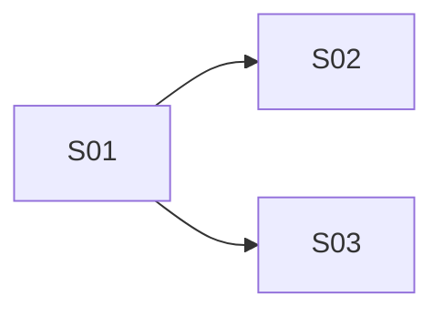

# rff-plan

Turn a request-for-feature (RFF) file into an implementation plan made of vertical slices, grouped into stages that can be executed in parallel. Output: `.rff/plan.md`.

## 1. Load the request for feature

Find the RFF file, in this order:

1. **Argument given** (`$ARGUMENTS`): use that path.
2. **No argument**: look for `request-for-feature*.md` in the working directory, then in `docs/`, `.rff/` and other spec folders. If several match, ask the user which one with `AskUserQuestion`.
3. **Nothing found**: ask the user for the path.

Read the whole file. Extract and keep at hand:
- the functional requirements (FR-xx), acceptance criteria, data model, UI/UX and integration notes;
- non-goals (never plan work for them);
- open questions and their recommended defaults (use the default, and mark the step that depends on it).

If the RFF has no numbered requirements, number them yourself (R-01, R-02, ...) so every step can be traced back.

## 2. Map the codebase into layers

The plan must name real files, so explore the target codebase first (the working directory, or the project the RFF names). Identify:

- **Tech stack and conventions**: languages, frameworks, folder structure, naming, how tests are written and run (or that there are none).
- **The layers that exist**, using the project's own terms. Typical layers, keep only those that apply:
  - Frontend / UI (pages, components, styles, assets)
  - Client state / API client
  - Endpoints / controllers / routes
  - Services / business logic / domain
  - Data access / repositories / ORM mappings
  - Data / schema / migrations / seed
  - Infrastructure / config / CI / deployment
  - Tests (unit, integration, end-to-end)
- **Existing files each requirement will touch**, and **new files** that must be created (follow existing naming and placement).

For a project with few layers (e.g. a static site with only HTML, CSS and assets), use its real layers (markup, styles, scripts, assets, metadata). Do not invent backend layers that do not exist and that the RFF does not ask for.

Read `CLAUDE.md` and similar docs if present; they often describe the architecture.

## 3. Define the steps (vertical slices)

Split the feature into steps. Each step must:

- **Have a well-defined behavior**: after the step, something specific works that did not work before. Describe it as observable behavior, not as "create class X".
- **Be testable**: state how to verify it (automated test to add or run, and/or a manual check with exact actions and expected result). Prefer Given / When / Then.
- **Be as vertical as possible**: cut through as many layers as the behavior needs (UI → endpoint → service → data) so it delivers an end-to-end, working slice. Avoid horizontal steps like "create all tables" or "build all endpoints".
  - A horizontal step is allowed only when it is truly a shared prerequisite (e.g. project scaffolding, a shared layout, a schema migration needed by several slices). Mark it as `Enabler` and keep it as small as possible.
- **Be small enough** to implement and review in one sitting (rough guide: a few hours, one PR). Split larger slices: thin happy path first, then edge cases, errors, polish.
- **Leave the software working**: after any step, the app builds, existing behavior is not broken and tests pass.
- **Be self-sufficient**: the step can later be designed in isolation, by someone who reads only this step, the items it depends on and the code (see "Self-sufficient steps" below).

### Self-sufficient steps

Each step is later detailed by `rff-steps` in a clean context, into a design file that never mentions other steps and never decides anything for them; any conflict between steps aborts that run. Define the steps so that this is always possible:

- **Own scope only.** Everything a step's purpose, behavior, requirements and tests need is done inside that step. A step never needs another step to finish, adjust or complete part of its work, and its acceptance criteria can be verified without any later step.
- **One owner per item.** Every shared item (type, interface, enum, table, route, event, config key; for front-end or static projects: element id, CSS class or variable, data attribute, JS function, shared script or style region) is created by exactly one step and listed in that step's **Provides**. Steps that use or extend it list it, with the same name, in **Prerequisites**. No item is created by two steps, and no step uses an item nobody creates.
- **Explicit names.** Give every shared item its final name in the plan, so the steps that create and use it agree without talking to each other.
- **No hidden contracts.** If a step relies on a behavior, shape or region of another step's work (a function signature, a CSS class's role, the part of a file it may edit), state it in the item's description in **Provides** and refer to it in **Prerequisites**; do not leave it implied.
- **No changes to others' items.** A step that extends a shared item only adds to it in the way the owner's **Provides** allows (e.g. "adds rows to the table", "appends cards to `#showcase-list`"). If a step would need to rename, reshape or remove an item another step creates, merge the two steps or move that work into the owner.
- **Self-contained text.** Purpose, behavior, how-to-test and notes describe this step's own work only. Do not write "S05 will handle the errors" or "finishes what S02 started"; dependencies are expressed only in **Depends on**, **Prerequisites** and the stages.

Slicing heuristics: one user story or FR per step when possible; walking skeleton first (the thinnest end-to-end path), then widen; separate happy path from validation/error handling when either is large; keep cross-cutting concerns (SEO, accessibility, logging) attached to the slice they belong to, or as a final step if they span everything.

Every requirement in the RFF must be covered by at least one step. Every step must cover at least one requirement (enablers point to the requirements they unblock).

### Step template

Number steps `S01`, `S02`, ... For each:

```markdown
### S03 - <Short behavior-oriented title>

- **Type:** Slice | Enabler
- **Purpose:** What the step delivers and why, in 1 to 3 sentences.
- **Behavior:** What works after this step, in observable terms.
- **Requirements covered:** FR-04, FR-05
- **Depends on:** S01, S02  (or "none")
- **Prerequisites:** shared items that must exist before this step, by name: `OrderStatus` (enum), `GET /api/orders` (route)  (or "none")
- **Provides:** shared items this step creates, by name, with what other steps may rely on: `status` query param on `GET /api/orders` (accepts one `OrderStatus` value)  (or "none")
- **Layers touched:**
  | Layer | Files | Change |
  |-------|-------|--------|
  | Frontend | `src/pages/Orders.tsx` | modify: add filter bar |
  | Endpoint | `api/OrdersController.cs` | modify: add `status` query param |
  | Service | `services/OrderService.cs` | modify: filter by status |
  | Data | `data/OrderRepository.cs` | modify: indexed query |
  | Tests | `tests/OrderServiceTests.cs` | new |
- **How to test:**
  - Automated: <test to add/run and the command>
  - Manual: Given <state>, when <action>, then <expected result>
- **Notes / risks:** assumptions, RFF open-question defaults used, gotchas. (Omit if none.)
```

Use repo-relative paths in backticks. Mark each file as `new`, `modify` or `delete`.

## 4. Organize by dependency into stages

1. For each step, list its real dependencies: another step must be done first because it creates code, data, UI structure or contracts this step needs. Do not add dependencies just for a "nice" order.
2. Check for **file conflicts**: two steps that edit the same file region heavily are risky to run in parallel. Either add a dependency between them, or note in each step which part of the file it owns (describe the region, e.g. "the `#showcase` section", not the other step). Small edits to different parts of a file are fine in parallel; say so.
3. Every **Prerequisites** item must appear in the **Provides** of a step listed (directly or transitively) in **Depends on**, or already exist in the code. Add the missing dependency, or fix the ownership.
4. Build stages by topological order:
   - **Stage 1**: steps with no dependencies.
   - **Stage N**: steps whose dependencies are all in earlier stages.
   - Steps within the same stage can be executed in parallel.
5. Check the result: no cycles; the critical path (longest chain) is as short as reasonable. If a stage holds a single large step that blocks everything, try to split it.
6. Check self-sufficiency (section 3): every shared item has exactly one owner; no step's text refers to another step's work; no step needs another step to meet its own requirements or tests; no step changes an item it does not own beyond what the owner's **Provides** allows. Fix the steps until every check passes, so `rff-steps` can design each one without conflicts.

## 5. Write `.rff/plan.md`

Write the file in a `.rff/` folder at the root of the project the RFF targets (create the folder if needed). If the file already exists, ask the user with `AskUserQuestion` whether to overwrite it or save as `.rff/plan-<short-slug>.md`.

Structure:

```markdown
# Implementation Steps: <Feature name>

- **Source RFF:** `<path to RFF>`
- **Date:** <YYYY-MM-DD>
- **Steps:** <n> (<x> slices, <y> enablers) in <m> stages

## 1. Overview
2 to 4 sentences: slicing strategy and what gets delivered first.

## 2. Software layers
| Layer | Location / main files | Notes |
|-------|----------------------|-------|

## 3. Steps
<all steps, using the step template>

## 4. Execution stages
| Stage | Steps (parallel) | Depends on stages | Delivers |
|-------|------------------|-------------------|----------|
| 1 | S01 | - | ... |
| 2 | S02, S03, S04 | 1 | ... |

**Critical path:** S01 → S03 → S07 → S09

**Parallelization notes:** shared files and how conflicts are avoided.



## 5. Requirements coverage
| Requirement | Steps |
|-------------|-------|
| FR-01 | S02 |

## 6. Shared items
Every item listed in a step's Provides or Prerequisites, with its single owner.
| Item | Kind | Created by | Used / extended by | What others may rely on |
|------|------|-----------|--------------------|-------------------------|
| `#showcase-list` | element id | S01 | S03, S04 | container; others append cards |

## 7. Assumptions and open points
Assumptions made while planning and RFF open questions whose defaults were used, with the steps affected. (Omit if none.)
```

## 6. Finish

Tell the user the file path (as a clickable markdown link) and give a short summary: number of steps and stages, the critical path, and which stage has the most parallelism. Mention any requirement you could not map cleanly or any assumption that needs their confirmation.

## Guidelines

- Plan only; do not implement any step.
- Base every file path on what you saw in the codebase. If a file does not exist yet, mark it `new` and place it where the project's conventions say.
- Never plan work listed as a non-goal in the RFF.
- Every step must be self-sufficient (section 3): one owner per shared item, explicit names, and no step text that relies on or describes another step's work.
- Prefer fewer, meaningful steps over many trivial ones; but never merge unrelated behaviors just to reduce the count.
- Write in the same language as the RFF, unless the user asks otherwise.
