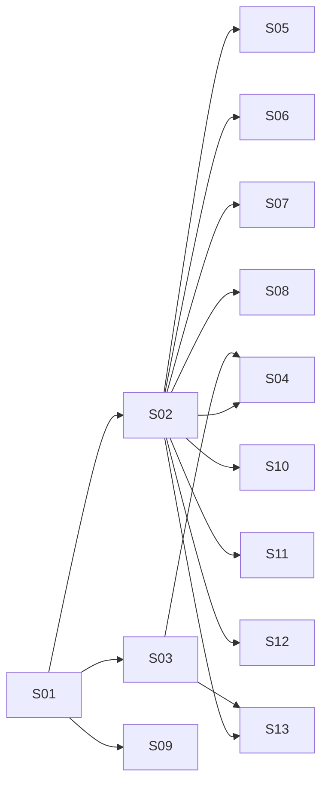

# Implementation Steps: Modernize Site Appearance

- **Source RFF:** `.rff/revamp/request-for-feature.md`
- **Date:** 2026-11-07
- **Steps:** 13 (10 slices, 3 enablers) in 3 stages

## 1. Overview

The revamp is presentation-only, so the slices are cut **by screen area** (one owner per component file) rather than by backend flow. A small design-system foundation goes first: the theme tokens and font (S01), which immediately re-skin the whole app through remapped legacy token names, then shared UI primitives (S02) and an app-level toast service (S03). After that, every area of the app (new-tweet dialog, desktop nav, mobile nav, layout and simple pages, tweet row, News, profile, login, sign-up, edit profile) is restyled in its own independent slice, all ten in parallel. Each slice also carries the accessibility (semantic controls, focus), Lucide icon swap and `alert()` removal for the files it owns, and verifies backend parity for the flows those files drive.

## 2. Software layers

The project is a frontend SPA with no test suite. The API layer exists but is a non-goal (must not change).

| Layer | Location / main files | Notes |
|-------|----------------------|-------|
| Global styles / theme | `src/app-style.css`, `index.css` (project root, linked from `index.html`), `index.html` | CSS custom properties; `index.css` holds the box-sizing reset. Font link goes in `index.html`. |
| App shell | `src/App.tsx` | Warm-up ping + toast; wraps `RouterProvider`. `src/main.tsx` and `src/app-router.tsx` must not change. |
| Shared UI primitives (new) | `src/components/ui/*.tsx` | New folder; styled-components only, one concern per file. |
| Components | `src/components/*.tsx`, `src/components/tweet/*.tsx` | styled-components at the bottom of each file. |
| Pages | `src/pages/**` | Layout (`main-template-page.tsx`), feed/explore/replies, profile, login, new-account, edit-account. |
| API client (read-only) | `src/api/**` | Non-goal. Used as-is; request sequence must stay identical. |
| Verification | `npm run lint`, `npm run build`, manual checks in the browser (3 widths), DevTools Network tab | No automated tests exist and none are added (RFF decision 11). |

**Conventions every step follows**
- styled-components at the bottom of the component file; colors, sizes, radius, shadow and motion only through the tokens provided by S01 (no new hard-coded color values in components; where a library cannot take `var(--…)`, read the token at runtime with `readThemeColor` from S02).
- `eslint-plugin-react-refresh` (`only-export-components`) is on and lint fails on any warning: a `.tsx` file that exports components must not also export hooks, contexts or plain functions.
- Icons use the **current Lucide names** from `react-icons@^5.7.0` (upgraded by S01; verified present in 5.7.0): `LuHouse`, `LuHash`, `LuUser`, `LuSquarePlus`, `LuLogIn`, `LuLogOut`, `LuPencil`, `LuHeart`, `LuMessageCircle`, `LuArrowDownToLine`, `LuArrowUpToLine`, `LuInfo`, `LuCircleCheck`, `LuCircleAlert`, `LuTriangleAlert`, `LuX`. The old names `LuHome` and `LuPlusSquare` no longer exist in 5.7.0 and must not be used. The liked heart is `LuHeart` with `fill="currentColor"`.
- Backend parity: a step never changes which `Api*` methods are called, their order, arguments, or the navigation/reload that follows.

## 3. Steps

### S01 - Dark theme tokens and Inter font re-skin the whole app

- **Type:** Enabler
- **Purpose:** Establish the design-system foundation (FR-01 to FR-04) in one place so every later slice styles against stable token names. Remapping the legacy token names makes the whole app switch to the dark neutral theme and Inter immediately, with no component edits.
- **Behavior:** Every page renders on a near-black/charcoal background with white text, orange accents and the Inter font; the navy `rgb(3,0,34)` is gone. Any focusable element shows a 2px orange focus ring on keyboard focus. With the OS "reduce motion" setting on, transitions and animations are effectively disabled.
- **Requirements covered:** FR-01, FR-02, FR-03, FR-04, FR-05 (icon library upgrade), FR-06 (global focus ring baseline), FR-15 (app background token); unblocks all FRs.
- **Depends on:** none
- **Prerequisites:** none
- **Provides:**
  - **Color tokens** (in `:root` of `src/app-style.css`): `--color-surface-0` (app background), `--color-surface-1` (raised: cards, News, auth panels), `--color-surface-2` (elevated: modal, toast, menus), `--color-surface-hover` (row/item hover tint), `--color-border` (dividers, input borders), `--color-text` (`#fff`), `--color-text-secondary`, `--color-text-muted`, `--color-accent` (`rgb(230, 110, 41)`), `--color-accent-hover`, `--color-accent-pressed`, `--color-accent-subtle` (low-alpha orange for tinted hovers, e.g. like button), `--color-on-accent` (`#fff`), `--color-focus-ring`, `--color-danger`, `--color-danger-subtle` (low-alpha danger for banner backgrounds), `--color-success`, `--color-info`, `--color-warning`, `--color-backdrop` (translucent dark for modal backdrop).
  - **Legacy aliases kept forever** (FR-02, remap strategy): `--color-1` → `--color-surface-0`, `--color-2` → `--color-accent`, `--color-3` → `--color-text`, `--color-bg-1..5` / `--color-fg-1..5`, `--color-bg-disabled` / `--color-fg-disabled`, `--color-danger-1/2`, `--color-bg/fg-danger-1/2`, `--color-info-1`, `--color-bg/fg-info-1`, remapped onto the new tokens (`--color-bg-5` → `--color-surface-1`, `--color-fg-5` → `--color-text`, i.e. the auth panels become dark cards per the open-question default). Other steps may keep referencing them but should prefer the new names in files they own; no step removes or renames them.
  - **Typography tokens:** `--font-family-base` (`"Inter", system-ui, sans-serif`), `--font-size-xs` (13px), `--font-size-sm` (15px, tweet body), `--font-size-md` (17px), `--font-size-lg` (20px), `--font-size-xl` (24px), `--font-size-2xl` (32px), `--font-weight-regular` (400), `--font-weight-medium` (500), `--font-weight-semibold` (600), `--font-weight-bold` (700), `--line-height-tight` (1.25), `--line-height-base` (1.5).
  - **Spacing tokens:** `--space-1` 4px, `--space-2` 8px, `--space-3` 12px, `--space-4` 16px, `--space-5` 24px, `--space-6` 32px, `--space-7` 48px.
  - **Radius tokens:** `--radius-sm` 6px, `--radius-md` 10px, `--radius-lg` 16px, `--radius-pill` 9999px.
  - **Elevation tokens:** `--shadow-1` (cards), `--shadow-2` (modal, toast).
  - **Motion tokens:** `--duration-fast` 150ms, `--duration-base` 200ms, `--duration-slow` 250ms, `--ease-out`. Under `@media (prefers-reduced-motion: reduce)` the durations become `0ms` and a global rule neutralizes `animation-duration` / `transition-duration` on all elements, so components need no own reduced-motion handling.
  - **Layout token:** `--mobile-nav-height` (56px): height of the mobile bottom bar's content, **excluding** `env(safe-area-inset-bottom)`. Contract: the bar's full height is `calc(var(--mobile-nav-height) + env(safe-area-inset-bottom))`, and the layout reserves exactly that.
  - **Global base styles:** `body` uses `--font-family-base`, `--color-surface-0` background, `--color-text` color, `--font-size-sm`, `--line-height-base`; `:focus-visible { outline: 2px solid var(--color-focus-ring); outline-offset: 2px; }` applied globally (components may refine offset/radius but not remove it).
  - **Inter font** loaded in `index.html` with `<link rel="preconnect">` + Google Fonts stylesheet, weights 400/500/600/700, `display=swap`.
  - **`react-icons@^5.7.0`** dependency (upgraded from `^5.0.1`), so the current Lucide names listed in §2 (e.g. `LuHouse`, `LuSquarePlus`, `LuCircleCheck`, `LuCircleAlert`) are importable from `react-icons/lu`. Every icon the code imports today still exists in 5.7.0, so the upgrade alone changes no component.
  - **Theme tokens are readable at runtime:** every color token resolves to a valid CSS color on `document.documentElement` (needed by the runtime color reader that libraries without CSS-variable support use).
- **Layers touched:**
  | Layer | Files | Change |
  |-------|-------|--------|
  | Dependencies | `package.json`, `package-lock.json` | modify: `npm install react-icons@^5.7.0` |
  | Global styles | `src/app-style.css` | modify: remove Roboto `@import` from `:root`, replace palette with the tokens above, legacy aliases, base `body`, `:focus-visible`, reduced-motion rules |
  | Global styles | `index.html` | modify: add Inter `<link>` tags in `<head>` |
  | Global styles | `index.css` | modify (optional): keep reset; add `-webkit-font-smoothing` if desired |
- **How to test:**
  - Automated: `npm run lint` and `npm run build` pass; `npm ls react-icons` reports 5.7.x.
  - Manual: Given the dev server, when opening `/`, `/login`, `/new-account`, `/edit-profile`, then backgrounds are dark neutral, text white, accents orange, and DevTools → Computed shows `font-family` resolving to Inter (Network shows the Inter woff2 loaded).
  - Manual: Given any page, when searching the computed styles / `src/app-style.css`, then `rgb(3, 0, 34)` and `Roboto` do not appear.
  - Manual: Given the feed, when pressing Tab, then the focused control shows an orange outline.
  - Manual: Given DevTools → Rendering → "prefers-reduced-motion: reduce", when the warm-up toast slides in, then it appears without animation.
  - Parity: no request changes (no component logic touched).
- **Notes / risks:** The exact neutral values are the implementer's choice (RFF suggestion: `#0f0f10` / `#17171a` / `#1f1f23`, border ≈ `#2a2a2f`); keep white text readable on every surface. `--color-warning` is added beyond the RFF's list because FR-11 needs a "near limit" color. Open question (auth panel color) resolved with the RFF default: dark card.

### S02 - Shared UI primitives (buttons, icon button, fields, alert, panel, page title)

- **Type:** Enabler
- **Purpose:** Avoid duplicated control styles (today `CreateTweetButton` and `LoginButton` are copies) by providing one themed implementation of each control with all interaction states (FR-06, FR-07). Every area slice composes these.
- **Behavior:** The primitives exist, compile, and render correctly with hover, active, disabled and focus-visible states (verified on a temporary local render or via the first consumer); the app behaves exactly as before since nothing consumes them yet.
- **Requirements covered:** FR-06, FR-07, FR-09 (hit-area rule), FR-20 (field styling), FR-12 (inline error styling), FR-14 (runtime theme colors for skeletons); unblocks FR-10, FR-12, FR-16, FR-17, FR-19, FR-20, FR-21.
- **Depends on:** S01
- **Prerequisites:** S01 tokens (color, typography, spacing, radius, elevation, motion); S01 `react-icons@^5.7.0` (for `LuCircleAlert`, `LuCircleCheck`, `LuInfo`).
- **Provides:** (each file exports only styled-components / components and their prop types)
  - `Button` (`src/components/ui/button.tsx`): styled `<button>`; transient props `$variant: "primary" | "ghost"` (default `"primary"`) and `$fullWidth?: boolean`. Primary = solid `--color-accent` pill, `--color-on-accent` text, hover/pressed accent variants; ghost = transparent with `--color-border` outline and `--color-text`, hover `--color-surface-hover`. Disabled: reduced opacity, `cursor: default`, no hover change. Min height 40px. Consumers set `type` themselves. Children may include an icon and/or a `PulseLoader`, laid out inline-centered with a gap.
  - `IconButton` (`src/components/ui/icon-button.tsx`): styled `<button type="button">`-ready circular button, 40×40px minimum hit area, transparent background, `--color-text-secondary` icon; circular hover tint `--color-surface-hover`. Transient prop `$tone?: "neutral" | "accent"` (default `"neutral"`): `"accent"` makes hover/active tint `--color-accent-subtle` and icon `--color-accent`. Transient prop `$active?: boolean` renders the icon in `--color-accent` (e.g. liked). Consumers must pass `aria-label`.
  - `FieldLabel`, `TextInput`, `TextArea`, `FieldError` (`src/components/ui/field.tsx`): `FieldLabel` styled `<label>` (`--font-size-xs`, `--color-text-secondary`, medium weight); `TextInput` styled `<input>` and `TextArea` styled `<textarea>` with `--color-surface-0` field, `--color-border` border, `--radius-md`, orange focus ring/border, `aria-invalid="true"` shows `--color-danger` border; `FieldError` styled `
` in `--color-danger`, `--font-size-xs`. All compatible with react-hook-form's `register()` spread (forward refs through styled-components).
  - `InlineAlert` (`src/components/ui/inline-alert.tsx`): component `InlineAlert({ variant?: "danger" | "success" | "info", children })` rendering a `role="alert"` banner (subtle tinted background, left accent border in the variant color, matching Lucide icon `LuCircleAlert` / `LuCircleCheck` / `LuInfo`). Default variant `"danger"`.
  - `readThemeColor(token: string): string` (`src/components/ui/theme-color.ts`): returns the **resolved** color of a CSS custom property (e.g. `readThemeColor("--color-surface-1")` → `"rgb(23, 23, 26)"`) for libraries that cannot take `var(--…)`, such as `react-content-loader`'s SVG `stop-color` attributes. It resolves through the browser (a hidden probe element styled with `color: var(<token>)` and read via `getComputedStyle`), so tokens defined with `var()` or `color-mix()` still return a concrete color. Call it at render time (cheap) or memoize per token; it does not react to token changes after load (none happen: no theme toggle).
  - `CenteredPage`, `Panel` (`src/components/ui/panel.tsx`): `CenteredPage` = full-viewport (`100dvh`) flex wrapper centering its child on `--color-surface-0` with page padding on small screens; `Panel` = `--color-surface-1` card, `--radius-lg`, `--shadow-1`, `--space-6` padding (smaller ≤600px), `--color-text`.
  - `PageTitle` (`src/components/ui/page-title.tsx`): styled `<h1>`-semantics header for the central column (`--font-size-lg`, bold, `--space-4` padding, bottom border `--color-border`), sticky at the top of the scrolling central column with `--color-surface-0` background. Accepts children (e.g. a `<small>` subtitle).
- **Layers touched:**
  | Layer | Files | Change |
  |-------|-------|--------|
  | Shared UI | `src/components/ui/button.tsx` | new |
  | Shared UI | `src/components/ui/icon-button.tsx` | new |
  | Shared UI | `src/components/ui/field.tsx` | new |
  | Shared UI | `src/components/ui/inline-alert.tsx` | new |
  | Shared UI | `src/components/ui/panel.tsx` | new |
  | Shared UI | `src/components/ui/page-title.tsx` | new |
  | Shared UI | `src/components/ui/theme-color.ts` | new: `readThemeColor` (plain `.ts`, no components) |
- **How to test:**
  - Automated: `npm run lint` (0 warnings, including `react-refresh/only-export-components`) and `npm run build` pass.
  - Manual: Given the app running, when calling `readThemeColor("--color-surface-1")` and `readThemeColor("--color-1")` (a legacy alias defined via `var()`) from a temporary log, then both return concrete `rgb(...)` strings matching the S01 values.
  - Manual: Given a temporary scratch render of each primitive (not committed), when hovering, pressing, tabbing to and disabling them, then each shows distinct hover/active/disabled states and the orange focus ring; `IconButton` measures ≥ 40×40px.
  - Parity: no existing file changes, so no request changes.
- **Notes / risks:** Use transient `$` props so they are not forwarded to the DOM (styled-components v6 warns otherwise). Don't `export` helper functions from these `.tsx` files (lint rule).

### S03 - Toast variants and an app-level toast service

- **Type:** Slice
- **Purpose:** Restyle the toast with info/success/danger variants (FR-13) and lift it to app level so any page can show a toast that survives navigation (needed for FR-12's "Account updated!").
- **Behavior:** The warm-up toast appears after 4s on a slow `/auth/ping` exactly as today (same text, same reload on success), now as a raised dark card with an info accent and icon, sliding in. Any component under `App` can call `showToast(...)`; the toast stays visible across route changes and auto-dismisses.
- **Requirements covered:** FR-13, FR-05 (toast icons), FR-12 (infrastructure for the success toast)
- **Depends on:** S01
- **Prerequisites:** S01 tokens (`--color-surface-2`, `--shadow-2`, `--color-info`, `--color-success`, `--color-danger`, motion tokens); S01 `react-icons@^5.7.0` (icons `LuInfo`, `LuCircleCheck`, `LuCircleAlert`).
- **Provides:**
  - `Toast` (`src/components/toast.tsx`): props `{ text: string; variant?: ToastVariant }` (default `"info"`); presentational only, `role="status"` (`role="alert"` for danger), fixed at the top center, slide-in animation.
  - `ToastVariant` type: `"info" | "success" | "danger"` (exported from `src/components/toast-context.ts`).
  - `ToastProvider` (`src/components/toast-provider.tsx`): wraps children, renders the active toasts with `Toast`, auto-dismisses each after a default 3000ms.
  - `useToast()` (`src/components/toast-context.ts`): returns `{ showToast(text: string, variant?: ToastVariant, durationMs?: number): void }`. Callable from any component rendered inside `RouterProvider` (the provider wraps it in `App.tsx`). A toast shown right before `navigate(...)` stays visible after the navigation.
- **Layers touched:**
  | Layer | Files | Change |
  |-------|-------|--------|
  | Components | `src/components/toast.tsx` | modify: variants, Lucide icon, themed surface, `position: fixed` |
  | Components | `src/components/toast-context.ts` | new: context, `ToastVariant`, `useToast` |
  | Components | `src/components/toast-provider.tsx` | new: `ToastProvider` |
  | App shell | `src/App.tsx` | modify: wrap `RouterProvider` in `ToastProvider`; warm-up toast keeps its own state/timer/reload logic and renders `<Toast variant="info" .../>` |
- **How to test:**
  - Automated: `npm run lint`, `npm run build`.
  - Manual: Given the backend stopped (or DevTools throttling so `/auth/ping` takes > 4s), when loading `/`, then after 4s the info toast "Servers are warming up. This page will reload automatically when ready." slides in; when the ping succeeds, the page reloads (same as before).
  - Manual: Given a temporary call `showToast("Test", "success")` from a page followed by `navigate("/explore")` (not committed), when triggered, then the success toast stays visible after navigation and disappears after ~3s.
  - Parity: Network shows exactly one `GET /auth/ping` on load and the same reload behavior.
- **Notes / risks:** Keep the warm-up timer/reload code path untouched apart from the rendered element. The context hook must live in a `.ts` file separate from the provider component (react-refresh lint rule).

### S04 - Themed new-tweet/reply dialog with Esc/backdrop close, counter and inline errors

- **Type:** Slice
- **Purpose:** Make the tweet composer modern and accessible: a dark animated dialog that closes like Cancel (FR-10), a live character counter (FR-11), inline API errors instead of `alert()` (FR-12) and the new button hierarchy (FR-07).
- **Behavior:** Opening "Tweet Now", the mobile "+" or a reply shows a dark rounded dialog over a dimmed/blurred backdrop with a fade/scale-in; the page behind cannot scroll and the dialog covers the viewport even when scrolled. Esc or a backdrop click closes it exactly like Cancel, and all three are ignored while submitting. A live `n / 250` counter turns warning at ≥ 230 and danger above 250. API errors appear in an inline danger banner and the dialog stays open for retry/cancel; an unknown error shows a danger toast and the dialog also stays open. Cancel is a ghost button, Submit an orange pill.
- **Requirements covered:** FR-10, FR-11, FR-12 (tweet form), FR-07, FR-06, FR-05 (no icons from other sets)
- **Depends on:** S01, S02, S03
- **Prerequisites:** S01 tokens (`--color-surface-2`, `--color-backdrop`, `--shadow-2`, `--radius-lg`, `--color-warning`, `--color-danger`, motion tokens); S02 `Button`, `TextArea`, `FieldLabel`, `FieldError`, `InlineAlert`; S03 `useToast()` (`showToast(text, "danger")`) and the toast stack rendering above dialogs (`z-index` 1000).
- **Provides:**
  - `Modal` (`src/components/modal.tsx`): props `{ children: ReactNode; onClose?: () => void; closeDisabled?: boolean; labelledBy?: string }`. Renders a `position: fixed` backdrop + `role="dialog"` `aria-modal="true"` panel; Esc and backdrop click call `onClose` unless `closeDisabled`; locks `document.body` scroll while mounted and restores it on unmount; moves focus into the dialog on open if nothing inside already took it.
  - `TweetNewForm` (`src/components/tweet/tweet-new-form.tsx`): **public props unchanged** (`replyId?: number; onCreated: () => void; onCancel: () => void`), so existing callers keep working untouched.
- **Layers touched:**
  | Layer | Files | Change |
  |-------|-------|--------|
  | Components | `src/components/modal.tsx` | modify: fixed backdrop, themed dialog, animation, Esc/backdrop, scroll lock, ARIA, focus |
  | Components | `src/components/tweet/tweet-new-form.tsx` | modify: pass `onClose`/`closeDisabled={loading}` to `Modal`, counter via `watch("content")`, `InlineAlert` for API errors (same message text: `Error: <message>`); danger toast `Unknow error occurred!!` for unknown errors (dialog stays open), ghost Cancel + primary Submit, recolored `PulseLoader` |
- **How to test:**
  - Automated: `npm run lint`, `npm run build`; `grep -n "alert(" src/components/tweet/tweet-new-form.tsx` returns nothing.
  - Manual: Given a logged-in user on a long, scrolled feed, when clicking "Tweet Now", then the dialog is centered in the viewport, the backdrop covers everything, and the feed does not scroll behind it; the textarea has focus.
  - Manual: Given the dialog open, when pressing Esc / clicking the backdrop / clicking Cancel, then it closes each time; clicking inside the dialog does not close it.
  - Manual: Given typing, then the counter shows `n / 250`, turns warning at 230 and danger at 251; submitting 251 chars shows "Message can have a maximum of 250 characters"; submitting empty shows "Message can't be empty".
  - Manual: Given the API returns an error (e.g. stop the backend or force a 400), when submitting, then an inline danger banner shows `Error: <message>`, no browser alert appears, and the dialog stays open; during submission Esc/backdrop/Cancel do nothing.
  - Parity: Given a new tweet, Network shows one `POST` to the create endpoint then a full page reload; given a reply, `GET /auth/check` (from the caller) then the reply `POST`, then reload. Same payloads as before.
- **Notes / risks:** **Deviation from RFF §5:** the "unknown error" path no longer calls `props.onCancel()`; it shows the danger toast `Unknow error occurred!!` via `showToast(text, "danger")` and keeps the dialog open (user decision). The dialog must sit below the toast stack (`z-index` < 1000) so the toast shows over it. Keep the `loading` guard on Cancel. Body scroll lock: the central column (`CentralWidget`) is the real scroller, so lock `document.body` overflow and rely on the fixed backdrop to block pointer/scroll events reaching the column.

### S05 - Desktop NavBar with active route, primary pill and compact user chip

- **Type:** Slice
- **Purpose:** Restyle the desktop sidebar (FR-16) with Lucide icons (FR-05), active-route highlighting (FR-08) and semantic, keyboard-usable controls (FR-09), including the logout control shared with the profile header.
- **Behavior:** On desktop/tablet, the sidebar shows the logo, then Home / Explore / My Profile as rounded rows with hover backgrounds; the item matching the current route is orange and bolder. Below, the orange "+ Tweet Now" pill (logged in) or "Login" pill (logged out). The logged-in user chip (avatar, name, muted @handle, logout) stays pinned at the bottom. Everything is reachable with Tab and activates with Enter/Space.
- **Requirements covered:** FR-16, FR-08 (desktop), FR-09 (nav items, Tweet Now, login, logout), FR-05 (home, explore, profile, logout), FR-06, FR-07
- **Depends on:** S01, S02
- **Prerequisites:** S01 tokens; S02 `Button`.
- **Provides:**
  - `LogoutButton` (`src/components/logout-button.tsx`): a semantic `<button type="button">` with `LuLogOut` icon and visible "Logout" text, compact ghost/text style, disabled while logging out; same handler (`logout()` then `navigate(0)`). No props; can be placed anywhere (sidebar chip, profile header).
- **Layers touched:**
  | Layer | Files | Change |
  |-------|-------|--------|
  | Components | `src/components/nav-bar.tsx` | modify: `NavLink` items (`/` with `end`, `/explore`, `/profile/:id`), Lucide icons (`LuHouse`, `LuHash`, `LuUser`), active style, `Button` pills replacing `CreateTweetButton`/`LoginButton`, logo `alt="GrowTweet"` |
  | Components | `src/components/logged-user-info.tsx` | modify: compact chip (avatar with `alt`, name, muted handle, logout) |
  | Components | `src/components/logout-button.tsx` | modify: semantic button, `LuLogOut`, states |
- **How to test:**
  - Automated: `npm run lint`, `npm run build`; `grep -nE "react-icons/(fa|sl)" src/components/nav-bar.tsx src/components/logout-button.tsx` returns nothing.
  - Manual: Given a width > 600px, when on `/`, `/explore` and my profile, then exactly the matching item is highlighted orange/bold (on `/replies/:id` none is).
  - Manual: Given keyboard only, when tabbing through the sidebar, then each nav item, Tweet Now/Login and Logout show the focus ring and activate with Enter (Space for buttons).
  - Manual: Given logged out, then the Login pill shows where it did and navigates to `/login`.
  - Parity: clicking Logout clears the session and reloads the current route (`navigate(0)`), no new requests; Tweet Now opens the composer as before.
- **Notes / risks:** `/` and `/home` both render the feed; use `end` on the `/` link so it is not active on every route, and treat `/home` as active for Home if cheap (optional). `NavBar` reads the user from localStorage in an effect; keep that.

### S06 - Mobile bottom bar with Lucide icons, active state and safe-area padding

- **Type:** Slice
- **Purpose:** Restyle `NavBarMobile` (FR-21) with Lucide icons (FR-05), active highlighting (FR-08) and labelled, tappable controls (FR-09).
- **Behavior:** At ≤ 600px, the bottom bar shows the same items in the same order (Home, Explore, Profile, New tweet when logged in; Login when logged out), evenly spaced, each a ≥ 40×40 tap target with an `aria-label`, the current route in orange, a top divider, and padding for the iPhone home indicator.
- **Requirements covered:** FR-21, FR-08 (mobile), FR-09 (mobile items), FR-05 (mobile icons), FR-06
- **Depends on:** S01, S02
- **Prerequisites:** S01 tokens incl. `--mobile-nav-height` (bar content height; full height = `calc(var(--mobile-nav-height) + env(safe-area-inset-bottom))`); S02 `IconButton` (for the new-tweet action).
- **Provides:** none
- **Layers touched:**
  | Layer | Files | Change |
  |-------|-------|--------|
  | Components | `src/components/nav-bar-mobile.tsx` | modify: `NavLink` items with `aria-label`s (`LuHouse`, `LuHash`, `LuUser`, `LuLogIn`), `IconButton` with `LuSquarePlus` for new tweet, height `--mobile-nav-height` + safe-area padding, `--color-border` top divider, `flex-shrink: 0` |
- **How to test:**
  - Automated: `npm run lint`, `npm run build`; `grep -nE "react-icons/(fa|sl|bs)" src/components/nav-bar-mobile.tsx` returns nothing.
  - Manual: Given DevTools mobile emulation (375×812), when on `/`, `/explore`, my profile, then the matching icon is orange; each item is ≥ 40×40px; Tab reaches each item with a focus ring.
  - Manual: Given logged out on mobile, then the Login icon shows in the same place and opens `/login`.
  - Parity: the "+" opens the composer; posting reloads the page as before.
- **Notes / risks:** Owns only `nav-bar-mobile.tsx`; the space the layout reserves for the bar comes from the `--mobile-nav-height` contract, so the bar must not exceed it.

### S07 - Main layout, central-column titles, Explore page and replies inline error

- **Type:** Slice
- **Purpose:** Apply the theme to the 3-column shell (FR-15) and the simple central-column pages, and replace the replies `alert()` with an inline error (FR-12).
- **Behavior:** The layout keeps NavBar | central column | News with breakpoints at 1024px and 600px; the central column has subtle `--color-border` dividers. Feed, Explore and Replies use the shared sticky page title. Explore's static items use the type scale and muted meta text with hover tints. If loading replies fails, the central column shows the inline danger message "An error ocurred while fetching data" instead of a browser alert.
- **Requirements covered:** FR-15, FR-12 (replies page), FR-03 (type scale on these pages)
- **Depends on:** S01, S02
- **Prerequisites:** S01 tokens incl. `--mobile-nav-height` (reserve `calc(var(--mobile-nav-height) + env(safe-area-inset-bottom))` at ≤ 600px); S02 `PageTitle`, `InlineAlert`.
- **Provides:** none
- **Layers touched:**
  | Layer | Files | Change |
  |-------|-------|--------|
  | Pages | `src/pages/main-template-page.tsx` | modify: surface/text tokens, border token, mobile height reservation via `--mobile-nav-height` |
  | Pages | `src/pages/feed-page.tsx` | modify: `PageTitle` |
  | Pages | `src/pages/explore-page.tsx` | modify: `PageTitle`, item typography and hover |
  | Pages | `src/pages/replies-page.tsx` | modify: `PageTitle`, error state rendered with `InlineAlert` (same text), stop showing skeletons once an error is set |
- **How to test:**
  - Automated: `npm run lint`, `npm run build`; `grep -n "alert(" src/pages/replies-page.tsx` returns nothing.
  - Manual: Given widths 1280, 800 and 375px, when comparing with the pre-revamp app, then the same columns show/hide at the same breakpoints and nothing overlaps the mobile bar.
  - Manual: Given `/replies/999999` (or the backend stopped), when the fetch fails, then the inline message "An error ocurred while fetching data" appears in the central column and no browser alert.
  - Parity: feed and replies fire the same single `GET` each as before.
- **Notes / risks:** The replies page title stays "Home" (current text; no content changes). Showing the error instead of endless skeletons is a local-only change.

### S08 - Tweet row restyle with accessible icon actions and themed skeleton

- **Type:** Slice
- **Purpose:** Restyle `TweetDisplay` (FR-17) with a clear hierarchy, Lucide icons (FR-05) and semantic, labelled action buttons (FR-09), and blend the feed skeleton into the dark UI (FR-14).
- **Behavior:** Each tweet shows avatar | bold name, muted `@handle` (a real link to the profile) and relative time, 15px content with comfortable line height, and a footer of circular icon buttons: like (outline → filled orange when liked, with count), reply (with count), show replies, show replied tweet. Rows get a subtle hover background and `--color-border` dividers. Loading shows skeleton rows in surface colors.
- **Requirements covered:** FR-17, FR-09 (@username, like, reply, show-replies, show-replied), FR-05 (like, reply, show replies, show replied), FR-14 (`TweetDisplayLoading`), FR-06
- **Depends on:** S01, S02
- **Prerequisites:** S01 tokens and `react-icons@^5.7.0`; S02 `IconButton` (`$tone="accent"` and `$active` for like), `readThemeColor` (skeleton colors).
- **Provides:** none
- **Layers touched:**
  | Layer | Files | Change |
  |-------|-------|--------|
  | Components | `src/components/tweet/tweet-display.tsx` | modify: `Link` for `@username` (`/profile/:id`), `IconButton`s with `aria-label`s (`LuHeart`, `LuMessageCircle`, `LuArrowDownToLine`, `LuArrowUpToLine`), avatar `alt`, typography/hover/dividers; same handlers |
  | Components | `src/components/tweet/tweet-display-loading.tsx` | modify: `backgroundColor`/`foregroundColor` from `readThemeColor` (surface tokens; the `opacity` prop keeps fading successive rows), border token |
  | Components | `src/components/tweet/tweet-list.tsx` | modify (light): spacing only, if needed |
- **How to test:**
  - Automated: `npm run lint`, `npm run build`; `grep -nE "react-icons/(hi2|io)" src/components/tweet/` returns nothing.
  - Manual: Given the feed, when tabbing through a tweet, then @username, like, reply, show-replies and show-replied are reachable, show the focus ring and activate with Enter/Space.
  - Manual: Given a tweet not liked, when clicking like, then the heart fills orange and the count increments immediately; clicking again reverts.
  - Manual: Given a hard reload of `/`, then skeleton rows appear in dark surface tones, not white blocks.
  - Parity: like → one `like` request after the optimistic update; unlike → one `unlike`; reply → `GET /auth/check` then the composer opens; show replies / replied → navigation to `/replies/:id` with no extra requests.
- **Notes / risks:** `react-content-loader` sets colors as SVG `stop-color` attributes, where `var(--…)` does not resolve, so colors are read at runtime with `readThemeColor`; no literal color values in this file. Keep `@username` click target navigation identical (`/profile/${tweet.user.id}`).

### S09 - News box as a dark raised card

- **Type:** Slice
- **Purpose:** Restyle the right-column News box (FR-18) to match the theme while keeping its static content.
- **Behavior:** On desktop (> 1024px), "What is happening now?" appears as a dark raised card with an orange accent, the same 4 items with readable sizes (meta in `--font-size-xs` muted, headline in `--font-size-sm` semibold), hover tints on rows, and an orange "Show more ..." link to `/explore` with a focus ring.
- **Requirements covered:** FR-18, FR-06 (link states), FR-03 (no 0.6rem text)
- **Depends on:** S01
- **Prerequisites:** S01 tokens.
- **Provides:** none
- **Layers touched:**
  | Layer | Files | Change |
  |-------|-------|--------|
  | Components | `src/components/news.tsx` | modify: styles only (content and link target unchanged) |
- **How to test:**
  - Automated: `npm run lint`, `npm run build`.
  - Manual: Given width 1280px, then the card shows the same 4 items and link, no text below 13px; at 1024px or less it is hidden as before.
  - Parity: no requests; "Show more ..." navigates to `/explore`.

### S10 - Profile header restyle with ghost Edit button and themed skeleton

- **Type:** Slice
- **Purpose:** Restyle the profile page header (FR-19) with Lucide icons (FR-05), a semantic ghost "Edit" button (FR-07, FR-09) and a dark-blended loading skeleton (FR-14).
- **Behavior:** `/profile/:id` shows the same elements in the same order: page title, framed avatar with the actions (Logout, Edit — only on my own profile), name, muted @handle; then the tweet list. Edit is a ghost button with a `LuPencil` icon that navigates to `/edit-profile`. While loading, the skeleton uses surface tones.
- **Requirements covered:** FR-19, FR-14 (`ProfileUserInfoLoading`), FR-09 (edit-profile), FR-05 (edit icon), FR-07
- **Depends on:** S01, S02
- **Prerequisites:** S01 tokens and `react-icons@^5.7.0`; S02 `Button` (`$variant="ghost"`), `PageTitle`, `readThemeColor` (skeleton colors). Uses the existing `LogoutButton` component as-is (no prop changes).
- **Provides:** none
- **Layers touched:**
  | Layer | Files | Change |
  |-------|-------|--------|
  | Pages | `src/pages/profile/profile-page.tsx` | modify: `PageTitle`, header spacing |
  | Pages | `src/pages/profile/profile-user-info.tsx` | modify: avatar framing (accent ring), avatar `alt`, typography |
  | Pages | `src/pages/profile/profile-user-info-loading.tsx` | modify: `backgroundColor`/`foregroundColor` from `readThemeColor` (surface tokens) |
  | Components | `src/components/edit-profile-button.tsx` | modify: ghost `Button` (`type="button"`) with `LuPencil` + "Edit" |
- **How to test:**
  - Automated: `npm run lint`, `npm run build`; `grep -n "react-icons/vsc" src` returns nothing.
  - Manual: Given my own profile, then avatar, Logout, Edit, name and handle appear in the same order as before; Edit is reachable by Tab and opens `/edit-profile`. Given another user's profile, no actions show.
  - Manual: Given a slow network, then the profile skeleton blends with the dark background.
  - Parity: the page still fires `fromUserId` and `byId` requests once per `userId` change.
- **Notes / risks:** `react-content-loader` cannot take `var(--…)` in its SVG color attributes, so the skeleton colors come from `readThemeColor` at runtime; no literal color values in this file.

### S11 - Login page as a themed split panel

- **Type:** Slice
- **Purpose:** Make the first screen visitors see look trustworthy (FR-20) with themed inputs, a primary Login button and a semantic "Create your new account" link (FR-09).
- **Behavior:** `/login` still shows the two-part panel (welcome text | "Come in..." form) side by side on wide screens and stacked ≤ 768px, now as a dark raised card with an orange accent area or title. Inputs are dark fields with visible labels or accessible names and the orange focus ring; Login is an orange pill with the recolored `PulseLoader`; errors show inline as today. "Create your new account" is a real link to `/new-account`.
- **Requirements covered:** FR-20, FR-07, FR-09 (login, create-account link), FR-06
- **Depends on:** S01, S02
- **Prerequisites:** S01 tokens; S02 `Button`, `TextInput`, `FieldLabel` (or `aria-label`), `InlineAlert` or `FieldError` for the existing error message, `CenteredPage`.
- **Provides:** none
- **Layers touched:**
  | Layer | Files | Change |
  |-------|-------|--------|
  | Pages | `src/pages/login/login-page.tsx` | modify: `CenteredPage`, dark panels, `Link` to `/new-account` |
  | Pages | `src/pages/login/login-form.tsx` | modify: primitives, recolored loader; same submit handler |
- **How to test:**
  - Automated: `npm run lint`, `npm run build`.
  - Manual: Given `/login` at 1280px and 375px, then the panel layout matches the old arrangement; Tab order is email → password → Login → Create account link, each with a focus ring.
  - Manual: Given wrong credentials, then the server message shows inline (no alert), and the button shows the loader while waiting.
  - Parity: one `POST /auth/login` with `{ email, password }`, then `setLoggedUser` and navigation to `/`.
- **Notes / risks:** The "Wellcome" spelling and all copy stay verbatim (no content changes). Dark card per the RFF open-question default.

### S12 - New-account page restyle with inline API errors

- **Type:** Slice
- **Purpose:** Restyle sign-up (FR-20) and replace its `alert()` with inline error feedback (FR-12).
- **Behavior:** `/new-account` shows a centered dark panel "Create your account" with labelled dark inputs, inline field errors and an orange "Create" pill with loader. If the API rejects the sign-up, the message `Error: <message>` appears inline above the button and no browser alert is shown; the user can correct and retry.
- **Requirements covered:** FR-20, FR-12 (new-account), FR-07, FR-06
- **Depends on:** S01, S02
- **Prerequisites:** S01 tokens; S02 `Button`, `FieldLabel`, `TextInput`, `FieldError`, `InlineAlert`, `CenteredPage`, `Panel`.
- **Provides:** none
- **Layers touched:**
  | Layer | Files | Change |
  |-------|-------|--------|
  | Pages | `src/pages/new-account/new-account-page.tsx` | modify: `CenteredPage` + `Panel` |
  | Pages | `src/pages/new-account/new-account-form.tsx` | modify: primitives, `apiError` state rendered with `InlineAlert` (cleared on submit), labels linked to inputs via `id`/`htmlFor` |
- **How to test:**
  - Automated: `npm run lint`, `npm run build`; `grep -n "alert(" src/pages/new-account` returns nothing.
  - Manual: Given an already-used email, when submitting, then `Error: <server message>` appears inline and the form stays filled.
  - Manual: Given empty required fields, then the same validation messages as before show under each field.
  - Parity: one `POST` to the user-create endpoint with the same payload, then `ApiAuth.unlogUser()` and navigation to `/login`.

### S13 - Edit-profile page restyle with inline errors and "Account updated!" toast

- **Type:** Slice
- **Purpose:** Restyle the edit-profile screen (FR-20) and replace both of its `alert()` calls (FR-12): API errors inline, success as a toast that survives `navigate(-1)`.
- **Behavior:** `/edit-profile` shows a centered dark panel "Edit your account" with labelled dark inputs, inline field errors and an orange "Update" pill with loader. API errors show `Error: <message>` inline. On success, a success toast "Account updated!" appears and the app navigates back immediately; the toast remains visible on the previous page.
- **Requirements covered:** FR-20, FR-12 (edit-account form and page), FR-07, FR-06
- **Depends on:** S01, S02, S03
- **Prerequisites:** S01 tokens; S02 `Button`, `FieldLabel`, `TextInput`, `FieldError`, `InlineAlert`, `CenteredPage`, `Panel`; S03 `useToast()` (`showToast(text, "success")`, survives navigation).
- **Provides:** none
- **Layers touched:**
  | Layer | Files | Change |
  |-------|-------|--------|
  | Pages | `src/pages/edit-account/edit-account-page.tsx` | modify: `CenteredPage` + `Panel`; `onSuccess` calls `showToast("Account updated!", "success")` then `navigate(-1)` |
  | Pages | `src/pages/edit-account/edit-account-form.tsx` | modify: primitives, `apiError` state rendered with `InlineAlert`, labels linked to inputs |
- **How to test:**
  - Automated: `npm run lint`, `npm run build`; `grep -rn "alert(" src` returns nothing (last remaining `alert()` calls removed here).
  - Manual: Given a wrong current password, when submitting, then `Error: <server message>` shows inline and no browser alert.
  - Manual: Given valid data, when submitting, then the "Account updated!" success toast is visible on the page you return to, and the sidebar shows the updated name.
  - Parity: one update request with the same payload (empty `newPassword` still sent as `undefined`), `setLoggedUser` with the new token, then `navigate(-1)`.
- **Notes / risks:** The `grep -rn "alert(" src` check passes only once every `alert()`-owning slice is done; for this step alone, check `src/pages/edit-account`.

## 4. Execution stages

| Stage | Steps (parallel) | Depends on stages | Delivers |
|-------|------------------|-------------------|----------|
| 1 | S01 | - | Dark theme, Inter, focus ring and motion tokens applied app-wide via remapped tokens |
| 2 | S02, S03, S09 | 1 | Shared primitives; themed toasts + app-level toast service; News card |
| 3 | S04, S05, S06, S07, S08, S10, S11, S12, S13 | 1, 2 | Every remaining area restyled and accessible; all `alert()`s gone |

**Critical path:** S01 → S02 → S04 (or any stage-3 step; S04 and S13 also need S03, which runs alongside S02).

**Parallelization notes:**
- Every component/page file has exactly one owning step (see the Files columns); no two steps edit the same file. `src/app-style.css` and `index.html` are owned by S01 only; later steps never add global CSS.
- `TweetNewForm` is owned by S04 with its props frozen; S05, S06 and S08 render it unchanged.
- `LogoutButton` is owned by S05; S10 renders it unchanged.
- The mobile bar height is shared only through the S01 token `--mobile-nav-height`; S06 sizes the bar with it and S07 reserves space with it.
- `App.tsx` is touched only by S03.

**Final acceptance (after stage 3):** run `npm run lint`, `npm run build`, `grep -rn "alert(" src`, `grep -rnE "react-icons/(fa|io|hi2|sl|bs|vsc)" src`, the 3-width side-by-side comparison and the per-flow Network parity check listed in RFF §10.

## 5. Requirements coverage

| Requirement | Steps |
|-------------|-------|
| FR-01 | S01 |
| FR-02 | S01 |
| FR-03 | S01 (font, scale), S07, S09 (scale applied) — every area slice applies the scale to its files |
| FR-04 | S01 |
| FR-05 | S01 (library upgrade), S03, S04, S05, S06, S08, S10 |
| FR-06 | S01 (global focus ring), S02, S04, S05, S06, S08, S09, S11, S12, S13 |
| FR-07 | S02, S04, S05, S10, S11, S12, S13 |
| FR-08 | S05 (desktop), S06 (mobile) |
| FR-09 | S02 (hit-area rule), S05, S06, S08, S10, S11 |
| FR-10 | S04 |
| FR-11 | S04 |
| FR-12 | S03 (toast service), S04, S07, S12, S13 |
| FR-13 | S03 |
| FR-14 | S02 (`readThemeColor`), S08, S10 |
| FR-15 | S01, S07 |
| FR-16 | S05 |
| FR-17 | S08 |
| FR-18 | S09 |
| FR-19 | S10 |
| FR-20 | S02, S11, S12, S13 |
| FR-21 | S06 |

## 6. Shared items

| Item | Kind | Created by | Used / extended by | What others may rely on |
|------|------|-----------|--------------------|-------------------------|
| Color tokens (`--color-surface-0/1/2`, `--color-surface-hover`, `--color-border`, `--color-text*`, `--color-accent*`, `--color-on-accent`, `--color-focus-ring`, `--color-danger`, `--color-danger-subtle`, `--color-success`, `--color-info`, `--color-warning`, `--color-backdrop`) | CSS variables | S01 | all other steps | Stable names and roles as described in S01 |
| Legacy color aliases (`--color-1..3`, `--color-bg/fg-1..5`, `--color-*-disabled`, `--color-*-danger-1/2`, `--color-*-info-1`) | CSS variables | S01 | any not-yet-migrated file | Remain defined, remapped onto the new palette; never removed |
| Typography tokens (`--font-family-base`, `--font-size-xs..2xl`, `--font-weight-*`, `--line-height-*`) | CSS variables | S01 | all other steps | Scale 13/15/17/20/24/32px |
| Spacing, radius, shadow tokens (`--space-1..7`, `--radius-sm/md/lg/pill`, `--shadow-1/2`) | CSS variables | S01 | all other steps | Values as listed in S01 |
| Motion tokens (`--duration-fast/base/slow`, `--ease-out`) + global reduced-motion rule | CSS variables / global rule | S01 | S02, S03, S04, area slices | Reduced motion handled globally; components need no own media query |
| `--mobile-nav-height` | CSS variable | S01 | S06, S07 | Bar content height excl. safe area; full bar = `calc(var(--mobile-nav-height) + env(safe-area-inset-bottom))` |
| Global `:focus-visible` ring and `body` base styles | global CSS | S01 | all | Always present; components may refine, not remove |
| Inter font link | `index.html` tags | S01 | all | Font available as `--font-family-base` |
| `react-icons@^5.7.0` | npm dependency | S01 | S02, S03, S04, S05, S06, S08, S10 | Current Lucide names (§2) importable from `react-icons/lu` |
| `readThemeColor(token)` | function (`src/components/ui/theme-color.ts`) | S02 | S08, S10 | Returns a concrete resolved color string for any S01 token |
| `Button` (`$variant`, `$fullWidth`) | styled component | S02 | S04, S05, S10, S11, S12, S13 | Primary pill / ghost; states built in |
| `IconButton` (`$tone`, `$active`) | styled component | S02 | S06, S08 | ≥ 40×40 hit area; caller adds `aria-label` |
| `FieldLabel`, `TextInput`, `TextArea`, `FieldError` | styled components | S02 | S04, S11, S12, S13 | react-hook-form `register()` compatible; `aria-invalid` styling |
| `InlineAlert` (`variant`) | component | S02 | S04, S07, S11, S12, S13 | `role="alert"` banner, default danger |
| `CenteredPage`, `Panel` | styled components | S02 | S11, S12, S13 | Full-viewport centered wrapper; raised card |
| `PageTitle` | styled component | S02 | S07, S10 | Sticky central-column title with bottom divider |
| `Toast` (`text`, `variant`) | component | S03 | S03 (`App.tsx`, `ToastProvider`) | Presentational; fixed top-center |
| `ToastVariant` | type | S03 | S13 | `"info" \| "success" \| "danger"` |
| `ToastProvider` | component | S03 | `App.tsx` (S03); S04 (stacking) | Wraps `RouterProvider`; stack at `z-index: 1000`, `pointer-events: none`, above dialogs |
| `useToast()` / `showToast(text, variant?, durationMs?)` | hook | S03 | S04, S13 | Toast survives route changes; default 3000ms |
| `Modal` (`onClose`, `closeDisabled`, `labelledBy`) | component | S04 | S04 (`TweetNewForm`) | Fixed, Esc/backdrop close, scroll lock, ARIA |
| `TweetNewForm` (`replyId?`, `onCreated`, `onCancel`) | component | existing; restyled by S04 | S05, S06, S08 | Props unchanged |
| `LogoutButton` | component | existing; restyled by S05 | S10 | No props; same logout + `navigate(0)` |

## 7. Assumptions and open points

- **Auth / edit-profile panel color (RFF open question):** default used — dark raised card (S01 remaps `--color-bg-5`/`--color-fg-5` to dark; S11, S12, S13 style dark panels).
- **Legacy token names are kept as aliases** (FR-02 "remap" option) rather than migrating every usage; area slices prefer the new names in the files they own. Affects S01 and every slice.
- **`--color-warning`** added to the palette for the FR-11 counter (S01, S04).
- **Shared primitives** (RFF §8 "optional") are adopted to remove duplicated button/input styles (S02).
- **Replies error** uses the inline variant (not a toast) and stops the endless skeleton on failure (S07).
- **Empty feed:** no new empty state (RFF assumption); whatever renders today is kept, restyled.
- **Skeleton colors (confirmed):** `react-content-loader` cannot consume CSS variables in SVG attributes; S08 and S10 read the token values at runtime through `readThemeColor` (S02).
- **Icon library (confirmed):** `react-icons` is upgraded to `^5.7.0` in S01 and all steps use the current Lucide names (`LuHouse`, `LuSquarePlus`, `LuCircleCheck`, `LuCircleAlert`, ...). Every icon imported today still exists in 5.7.0, so the upgrade does not break the build before the area slices land.
