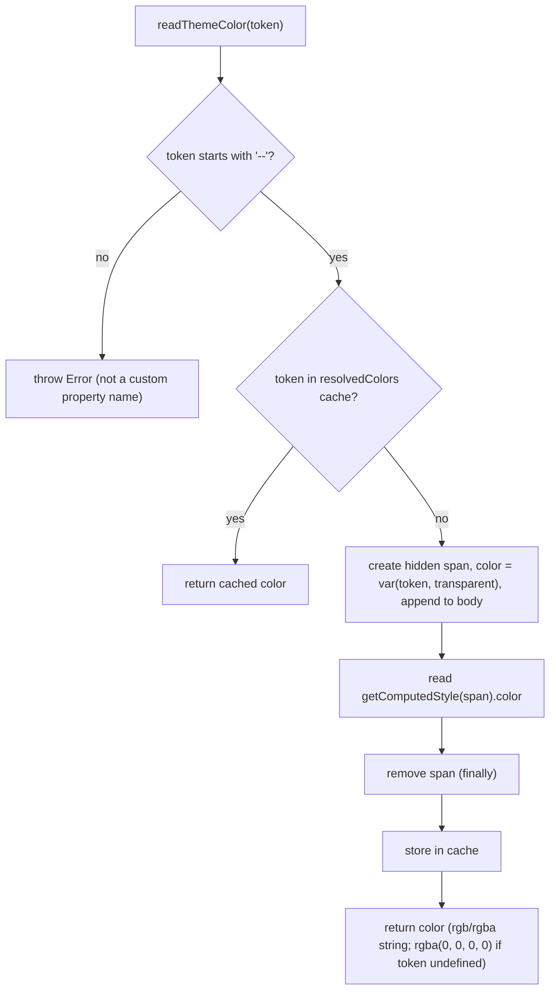
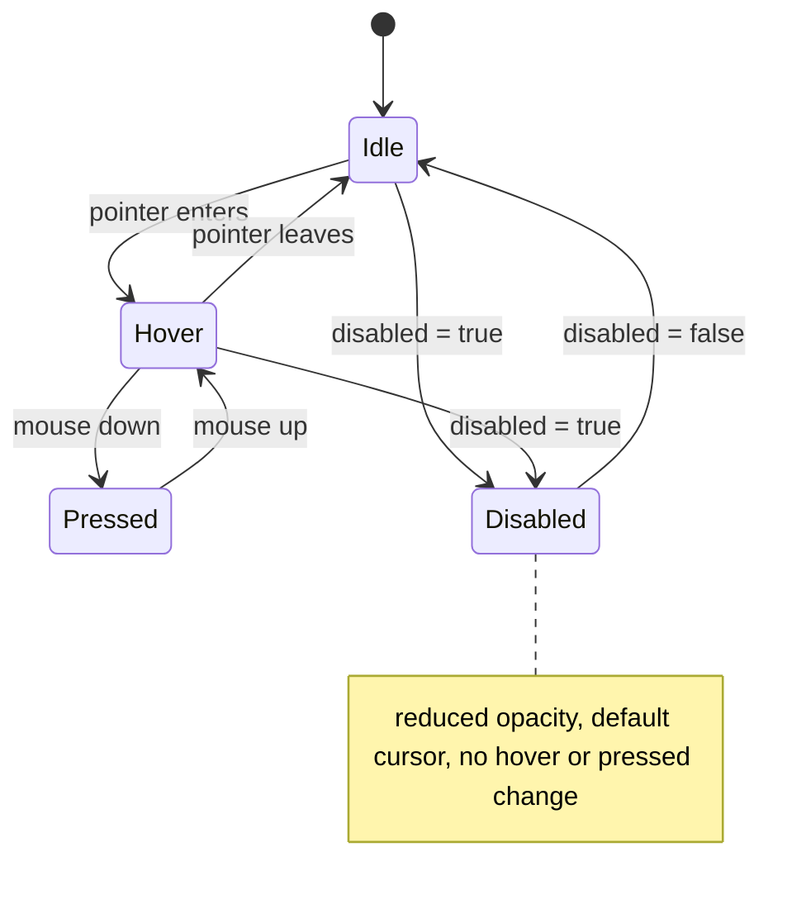

# S02 - Shared UI primitives (buttons, icon button, fields, alert, panel, page title)

- **Plan:** [plan.md](plan.md)
- **Type:** Enabler
- **Requirements covered:** FR-06, FR-07, FR-09 (hit-area rule), FR-20 (field styling), FR-12 (inline error styling), FR-14 (runtime theme colors for skeletons)
- **Prerequisites:** color tokens (`--color-surface-0`, `--color-surface-1`, `--color-surface-2`, `--color-surface-hover`, `--color-border`, `--color-text`, `--color-text-secondary`, `--color-text-muted`, `--color-accent`, `--color-accent-hover`, `--color-accent-pressed`, `--color-accent-subtle`, `--color-on-accent`, `--color-danger`, `--color-danger-subtle`, `--color-success`, `--color-info`), typography tokens (`--font-size-xs/sm/md/lg`, `--font-weight-regular/medium/semibold/bold`, `--line-height-tight/base`), spacing `--space-1..6`, radius `--radius-md/lg/pill`, `--shadow-1`, motion `--duration-fast`, `--ease-out`, global `:focus-visible` ring, global `button, input, textarea, select { font: inherit; }` rule, `react-icons@^5.7.0` (`LuCircleAlert`, `LuCircleCheck`, `LuInfo` from `react-icons/lu`)
- **Creates:** `Button` (`$variant`, `$fullWidth`), `IconButton` (`$tone`, `$active`), `FieldLabel`, `TextInput`, `TextArea`, `FieldError`, `InlineAlert` (`variant`), `CenteredPage`, `Panel`, `PageTitle`, `readThemeColor(token)`

## 1. Goal

Provide one themed implementation of each common control and container in a new `src/components/ui/` folder, with every interaction state built in, so screens compose them instead of copying styles (today `CreateTweetButton` and `LoginButton` in `nav-bar.tsx`, and the `Input`/`Button`/`ErrorMessage` styles in the auth forms, are copies).

When done:

- `Button` renders an orange primary pill or a ghost outline button; `IconButton` renders a circular, at least 40×40px icon button; both show distinct hover, pressed and disabled states and the orange focus ring on keyboard focus.
- `FieldLabel`, `TextInput`, `TextArea`, `FieldError` give dark fields with an orange focus border, a red border when `aria-invalid="true"`, and red inline error text; they accept react-hook-form's `register()` spread unchanged.
- `InlineAlert` renders a `role="alert"` banner (danger by default, also success and info) with a matching Lucide icon.
- `CenteredPage`/`Panel` give the full-viewport centered wrapper and the raised dark card; `PageTitle` gives the sticky central-column `<h1>` with a bottom divider.
- `readThemeColor("--color-surface-1")` returns a concrete color string such as `"rgb(23, 23, 26)"`, also for tokens defined through `var()`.
- Nothing outside `src/components/ui/` changes, so the app looks and behaves exactly as before.

## 2. Context

- No `src/components/ui/` folder exists yet. Components are `.tsx` files with named function exports and styled-components at the bottom (`const Wrapper = styled.div\`...\``); both `import styled from "styled-components"` and `import { styled } from "styled-components"` appear; this step uses `import { styled, css } from "styled-components"`.
- styled-components `^6.1.8`: styled components forward refs, and props prefixed with `$` (transient props) are not forwarded to the DOM. `.attrs()` is available.
- ESLint (`.eslintrc.cjs`) enables `react-refresh/only-export-components` (`allowConstantExport: true`) and lint fails on any warning: a `.tsx` file may export components (styled components count) and TypeScript types/interfaces, but no functions, hooks or non-primitive constants. Plain helpers go in `.ts` files.
- TypeScript is `strict` with `noUnusedLocals`/`noUnusedParameters`.
- The central column (`CentralWidget` in `src/pages/main-template-page.tsx`) is the scrolling element (`overflow-y: auto`) and its background is the layout's surface-0 background, so a `position: sticky; top: 0` child sticks to its top.
- Existing error text pattern to match (FR-12): `login-form.tsx` `ErrorLabel` (danger color, bold) and `new-account-form.tsx` `ErrorMessage` (`<p>`, danger color, `margin: 0`).
- `react-content-loader` sets colors as SVG `stop-color` attributes, where `var(--…)` does not resolve; hence `readThemeColor`.
- Breakpoint convention: `@media (width <= 600px)`.
- No test suite; verification is lint, build and manual browser checks.

## 3. Structure

### 3.1 Files

| File | Change | Responsibility |
|------|--------|----------------|
| `src/components/ui/control-styles.ts` | new | Private constants shared by the primitives (hit area, disabled opacity, pressed scale, transition) |
| `src/components/ui/theme-color.ts` | new | `readThemeColor`: resolve a CSS custom property to a concrete color at runtime |
| `src/components/ui/button.tsx` | new | `Button`: primary / ghost button |
| `src/components/ui/icon-button.tsx` | new | `IconButton`: circular icon action |
| `src/components/ui/field.tsx` | new | `FieldLabel`, `TextInput`, `TextArea`, `FieldError` |
| `src/components/ui/inline-alert.tsx` | new | `InlineAlert`: in-page feedback banner |
| `src/components/ui/panel.tsx` | new | `CenteredPage`, `Panel` |
| `src/components/ui/page-title.tsx` | new | `PageTitle`: sticky central-column title |

No existing file is modified.

### 3.2 Shared constants: `src/components/ui/control-styles.ts`

Plain `.ts` (constants only, consumed by the primitives in this folder; not part of the public set). One source of truth for values that would otherwise repeat in `button.tsx`, `icon-button.tsx` and `field.tsx`.

```ts
/** Minimum size of any clickable control (FR-09 touch hit area). */
export const MIN_HIT_AREA = "40px";

/** Opacity of disabled controls. */
export const DISABLED_OPACITY = 0.5;

/** Scale applied while a control is pressed (:active). */
export const PRESSED_SCALE = 0.97;

/** Transition for state changes; durations collapse globally under prefers-reduced-motion. */
export const CONTROL_TRANSITION = [
    "background-color", "border-color", "color", "transform",
].map((property) => `${property} var(--duration-fast) var(--ease-out)`).join(", ");
```

### 3.3 Runtime color reader: `src/components/ui/theme-color.ts`

```ts
const CUSTOM_PROPERTY_PREFIX = "--";
const UNDEFINED_TOKEN_FALLBACK = "transparent";

/** Resolved colors per token; tokens never change after load (no theme toggle). */
const resolvedColors = new Map<string, string>();

/**
 * Returns the resolved (computed) color of a CSS custom property,
 * e.g. readThemeColor("--color-surface-1") returns the surface color in rgb notation.
 * For libraries that cannot take var(--…) (react-content-loader SVG attributes).
 * @throws Error if `token` does not start with "--".
 */
export function readThemeColor(token: string): string
```

Behavior:

- **Precondition:** `token` starts with `--`; otherwise throw `new Error(\`readThemeColor: "${token}" is not a CSS custom property name\`)` (a programming error, surfaced immediately).
- **Cache:** if `resolvedColors` has the token, return the stored value.
- **Resolve through the browser:** create a `span`, set `probe.style.display = "none"` and `probe.style.color = \`var(${token}, ${UNDEFINED_TOKEN_FALLBACK})\``, append it to `document.body`, read `getComputedStyle(probe).color`, remove the probe (in a `finally`), store and return the value. Because the browser computes `color`, the result is always a concrete computed color. Literal and `var()`-aliased tokens serialize as `rgb(...)`/`rgba(...)`. A `color-mix()`-based token may serialize as `color(srgb …)`, which SVG `stop-color` also accepts. No current token uses `color-mix()`. `display: none` keeps it out of layout; computed style is still available.
- **Undefined token:** the `var()` fallback makes it resolve to `transparent`, i.e. `"rgba(0, 0, 0, 0)"` (never a misleading inherited color).
- **Side effects:** a short-lived DOM node per first call of each token; nothing else.
- Call it at render time; it does not react to token changes after load (none happen).

### 3.4 Button: `src/components/ui/button.tsx`

```tsx
import { styled, css } from "styled-components";
import { CONTROL_TRANSITION, DISABLED_OPACITY, MIN_HIT_AREA, PRESSED_SCALE } from "./control-styles";

export type ButtonVariant = "primary" | "ghost";

export interface ButtonProps
{
    $variant?: ButtonVariant;   // default "primary"
    $fullWidth?: boolean;       // default false
}

export const Button = styled.button<ButtonProps>`...`;
```

- Not wrapped in `.attrs`: consumers set `type` themselves (`"submit"` in forms, `"button"` elsewhere).
- **Base rules (both variants):** `display: inline-flex; align-items: center; justify-content: center; gap: var(--space-2)` (icon and/or `PulseLoader` sit inline-centered next to the text); `min-height: ${MIN_HIT_AREA}`; `padding: 0 var(--space-5)`; `border: 1px solid transparent` (both variants have the same box size); `border-radius: var(--radius-pill)`; `font-size: var(--font-size-sm)`; `font-weight: var(--font-weight-semibold)`; `line-height: var(--line-height-tight)`; `cursor: pointer`; `transition: ${CONTROL_TRANSITION}`; `& svg { flex-shrink: 0; }`.
- **`$fullWidth`:** `width: 100%`.
- **Pressed (both):** `&:active:not(:disabled) { transform: scale(${PRESSED_SCALE}); }`.
- **Disabled (both):** `&:disabled { opacity: ${DISABLED_OPACITY}; cursor: default; }`; every hover/active rule is guarded with `:not(:disabled)`, so a disabled button does not change on hover.
- **Variant rules** from a private, non-exported map `const VARIANT_STYLES: Record<ButtonVariant, ReturnType<typeof css>>` (adding a variant = adding an entry):
  - `primary`: `background-color: var(--color-accent); color: var(--color-on-accent);` hover `var(--color-accent-hover)`, active `var(--color-accent-pressed)`.
  - `ghost`: `background-color: transparent; border-color: var(--color-border); color: var(--color-text);` hover `background-color: var(--color-surface-hover)`.
- Focus: the global `:focus-visible` outline applies unchanged (it follows the pill radius).

### 3.5 IconButton: `src/components/ui/icon-button.tsx`

```tsx
export type IconButtonTone = "neutral" | "accent";

export interface IconButtonProps
{
    $tone?: IconButtonTone;   // default "neutral"
    $active?: boolean;        // default false; e.g. liked
}

export const IconButton = styled.button
    .attrs<IconButtonProps>((props) => ({ type: props.type ?? "button" }))<IconButtonProps>`...`;
```

- `type` defaults to `"button"` (FR-09 actions; never submits a surrounding form) but a consumer may still override it.
- `aria-label` is not part of `IconButtonProps`. It is the native optional button attribute, so the compiler does not enforce it. By convention, consumers must pass it on every icon-only button. It reaches the DOM unchanged.
- **Base rules:** `display: inline-flex; align-items: center; justify-content: center; gap: var(--space-1)`; `min-width: ${MIN_HIT_AREA}; min-height: ${MIN_HIT_AREA}`; `padding: 0 var(--space-2)` (icon-only stays a 40×40 circle because the min size wins; an icon plus a count, e.g. likes, grows into a pill); `border: none; border-radius: var(--radius-pill)`; `background-color: transparent`; `color: var(--color-text-secondary)`; `font-size: var(--font-size-xs)` (count text); `& svg { font-size: var(--font-size-lg); flex-shrink: 0; }` (20px icons; react-icons size with `1em`); `cursor: pointer`; `transition: ${CONTROL_TRANSITION}`.
- **Tone** from a private map `TONE_STYLES: Record<IconButtonTone, ReturnType<typeof css>>`:
  - `neutral`: hover `background-color: var(--color-surface-hover); color: var(--color-text)`.
  - `accent`: hover `background-color: var(--color-accent-subtle); color: var(--color-accent)`.
- **`$active`:** when `$active` is true, add exactly this rule (its selectors match or exceed the specificity of the tone hover rule, and it is declared after the tone rules, so it wins):

  ```css
  &, &:hover:not(:disabled), &:active:not(:disabled) { color: var(--color-accent); }
  ```

  The hover background tint from the tone still applies. When the button is disabled and `$active`, the icon stays orange: the base `&` selector still applies, and the disabled opacity fades it.
- **Pressed:** `&:active:not(:disabled) { transform: scale(${PRESSED_SCALE}); }`.
- **Disabled:** `opacity: ${DISABLED_OPACITY}; cursor: default;` and no hover change (hover/active guarded with `:not(:disabled)`).

### 3.6 Fields: `src/components/ui/field.tsx`

```tsx
export const FieldLabel = styled.label`...`;
export const TextInput = styled.input`...`;
export const TextArea = styled.textarea`...`;
export const FieldError = styled.p`...`;
```

- **`FieldLabel`:** `display: block; font-size: var(--font-size-xs); font-weight: var(--font-weight-medium); color: var(--color-text-secondary); margin-bottom: var(--space-1)`. Consumers link it with `htmlFor`.
- **Shared field rules** in a private `const fieldStyles = css\`...\`` used by `TextInput` and `TextArea` (one definition):
  - `width: 100%; padding: var(--space-2) var(--space-3); background-color: var(--color-surface-0); color: var(--color-text); border: 1px solid var(--color-border); border-radius: var(--radius-md); font-size: var(--font-size-sm); line-height: var(--line-height-base); transition: ${CONTROL_TRANSITION};`
  - `&::placeholder { color: var(--color-text-muted); }`
  - Border precedence is **invalid > focus > hover**, enforced by the selectors themselves (not by declaration order), using exactly these rules:
    - `&:hover:not(:disabled):not(:focus):not([aria-invalid="true"]) { border-color: var(--color-text-muted); }`: the hover tint applies only to an idle, valid, enabled field.
    - `&:focus:not([aria-invalid="true"]) { border-color: var(--color-accent); }`: the global `:focus-visible` outline adds the orange ring, and text fields match `:focus-visible` on any focus.
    - `&[aria-invalid="true"] { border-color: var(--color-danger); }`
  - These three selectors never match the same element together, so no specificity contest arises.
  - `&:disabled { opacity: ${DISABLED_OPACITY}; cursor: default; }`
- **`TextInput`:** `fieldStyles` + `min-height: ${MIN_HIT_AREA}`.
- **`TextArea`:** `fieldStyles` + `resize: vertical; display: block`. Height comes from the consumer's `rows`.
- **`FieldError`:** `margin: 0; font-size: var(--font-size-xs); font-weight: var(--font-weight-medium); color: var(--color-danger)`.
- **react-hook-form:** `<TextInput id="email" {...register("email", {...})} aria-invalid={errors.email ? "true" : undefined} />` works because styled components forward `ref`, `name`, `onChange` and `onBlur` to the native element. No wrapper component is introduced (it would need `forwardRef` for `register()`).

### 3.7 InlineAlert: `src/components/ui/inline-alert.tsx`

```tsx
import { ReactNode } from "react";
import { IconType } from "react-icons";
import { LuCircleAlert, LuCircleCheck, LuInfo } from "react-icons/lu";

export type InlineAlertVariant = "danger" | "success" | "info";

export interface InlineAlertProps
{
    variant?: InlineAlertVariant;   // default "danger"
    children: ReactNode;
    className?: string;             // allows styled(InlineAlert) for spacing in a consumer
}

export function InlineAlert(props: InlineAlertProps)
```

- Private, non-exported map (one place per variant):

  | Variant | `color` (border + icon) | `tint` (background) | `Icon` |
  |---------|-------------------------|---------------------|--------|
  | `danger` | `var(--color-danger)` | `var(--color-danger-subtle)` | `LuCircleAlert` |
  | `success` | `var(--color-success)` | `tint("var(--color-success)")` | `LuCircleCheck` |
  | `info` | `var(--color-info)` | `tint("var(--color-info)")` | `LuInfo` |

  These names are private and not exported:

  ```ts
  /** Same strength as the theme's existing "subtle" tokens. */
  const DERIVED_TINT_STRENGTH = "12%";
  const tint = (color: string) => `color-mix(in srgb, ${color} ${DERIVED_TINT_STRENGTH}, transparent)`;
  const VARIANT_STYLES: Record<InlineAlertVariant, { color: string; tint: string; Icon: IconType }> = { ... };
  ```
- **Markup:**

  ```tsx
  <Wrapper role="alert" className={props.className} $color={style.color} $tint={style.tint}>
      <style.Icon aria-hidden="true" />
      <Message>{props.children}</Message>
  </Wrapper>
  ```

  `Wrapper` is a `styled.div<{ $color: string; $tint: string }>`; `Message` a `styled.div` (children may be text or inline elements).
- **Styles:** `Wrapper`: `display: flex; align-items: flex-start; gap: var(--space-2); padding: var(--space-3) var(--space-4); border-left: 3px solid ${$color}; border-radius: var(--radius-md); background-color: ${$tint}; color: var(--color-text); font-size: var(--font-size-sm); line-height: var(--line-height-base)`; `& > svg { flex-shrink: 0; font-size: var(--font-size-md); color: ${$color}; margin-top: 2px; }` (aligns the icon with the first text line). `Message`: `min-width: 0; overflow-wrap: anywhere` (long server messages wrap).
- The banner is announced as soon as it mounts; consumers render it conditionally (`{apiError && <InlineAlert>{apiError}</InlineAlert>}`).

### 3.8 Containers: `src/components/ui/panel.tsx`

```tsx
export const CenteredPage = styled.div`...`;
export const Panel = styled.div`...`;
```

- **`CenteredPage`:** `display: flex; justify-content: center; align-items: center; min-height: 100dvh; width: 100%; margin: 0; padding: var(--space-5); background-color: var(--color-surface-0); color: var(--color-text);` and `@media (width <= 600px) { padding: var(--space-4); }`. `min-height` (not `height`) so a tall form can grow and the page scrolls instead of clipping.
- **`Panel`:** `background-color: var(--color-surface-1); color: var(--color-text); border: 1px solid var(--color-border); border-radius: var(--radius-lg); box-shadow: var(--shadow-1); padding: var(--space-6);` (the subtle outline separates the card from the background in addition to the shadow) and `@media (width <= 600px) { padding: var(--space-5); }`. Width and inner layout are left to the consumer (`styled(Panel)`), since each auth screen sizes its card differently.

### 3.9 PageTitle: `src/components/ui/page-title.tsx`

```tsx
export const PageTitle = styled.h1`...`;
```

- `position: sticky; top: 0; z-index: 1;` (above the scrolling rows of the central column) `margin: 0; padding: var(--space-4); background-color: var(--color-surface-0); border-bottom: 1px solid var(--color-border); color: var(--color-text); font-size: var(--font-size-lg); font-weight: var(--font-weight-bold); line-height: var(--line-height-tight);`
- `& small { display: block; margin-top: var(--space-1); font-size: var(--font-size-xs); font-weight: var(--font-weight-regular); color: var(--color-text-muted); }` for an optional subtitle child.
- Renders an `<h1>` by default; styled-components' built-in `as` prop remains available.

## 4. Logic flows

`readThemeColor` is the only logic with branches: validate the name, serve from cache, otherwise resolve through a hidden probe whose `var()` fallback guarantees a color even for an undefined token.



Interaction states shared by `Button`, `IconButton` and the fields (focus is independent of hover/pressed and comes from the global `:focus-visible` rule):



## 5. Edge cases and errors

| Case | Expected behavior |
|------|-------------------|
| `readThemeColor("color-surface-1")` (missing `--`) | Throws `Error('readThemeColor: "color-surface-1" is not a CSS custom property name')`. |
| `readThemeColor` with an undefined token | Returns `"rgba(0, 0, 0, 0)"` (transparent), never an inherited color. |
| `readThemeColor` with a legacy alias (`--color-1`, defined via `var()`) | Returns the concrete color of the token it aliases. |
| `readThemeColor` called repeatedly for the same token | DOM probe only on the first call; later calls hit the cache. |
| `Button` disabled while showing a `PulseLoader` | Reduced opacity, default cursor, no hover/pressed change; loader and text stay centered. |
| `Button` with no `$variant` | Primary orange pill. |
| `Button` inside a form without `type` | Native default (`submit`), as with any `<button>`; consumers set `type` explicitly. |
| `IconButton` without `aria-label` | Compiles and renders a button with no accessible name. This is a consumer bug, ruled out by the convention that every icon-only use passes `aria-label`. |
| `IconButton` inside a form without `type` | Renders `type="button"`; never submits. |
| `IconButton` with an icon plus a count | Grows horizontally into a pill, height still ≥ 40px. |
| `IconButton` with `$active` and neutral tone, hovered or pressed | Icon stays orange; background gets the hover tint. |
| `IconButton` with `$active`, disabled | Icon stays orange at reduced opacity; no hover change. |
| Field with `aria-invalid="true"` focused | Red border kept, orange focus ring outline. |
| Invalid or focused field, hovered | Border stays red (invalid) or orange (focused); the muted hover border applies only to an idle, valid field. |
| Field disabled | Reduced opacity, no hover border change. |
| `InlineAlert` with a very long message | Text wraps inside the banner; icon stays top-aligned. |
| `InlineAlert` with no `variant` | Danger styling and `LuCircleAlert`. |
| `CenteredPage` content taller than the viewport | Page grows and scrolls; nothing is clipped. |
| `PageTitle` in a scrolled central column | Stays at the top with an opaque background; rows scroll under it. |
| Keyboard focus vs mouse click | Orange outline only on keyboard focus (global `:focus-visible`), except text fields, which show it on any focus. |
| Reduced motion | State transitions are instant via the global rule; no own media query here. |

## 6. Tests

The project has no automated test suite and this step adds none (RFF decision 11).

### 6.1 Automated

| Check | Given / When / Then | Proves |
|-------|---------------------|--------|
| `npm run lint` | Given the new files, when linting, then 0 errors and 0 warnings (including `react-refresh/only-export-components`). | Build criteria; lint-safe file split |
| `npm run build` | Given the new files, when running `tsc && vite build`, then it succeeds. | Types of transient props, `IconType` map, `.attrs` typing |

### 6.2 Manual

Run `npm run dev`; desktop 1280px unless stated.

- Given the dev app open, when running in the console `const { readThemeColor } = await import('/src/components/ui/theme-color.ts'); [readThemeColor('--color-surface-1'), readThemeColor('--color-1'), readThemeColor('--color-accent-subtle'), readThemeColor('--color-undefined-token')]`, then the first three are concrete `rgb(...)`/`rgba(...)` strings matching the theme values (`--color-1` equals the `--color-surface-0` value) and the last is `rgba(0, 0, 0, 0)`; `readThemeColor('color-1')` throws. (FR-14)
- Given a **temporary, uncommitted** scratch render (for example, adding to `FeedPage`'s JSX a block with `<Button type="button">Primary</Button>`, `<Button type="button" $variant="ghost">Ghost</Button>`, `<Button type="button" disabled>Disabled</Button>`, `<Button type="button" $fullWidth><LuPencil/> With icon</Button>`, `<IconButton aria-label="Like"><LuHeart/></IconButton>`, `<IconButton aria-label="Like" $tone="accent" $active><LuHeart fill="currentColor"/> 3</IconButton>`, `<IconButton aria-label="Off" disabled><LuHeart/></IconButton>`), when hovering, pressing, tabbing to and disabling each, then: primary is an orange pill with white text that lightens on hover and darkens/shrinks slightly when pressed; ghost is outlined and gets a hover tint; disabled ones are faded and do not react to hover; each shows the 2px orange outline on Tab and none on mouse click. (FR-06, FR-07)
- Given the same scratch render, when inspecting the icon-only `IconButton` in DevTools, then its box is at least 40×40px and round; the accent one turns orange with an orange tint on hover; the `$active` one is orange at rest, while hovered and while pressed (also check a disabled `$active` one stays orange, faded); the rendered element has `type="button"` and the `aria-label` the scratch passed. (FR-09 hit area, FR-06)
- Given a scratch form `<FieldLabel htmlFor="t">Email</FieldLabel><TextInput id="t" placeholder="email"/><TextInput aria-invalid="true"/><TextArea rows={3}/><FieldError>Email can't be empty</FieldError>`, when clicking the label, focusing and tabbing, then the label focuses the input, fields are dark with a muted placeholder, focus turns the border orange with the ring, the invalid one has a red border (also while focused and while hovered), a focused valid field keeps its orange border while hovered, and the error text is red at 13px. (FR-20, FR-12)
- Given a scratch `useForm` with `<TextInput {...register("x", { required: "Required" })}/>` and a submit button, when submitting empty, then react-hook-form focuses the field and reports the error (proves the ref is forwarded). (FR-20)
- Given scratch `<InlineAlert>Error: something</InlineAlert>`, `<InlineAlert variant="success">Saved</InlineAlert>`, `<InlineAlert variant="info">Info</InlineAlert>` and one with a 300-character message, then each shows a tinted background, a left border and icon in its color (red / green / blue), the element has `role="alert"`, and the long text wraps. (FR-12)
- Given a scratch `<CenteredPage><Panel>...</Panel></CenteredPage>` at 1280px and 375px (DevTools mobile emulation), then the dark card is centered on the app background with a subtle 1px border, a soft shadow and rounded corners, padding shrinks at 375px, and tall content scrolls. (FR-20)
- Given a scratch `<PageTitle>Home <small>12 tweets</small></PageTitle>` placed first in the feed, when scrolling the central column, then the title stays at the top with an opaque dark background and a bottom divider, and the subtitle is muted and smaller.
- Given DevTools → Rendering → `prefers-reduced-motion: reduce`, when hovering a scratch `Button`, then the color change is instant. (FR-04 respected)
- Given the scratch code removed (`git checkout -- src/pages/feed-page.tsx`), when loading `/` and opening the Network tab, then the app looks and requests exactly as before. (Backend parity)

### 6.3 Static checks

- `git status --porcelain -- src ':!src/components/ui'` → no output (no existing file changed, scratch code removed).
- `ls src/components/ui` → `button.tsx control-styles.ts field.tsx icon-button.tsx inline-alert.tsx page-title.tsx panel.tsx theme-color.ts`.
- `grep -rnE "#[0-9a-fA-F]{3,8}\b|rgba?\(|hsla?\(" src/components/ui` → no output (colors only through tokens).
- `grep -rn "react-icons/" src/components/ui | grep -v "react-icons/lu"` → no output. (FR-05)
- `grep -rln "components/ui/" src --include=*.tsx | grep -v "^src/components/ui/"` → no output (nothing consumes the primitives yet).
- `grep -n "role=\"alert\"" src/components/ui/inline-alert.tsx` → one match.
- `grep -n "export" src/components/ui/theme-color.ts` → only `export function readThemeColor`.

## 7. Implementation order

1. `control-styles.ts` (constants), then `theme-color.ts`; run the console check for `readThemeColor`.
2. `button.tsx` and `icon-button.tsx`; `npm run lint && npm run build`.
3. `field.tsx`, then `inline-alert.tsx`; lint + build.
4. `panel.tsx` and `page-title.tsx`; lint + build.
5. Temporary scratch render for the manual checks, then remove it and run the static checks.

## 8. Out of scope

- Does not modify any existing file (components, pages, `App.tsx`, `src/app-style.css`, `index.html`, `src/api/**`, routes); nothing consumes the primitives yet, so no screen changes.
- Adds no global CSS and no new tokens; uses only the existing tokens.
- Adds no npm dependency, no UI library, no light theme.
- Does not commit any scratch/demo rendering of the primitives.

## 9. Design notes

- **One implementation per control (DRY, FR-07):** the duplicated pill buttons and auth-form input/button/error styles get a single themed source each; shared numbers (40px hit area, disabled opacity, pressed scale, transition) live once in `control-styles.ts`. This file is an addition to the plan's file list, kept private to the folder; rejected: repeating the literals in three files.
- **Styled components, not wrappers:** `Button`, `IconButton` and the fields are plain styled elements, so `ref`, `type`, events and react-hook-form's `register()` pass straight through without `forwardRef`. Only `InlineAlert` is a function component, because it owns markup (role, icon).
- **Open/Closed via maps:** variant and tone styles come from `Record<Variant, …>` maps instead of nested ternaries; adding a variant is a new entry. Transient `$` props keep styling props out of the DOM (styled-components v6 warns otherwise).
- **`aria-label` by convention (user decision):** it stays the native optional attribute, as the plan describes. Consumers must pass it on every icon-only `IconButton` (FR-09), but the type does not enforce it. `type` defaults to `"button"` via `.attrs` but stays overridable.
- **`control-styles.ts` kept (user decision):** the one private addition to the plan's file list.
- **Lint-safe split:** helpers (`readThemeColor`, constants) live in `.ts` files; `.tsx` files export only components and types, satisfying `react-refresh/only-export-components`.
- **`readThemeColor` resolves through the browser** (probe + `getComputedStyle`) rather than reading `getPropertyValue`, which would return the raw `var(--…)` text for aliases. The result is a computed color: `rgb()`/`rgba()`, or possibly `color(srgb …)` for a `color-mix()`-based token, and all of these are valid for SVG `stop-color`. The `var(token, transparent)` fallback distinguishes undefined tokens from inherited colors; a module cache avoids repeated style recalculation (safe: no theme toggle).
- **Alert tints:** only a danger "subtle" token exists, so success/info tints are derived with `color-mix(... 12%, transparent)`, the same strength as the existing subtle tokens; no new global token is added.
- **`Panel` sets no width:** the auth screens size their cards differently; consumers extend with `styled(Panel)`. `CenteredPage` uses `min-height: 100dvh` so long forms scroll instead of clipping.
- **`PageTitle` is an `<h1>`** (the page's main heading in the central column) with an opaque background so sticky scrolling stays readable.
