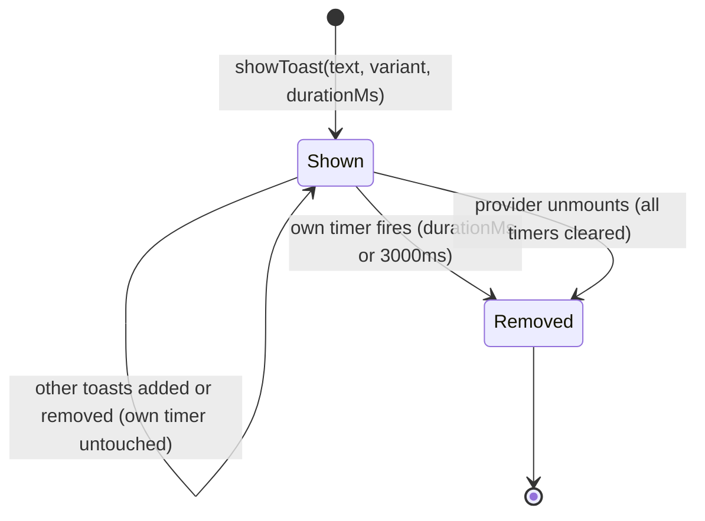
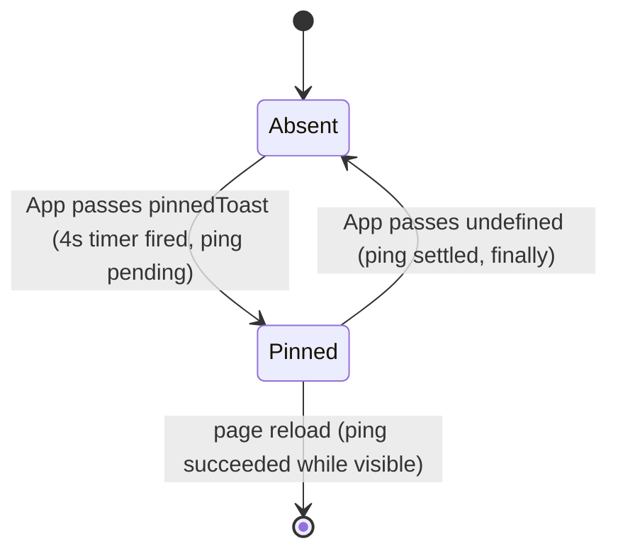
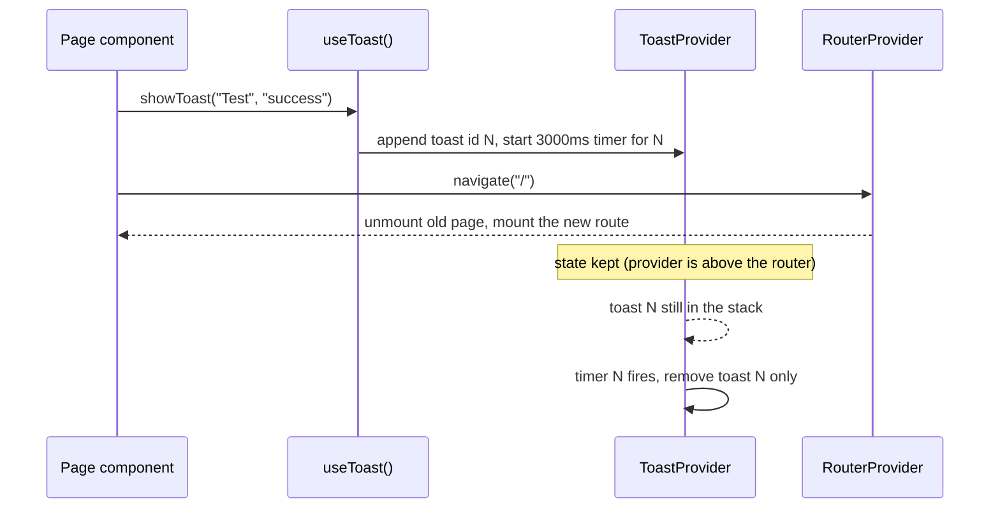
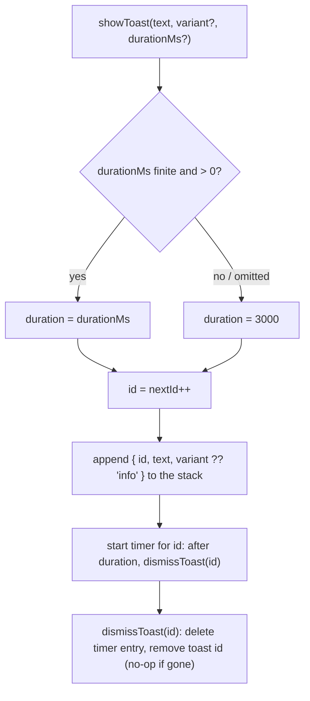

# S03 - Toast variants and an app-level toast service

- **Plan:** [plan.md](plan.md)
- **Type:** Slice
- **Requirements covered:** FR-13, FR-05 (toast icons), FR-12 (infrastructure for the success toast that survives navigation)
- **Prerequisites:**
  - Tokens `--color-surface-2`, `--color-border`, `--color-text`, `--color-info`, `--color-success`, `--color-danger`, `--shadow-2`, `--radius-md`, `--space-2`, `--space-3`, `--space-4`, `--space-6`, `--font-size-sm`, `--line-height-base`, `--duration-slow`, `--ease-out`, and the global reduced-motion rule
  - `react-icons@^5.7.0` (icons `LuInfo`, `LuCircleCheck`, `LuCircleAlert` from `react-icons/lu`)
- **Creates:** `Toast` (`text`, `variant`), `ToastVariant`, `ToastProvider`, `useToast()` / `showToast(text, variant?, durationMs?)`

## 1. Goal

- The toast is a raised dark card (`--color-surface-2`, `--shadow-2`, rounded) with a 4px left border and a Lucide icon in the variant color, sliding in from above. Variants: `info` (default), `success`, `danger`.
- All toasts appear in one **stack** at the top center of the viewport (a fixed viewport container owned by `ToastProvider`). Several toasts show at once, one under the other, and do not overlap once settled in their slots (a new toast briefly passes over the one above during its slide-in); each timed toast is removed by its own timer.
- Any component rendered inside `RouterProvider` can call `useToast().showToast(text, variant?, durationMs?)`. The new toast joins the stack and is removed after 3000ms (or `durationMs`). `ToastProvider` wraps `RouterProvider` in `App.tsx`, so a toast shown right before `navigate(...)` stays visible on the next route.
- The warm-up toast behaves exactly as today: shown 4s after load if `/auth/ping` has not answered, same text, no auto-dismiss, page reload when the ping succeeds while it is visible. It now renders as an `info` toast at the top of the same stack (a **pinned** toast), so it does not overlap other toasts once they are settled in their slots (a new toast briefly passes over the one above during its slide-in).
- No component calls `showToast` yet; the app behaves as before apart from the toast's look.

## 2. Context

- `src/components/toast.tsx` today: `export interface ToastProps { text: string }` and `export function Toast(props)` rendering a styled `Content` div with `position: absolute; top: 10px; left: 50%`, info colors from legacy tokens `--color-bg-info-1` / `--color-fg-info-1`, and a nested `@keyframes toast-slide-effect` (0.5s, ease-out) sliding from `translate(-50%, -110%)` to `translate(-50%, 0)`. No icon, no role.
- `src/App.tsx` today: `App` holds `showWarmupMessage` state (+ ref), a `warmupToastTimeout` state (+ ref), one `useEffect([])` that calls `new ApiAuth().ping()` (`.then` clears the timeout and calls `window.history.go(0)` if the toast is visible; `.finally` hides it) and starts a 4000ms `setTimeout` that shows the toast. It renders `{showWarmupMessage && <Toast text="Servers are warming up. This page will reload automatically when ready."/>}` followed by `<RouterProvider router={appRouter} />` inside a fragment. `src/main.tsx` renders `<App />` (no `StrictMode`).
- `App` renders the provider, so it cannot call `useToast()` itself (a hook only sees providers above the calling component). The warm-up toast therefore reaches the stack through a provider prop, not through `showToast`.
- No React context exists in the project yet; no `z-index` is used anywhere.
- Lint: `react-refresh/only-export-components` (warn, `allowConstantExport: true`) with `--max-warnings 0`. A `.tsx` file exporting a component must export only components (types are fine); the context object and hook therefore live in a plain `.ts` file.
- TypeScript `strict`, `noUnusedLocals`, `noUnusedParameters`. File naming: kebab-case; component files use named function exports and styled-components at the bottom; 4-space indent, braces on their own line for functions/interfaces (Allman style, as in `toast.tsx`).
- No test suite: verification is lint, build and manual checks.

## 3. Structure

### 3.1 Files

| File | Change | Responsibility |
|------|--------|----------------|
| `src/components/toast-context.ts` | new | `ToastVariant` and `ToastContent` types, context value type, `ToastContext`, `useToast()` hook |
| `src/components/toast.tsx` | modify | Presentational toast card: variant styling, icon, ARIA role, slide-in (no positioning) |
| `src/components/toast-provider.tsx` | new | `ToastProvider`: timed toast list with per-toast timers, optional pinned toast, fixed top-center stack, provides `showToast` |
| `src/App.tsx` | modify | Wrap the tree in `ToastProvider`; pass the warm-up toast as the pinned toast while `showWarmupMessage` is true |

### 3.2 Context and hook: `src/components/toast-context.ts` (new, plain `.ts`, no JSX)

```ts
import { createContext, useContext } from "react";

export type ToastVariant = "info" | "success" | "danger";

export interface ToastContent
{
    text: string;
    variant?: ToastVariant;   // default "info" wherever it is rendered
}

export interface ToastContextValue
{
    showToast(text: string, variant?: ToastVariant, durationMs?: number): void;
}

export const ToastContext = createContext<ToastContextValue | null>(null);

export function useToast(): ToastContextValue
{
    // returns the context value; throws if null
}
```

- `ToastVariant`: exactly the three members `"info"`, `"success"`, `"danger"`.
- `ToastContent`: the text and variant of one toast; shared by `ToastProps` and the provider's `pinnedToast` prop (one definition, DRY).
- `ToastContextValue`: the only member is `showToast`, with the call shape `showToast(text, variant?, durationMs?)`. No `hideToast` or list access (Interface Segregation, YAGNI).
- `ToastContext`: default `null`, so a missing provider is detected instead of silently swallowing toasts.
- `useToast()`: reads `ToastContext`; if the value is `null` it throws `new Error("useToast must be used inside a ToastProvider")`; otherwise returns the value. Precondition: called during render of a component under `ToastProvider` (every component inside `RouterProvider` qualifies after this step).

### 3.3 Presentational toast: `src/components/toast.tsx` (modify)

```tsx
import { styled, keyframes } from "styled-components";
import { IconType } from "react-icons";
import { LuCircleAlert, LuCircleCheck, LuInfo } from "react-icons/lu";
import { ToastContent, ToastVariant } from "./toast-context";

export type ToastProps = ToastContent;

export function Toast({ text, variant = "info" }: ToastProps)
{
    // <Content $variant={variant} role={...}>
    //     <Icon size={ICON_SIZE} aria-hidden="true" />
    //     <p>{text}</p>
    // </Content>
}
```

Module-private constants (not exported, keeps the file component-only):

```ts
const VARIANT_ICON: Record<ToastVariant, IconType> = {
    info: LuInfo,
    success: LuCircleCheck,
    danger: LuCircleAlert,
};

const VARIANT_COLOR: Record<ToastVariant, string> = {
    info: "var(--color-info)",
    success: "var(--color-success)",
    danger: "var(--color-danger)",
};

const ICON_SIZE = 20; // px
```

- `Toast` is a card only: it does not position itself. Placement belongs to the stack in `ToastProvider` (Single Responsibility).
- Role: `danger` → `role="alert"` (assertive); `info` and `success` → `role="status"` (polite live region). A ternary on `variant`, no other branching.
- The icon is `VARIANT_ICON[variant]`, rendered with `size={ICON_SIZE}` and `aria-hidden="true"` (the text carries the meaning).
- Adding a variant later means one member in `ToastVariant` plus one entry in each map (Open/Closed; `Record` makes TypeScript enforce completeness).
- `ToastProps` stays exported (type-only export, lint-safe) and keeps `text` required; `variant` is new and optional.

Styled-components at the bottom of the file:

```ts
const slideIn = keyframes`
    from { transform: translateY(calc(-100% - var(--space-4))); }
    to   { transform: translateY(0); }
`;

const Content = styled.div<{ $variant: ToastVariant }>`...`;
```

`Content` rules:
- Layout: `display: flex; align-items: flex-start; gap: var(--space-3); padding: var(--space-3) var(--space-4); box-sizing: border-box; max-width: 100%;`
- Surface: `background-color: var(--color-surface-2); color: var(--color-text); border: 1px solid var(--color-border); border-left: 4px solid ${({ $variant }) => VARIANT_COLOR[$variant]}; border-radius: var(--radius-md); box-shadow: var(--shadow-2);`
- Motion: `animation: ${slideIn} var(--duration-slow) var(--ease-out);`. The translate is relative to the toast's own slot in the stack: each toast slides down by its own height plus `--space-4` into its slot. For the first toast in the stack this starts above the viewport edge; a new toast lower in the stack starts over the toast above it and briefly overlaps it during the 250ms slide (accepted: it is the only overlap, and it ends when the animation ends). Reduced motion is handled by the global rule, no local media query.
- `& > svg { flex-shrink: 0; color: <variant color>; }` (same `VARIANT_COLOR` lookup).
- `& > p { margin: 0; font-size: var(--font-size-sm); line-height: var(--line-height-base); overflow-wrap: anywhere; }`

The legacy `--color-bg-info-1` / `--color-fg-info-1` references, the `position: absolute` placement and the nested `@keyframes toast-slide-effect` are removed from this file.

### 3.4 Provider: `src/components/toast-provider.tsx` (new)

```tsx
import { ReactNode, useCallback, useEffect, useMemo, useRef, useState } from "react";
import { styled } from "styled-components";
import { Toast } from "./toast";
import { ToastContent, ToastContext, ToastContextValue, ToastVariant } from "./toast-context";

export interface ToastProviderProps
{
    children: ReactNode;
    /** Toast shown at the top of the stack, without timer, for as long as it is passed. */
    pinnedToast?: ToastContent;
}

export function ToastProvider({ children, pinnedToast }: ToastProviderProps)
{
    // state: timedToasts: TimedToast[]            (in order shown, oldest first)
    // refs:  nextIdRef = useRef<number>(0)
    //        timersRef = useRef<Map<number, number>>(new Map())   (toast id -> timeout id)
    // dismissToast = useCallback((id: number) => ..., [])
    // showToast    = useCallback((text, variant, durationMs) => ..., [dismissToast])
    // value        = useMemo(() => ({ showToast }), [showToast])
    // effect: on unmount, clear every pending timer
    // render:
    //   <ToastContext.Provider value={value}>
    //       {children}
    //       {(pinnedToast || timedToasts.length > 0) &&
    //           <Viewport>
    //               {pinnedToast && <Toast key={PINNED_TOAST_KEY} text={pinnedToast.text} variant={pinnedToast.variant} />}
    //               {timedToasts.map(t => <Toast key={t.id} text={t.text} variant={t.variant} />)}
    //           </Viewport>}
    //   </ToastContext.Provider>
}
```

Module-private:

```ts
const DEFAULT_TOAST_DURATION_MS = 3000;
const PINNED_TOAST_KEY = "pinned";   // cannot collide with numeric ids of timed toasts
const TOAST_MAX_WIDTH = "480px";     // readable line length on desktop
const TOAST_Z_INDEX = 1000;          // above page content and dialogs

interface TimedToast
{
    id: number;           // unique per showToast call; React key and timer key
    text: string;
    variant: ToastVariant;
}
```

Behavior of `showToast(text, variant = "info", durationMs = DEFAULT_TOAST_DURATION_MS)` (call shape and default unchanged from the shared contract):
1. Resolve the duration: if `durationMs` is not a finite number greater than 0, use `DEFAULT_TOAST_DURATION_MS`.
2. Take `id = nextIdRef.current++`.
3. Append `{ id, text, variant }` to `timedToasts` (functional state update, so calls in the same tick all land).
4. Start `window.setTimeout(() => dismissToast(id), duration)` and store it in `timersRef` under `id`.

Behavior of `dismissToast(id)` (private):
1. Delete `id` from `timersRef`.
2. Remove the toast with that `id` from `timedToasts` (functional update; no-op if already gone).

Pinned toast:
- Controlled entirely by the parent: rendered while `pinnedToast` is passed, gone as soon as it is `undefined`. No timer, no state in the provider.
- Always first (top) in the stack; it has a stable key, so re-renders of `App` do not replay its slide-in.

Stack order and lifetime:
- Timed toasts are listed oldest first below the pinned one; a new toast appears at the bottom, so the ones already visible do not move down. When one is removed, those below it move up.
- Each timed toast has its own timer; showing a new toast never resets or removes the others.
- No cap on the number of toasts (each one leaves after its own duration).

Other rules:
- Hook dependencies (as `react-hooks/exhaustive-deps` requires):
  - `dismissToast = useCallback(..., [])`: it only touches `timersRef` and the state setter, both stable, so it is stable.
  - `showToast = useCallback(..., [dismissToast])`: it stays stable because `dismissToast` is stable.
  - `value = useMemo(() => ({ showToast }), [showToast])`: stable too, so consumers do not re-render when toasts appear or disappear.
- `ToastProvider` adds no DOM around `children`; the `Viewport` is a sibling rendered after them and only while at least one toast exists.
- Unmount cleanup (copies the ref's `Map` in the effect body, so the cleanup does not read `timersRef.current`; the `Map` object is never reassigned, only mutated):

```ts
useEffect(() =>
{
    const timers = timersRef.current;
    return () =>
    {
        timers.forEach(t => window.clearTimeout(t));
        timers.clear();
    };
}, []);
```
- Exports: `ToastProvider` (component) and `ToastProviderProps` (type) only.

`Viewport` styled-component (bottom of the file):
- `position: fixed; top: var(--space-4); left: 50%; transform: translateX(-50%); z-index: ${TOAST_Z_INDEX};`
- `display: flex; flex-direction: column; align-items: center; gap: var(--space-2);`
- `width: max-content; max-width: min(${TOAST_MAX_WIDTH}, calc(100vw - var(--space-6)));` (16px gutter each side on phones; long text wraps).
- `pointer-events: none;` (toasts are not interactive; the stack never blocks clicks on the page beneath it).

### 3.5 App shell: `src/App.tsx` (modify)

- Replace `import { Toast } from "./components/toast";` with `import { ToastProvider } from "./components/toast-provider";` and add `import { ToastContent } from "./components/toast-context";`.
- Add a module-level constant (not exported, so the file still exports only `App`):

```ts
const WARMUP_TOAST: ToastContent = {
    text: "Servers are warming up. This page will reload automatically when ready.",
    variant: "info",
};
```

- Replace the `return`:

```tsx
return (
    <ToastProvider pinnedToast={showWarmupMessage ? WARMUP_TOAST : undefined}>
        <RouterProvider router={appRouter} />
    </ToastProvider>
)
```

- Untouched: every state, ref and the whole `useEffect` (ping call, `.then` with `clearTimeout` + `window.history.go(0)`, `.finally`, the 4000ms timer), the warm-up text (moved verbatim into `WARMUP_TOAST`), and the `./app-style.css` / `ApiAuth` imports. Visibility is still driven only by `showWarmupMessage`, so the toast still never auto-dismisses.

## 4. Logic flows



Lifecycle of one timed toast. Each toast lives independently: it is added to the stack when shown and removed only by its own timer (or when the provider unmounts). Route changes do not affect it because the provider sits above `RouterProvider`.



The pinned warm-up toast is fully controlled by `App`'s existing `showWarmupMessage` state; the provider only renders it at the top of the stack.



A toast requested just before navigation survives it because neither the toast list nor the timers live in the page that unmounts.



Duration resolution never throws: bad values fall back to the default. Removal is by `id`, so it only ever affects its own toast.

## 5. Edge cases and errors

| Case | Expected behavior |
|------|-------------------|
| `useToast()` called outside `ToastProvider` | Throws `Error("useToast must be used inside a ToastProvider")` at render (programming error surfaced immediately). |
| `showToast` called while other toasts are visible | The new toast appears at the bottom of the stack; the others stay where they are with their own timers. |
| Same text shown twice in a row | Two toasts are stacked, each with its own timer. |
| Several `showToast` calls in the same tick | All are added (functional state updates), each with its own timer. |
| A toast in the middle of the stack expires | Only that toast is removed; the ones below move up. |
| `variant` omitted | `info`. |
| `durationMs` omitted, `0`, negative, `NaN` or `Infinity` | 3000ms. |
| `showToast` then `navigate(...)` (including `navigate(-1)`) | Toast stays visible on the destination route until its timer fires. |
| Full page reload (`window.location.reload()`, `navigate(0)`, `history.go(0)`) | All toast state is lost with the page (expected; not a route change). |
| Warm-up toast and timed toasts at the same time | Warm-up toast is first in the stack; timed toasts are stacked below it; nothing overlaps once a toast has settled in its slot. |
| New toast added below an existing one | During its 250ms slide-in it passes over the toast above it (the only overlap; instant under reduced motion), then rests in its own slot. |
| Warm-up toast removed while timed toasts are visible | Timed toasts move up; their timers are unaffected. |
| Ping answers before 4s | Timer cleared, no pinned toast, no reload (unchanged). |
| Ping answers after the warm-up toast is visible | `window.history.go(0)` reload (unchanged). |
| Ping fails | `.finally` hides the toast if shown; the 4s timer is not cleared, so the toast can still appear later and then stays (unchanged behavior). |
| `App` re-renders while the warm-up toast is visible | Same key, same element: no remount and no replayed slide-in. |
| Many toasts | The stack grows downward; each leaves after its duration. Not capped. |
| Long text / phone width (375px) | Each toast wraps within `100vw - 32px`; no horizontal scroll. |
| Page scrolled | The stack stays at the top of the viewport (`position: fixed`). |
| Clicking on page content under the stack area | Click reaches the page (`pointer-events: none` on the stack). |
| `danger` variant | `role="alert"`, read immediately by screen readers. `info` / `success` use `role="status"`. |
| Reduced motion | Global rule makes the slide instant; no local handling. |

## 6. Tests

No automated test suite exists and none is added (RFF decision 11).

### 6.1 Automated

| Check | Given / When / Then | Proves |
|-------|---------------------|--------|
| `npm run lint` | Given the changes, when linting, then 0 errors and 0 warnings (no `react-refresh/only-export-components` warning in `toast.tsx`, `toast-provider.tsx` or `App.tsx`, no `react-hooks/exhaustive-deps` warning in the provider). | Build criteria, lint rule |
| `npm run build` | Given the changes, when running `tsc && vite build`, then it succeeds (Lucide icons resolve, `Record<ToastVariant, ...>` maps are complete). | FR-05, FR-13, build criteria |

Run with: `npm run lint && npm run build`

### 6.2 Manual

Dev server: `npm run dev`. Desktop 1280px unless stated. "Temporary test button" means an uncommitted button added to a page under the layout (e.g. `explore-page.tsx`) whose handler calls `showToast` as described; revert it afterwards.

- Given the backend stopped (ping fails, the 4s timer is not cleared) or DevTools throttling so `/auth/ping` takes more than 4s, when loading `/`, then after about 4s the toast "Servers are warming up. This page will reload automatically when ready." slides in at the top center as a dark raised card with a blue left border and an info icon, and it does not disappear on its own. (FR-13, FR-05)
- Given `/auth/ping` throttled past 4s and the backend running, when the ping finally succeeds, then the page reloads, as before. (FR-13, parity)
- Given the backend running normally, when loading `/`, then no toast appears and no reload happens. (Parity)
- Given the DevTools Network tab, when loading `/`, then exactly one `GET /auth/ping` is sent, as before. (Parity)
- Given the warm-up toast visible, when inspecting it, then it has `role="status"`, the icon has `aria-hidden="true"`, its colors come from `--color-surface-2` / `--color-info`, and its parent stack container has `position: fixed`. (FR-13)
- Given a temporary test button calling `showToast("Test", "success")` then `navigate("/")`, when clicking it, then the success toast (green border, check icon) stays visible on the feed after navigation and disappears after about 3s. (FR-12 infrastructure)
- Given the test button changed to `showToast("Oops", "danger", 6000)`, then the toast shows a red border and alert icon, has `role="alert"`, and disappears after about 6s. (FR-13)
- Given a test button calling `showToast("First")`, when clicking it, waiting about 1s and clicking it again with the text changed to `"Second"` (or two buttons), then both toasts are stacked with a small gap, "First" above "Second", not overlapping once "Second" has finished sliding in; "First" disappears about 3s after the first click and "Second" moves up, then disappears about 3s after the second click. (Stack, independent timers)
- Given the backend stopped so the warm-up toast is visible, when clicking a test button calling `showToast("Test", "success")`, then the success toast settles below the warm-up toast without overlapping it, disappears after about 3s, and the warm-up toast stays. (Warm-up joins the stack)
- Given the warm-up toast and a timed toast visible together with `/auth/ping` throttled, when the ping succeeds, then the page reloads as before. (Parity)
- Given DevTools mobile emulation 375×812 and a long temporary text, then the toast wraps inside the viewport with side gutters and no horizontal scroll appears. (Responsive)
- Given a toast visible over a link or button on the page, when clicking that control through the area beside the toast within the stack's width, then the page control receives the click. (`pointer-events: none`)
- Given DevTools → Rendering → `prefers-reduced-motion: reduce`, when a toast appears, then it shows without sliding. (FR-04 via global rule)
- Given a long, scrolled feed and a temporary `showToast`, then the toast appears at the top of the viewport, not at the top of the document. (Fixed position)

### 6.3 Static checks

- `grep -rn "react-icons/" src/components/toast.tsx` → exactly one match, the `react-icons/lu` import line. (FR-05)
- `grep -n "color-bg-info-1\|color-fg-info-1\|toast-slide-effect\|position" src/components/toast.tsx` → no output. (Legacy tokens, nested keyframes and self-positioning removed)
- `grep -n "ToastProvider" src/App.tsx` → the import and the opening/closing tags. (Provider wraps `RouterProvider`)
- `grep -n "<Toast " src/App.tsx` → no output. (Warm-up toast rendered only through the stack)
- `git diff -- src/App.tsx` → only the imports, the added `WARMUP_TOAST` constant and the `return` block changed; the `useEffect`, states and refs are identical. (Warm-up parity)
- `grep -rn "createContext\|useToast" src --include=*.tsx` → no output. (Lint rule layout)

## 7. Implementation order

1. Create `src/components/toast-context.ts` (`ToastVariant`, `ToastContent`, `ToastContextValue`, `ToastContext`, `useToast`). Build passes; nothing uses it yet.
2. Rewrite `src/components/toast.tsx` as the positionless card with `variant` (default `"info"`), icon and role. Build passes (`App.tsx` still renders `<Toast text=.../>`; it is temporarily unpositioned until step 4).
3. Create `src/components/toast-provider.tsx` with the timed list, per-toast timers, `pinnedToast` and the `Viewport` stack.
4. Update `src/App.tsx`: `WARMUP_TOAST` constant, wrap in `ToastProvider` with `pinnedToast`, drop the direct `<Toast>` render and its import.
5. Run `npm run lint`, `npm run build`, the static checks and the manual checks (temporary test buttons reverted afterwards).

## 8. Out of scope

- Does not call `showToast` from any page or component, and does not commit the temporary test buttons.
- Does not touch `src/main.tsx`, `src/app-router.tsx`, `src/api/**`, global CSS (`src/app-style.css`, `index.css`, `index.html`) or any other component or page.
- Does not change the warm-up logic: same ping, 4000ms timer, text, reload via `window.history.go(0)`, no auto-dismiss, and the same failure behavior.
- No close button, action buttons, pause-on-hover, exit animation, stack cap, or toast positions other than top center.
- No new npm package.

## 9. Design notes

- **Stack with independent timers (user decision):** the provider keeps a list of timed toasts keyed by a numeric id, each with its own timeout in a `Map`; removal is by id, so expiries never interfere. New toasts go at the bottom so visible ones do not jump.
- **Positioning lives in the provider's `Viewport`, not in `Toast`:** a stack needs one positioned container; making `Toast` a plain card keeps it presentational (Single Responsibility) and avoids per-toast offset props.
- **Warm-up toast as a controlled `pinnedToast` prop (user decision: it joins the stack):** `App` renders the provider, so it cannot use `useToast()`; moving the warm-up logic into a child component would rewrite the parity-critical ping code. A prop keeps `App`'s state, timer and reload logic byte-for-byte, keeps the "no auto-dismiss" rule (visibility is still `showWarmupMessage`), and leaves the shared `showToast(text, variant?, durationMs?)` contract and its 3000ms default unchanged. Rejected: a `durationMs` value meaning "never" plus a returned id and `hideToast` (widens the shared context API for a single internal caller).
- **One pinned slot, not a list:** only the warm-up toast needs it today (YAGNI); it is always placed first.
- **`ToastContent` shared type:** one definition of "text + optional variant" for `ToastProps`, `pinnedToast` and `WARMUP_TOAST` (DRY).
- **Context in a `.ts` file, provider in a `.tsx` file:** required by `react-refresh/only-export-components`; it also separates the API (types + hook) that consumers import from the implementation that only `App.tsx` imports (Dependency Inversion: consumers depend on `ToastContextValue`, not on the provider).
- **Throwing `useToast` outside a provider** instead of a no-op default context: a silent no-op would hide wiring mistakes; the provider wraps the whole app, so the throw can only happen through a programming error.
- **Variant lookups via `Record<ToastVariant, ...>`** rather than `switch`/`if` chains: one place per concern (icon, color), compiler-checked completeness.
- **`keyframes` helper, 250ms slide (user decision):** replaces the nested `@keyframes` with a fixed global name; the slide uses `--duration-slow` (250ms) and moves only on the Y axis because the horizontal centering now belongs to the stack.
- **`z-index: 1000` named constant and `pointer-events: none`:** the stack must float above everything, including dialogs, without blocking clicks around the toasts.
- **Stable `showToast` and memoized context value:** components that only call `showToast` never re-render when toasts appear or disappear.
