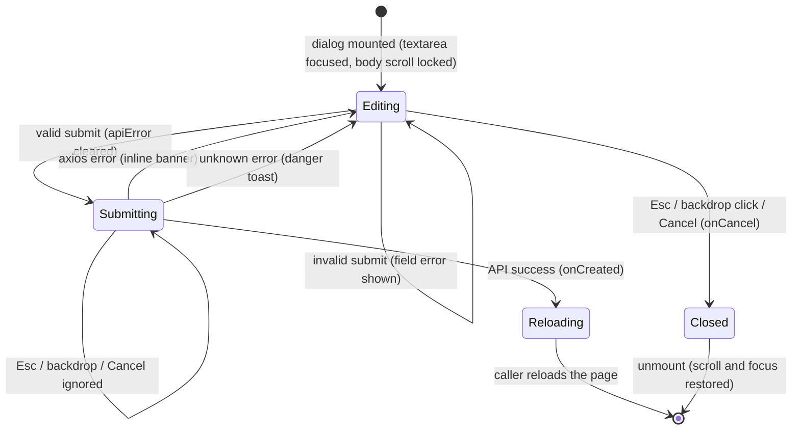
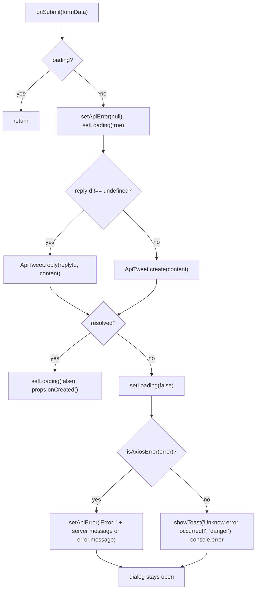
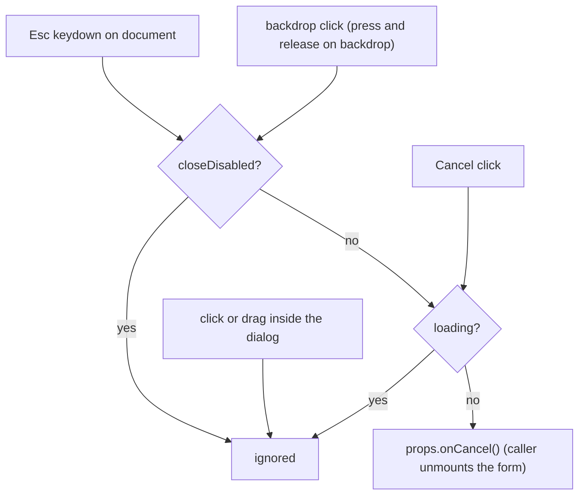

# S04 - Themed new-tweet/reply dialog with Esc/backdrop close, counter and inline errors

- **Plan:** [plan.md](plan.md)
- **Type:** Slice
- **Requirements covered:** FR-10, FR-11, FR-12 (tweet form), FR-07 (Cancel ghost, Submit primary), FR-06 (control states, focus), FR-05 (no icons from other sets)
- **Prerequisites:**
  - Tokens `--color-surface-2`, `--color-border`, `--color-text`, `--color-text-muted`, `--color-on-accent`, `--color-backdrop`, `--color-warning`, `--color-danger`, `--shadow-2`, `--radius-lg`, `--space-1..5`, `--font-size-xs`, `--font-size-md`, `--font-weight-medium`, `--font-weight-semibold`, `--line-height-tight`, `--duration-base`, `--ease-out`, the global `:focus-visible` ring and the global reduced-motion rule
  - `Button` (`$variant`) from `src/components/ui/button.tsx`
  - `FieldLabel`, `TextArea`, `FieldError` from `src/components/ui/field.tsx`
  - `InlineAlert` from `src/components/ui/inline-alert.tsx`
  - `useToast()` / `showToast(text, variant?, durationMs?)` from `src/components/toast-context.ts`
  - `ToastProvider` wrapping `RouterProvider`, rendering its fixed toast stack at `z-index: 1000`
- **Creates:** `Modal` (`onClose`, `closeDisabled`, `labelledBy`); restyled `TweetNewForm` (`replyId?`, `onCreated`, `onCancel`; props unchanged)

## 1. Goal

When "+ Tweet Now", the mobile "+" or a tweet's reply action opens the composer:

- A dark rounded dialog (`--color-surface-2`, `--radius-lg`, `--shadow-2`) appears centered in the **viewport** over a dimmed, slightly blurred backdrop, with a fade (backdrop) and scale-in (dialog). It covers the viewport even when the feed is scrolled, and the page behind it does not scroll.
- The textarea has focus. The dialog has `role="dialog"`, `aria-modal="true"` and is labelled by the prompt text ("Post your new message:" / "Post your reply:").
- **Esc**, a **backdrop click** and **Cancel** all close it through the same path (`props.onCancel()`); all three do nothing while a submit is in progress. Clicking inside the dialog never closes it.
- A live `n / 250` counter sits in the footer: muted below 230, warning color from 230 to 250, danger above 250. The validation messages "Message can't be empty" and "Message can have a maximum of 250 characters" are unchanged.
- An API (axios) error shows `Error: <message>` in an inline danger banner inside the dialog; the dialog stays open for retry or cancel, and the banner disappears as soon as the user edits the text. Any other error shows the danger toast `Unknow error occurred!!` above the dialog; the dialog also stays open. No `alert()` remains.
- Cancel is a ghost button, Submit an orange pill with a white `PulseLoader` while submitting.
- Backend flow unchanged: same `ApiTweet.create` / `ApiTweet.reply` call and the caller's `onCreated` (page reload) on success.

## 2. Context

- `src/components/modal.tsx` today: `ModalProps { children }`; `Modal` renders `Backdrop` (`position: absolute; 100vw × 100vh`, `rgba(0,0,0,0.5)`) and a white `Dialog` (`color: black`, radius 10px). No ARIA, no keyboard, no scroll lock. Its only consumer is `TweetNewForm`.
- `src/components/tweet/tweet-new-form.tsx` today: `TweetNewFormProps { replyId?: number; onCreated: () => void; onCancel: () => void }`; `useForm<TweetFormData>` with `register("content", { required, maxLength 250 })`; `loading` state guards submit and Cancel; axios errors and unknown errors go to `alert()`, the unknown path also calls `props.onCancel()`. The label has `htmlFor="content"` but the textarea has no `id` (the label is not linked). Cancel is a red button relying on `event.preventDefault()` (no `type`, so it defaults to submit). Submit uses legacy `--color-bg-2` and `PulseLoader color="white"`.
- `TweetNewForm` is rendered by `nav-bar.tsx`, `nav-bar-mobile.tsx` (both: `onCreated={() => window.location.reload()}`, `onCancel={() => setShowNewTweetForm(false)}`) and `tweet-display.tsx` (inside the tweet row, `replyId={tweet.id}`; `onCreated` reloads). Those callers are not edited; the form must keep its props.
- The reply form is mounted **inside a tweet row in `CentralWidget`**, the element that scrolls (`overflow-y: auto`). A fixed backdrop mounted there would chain wheel/touch scrolling to that column and could be trapped by any future stacking context on its ancestors. Hence the dialog is rendered through a portal into `document.body`.
- React 18.2 (`createPortal`, `useId` available), react-hook-form 7.49 (`watch`), react-spinners 0.13.8 (`PulseLoader` puts `color` directly into an inline `backgroundColor`, so `"var(--color-on-accent)"` works).
- Lint: `react-refresh/only-export-components` with `--max-warnings 0` (a `.tsx` exports only components and types; private functions/constants are fine), `react-hooks/exhaustive-deps`. TypeScript strict. 4-space indent, Allman braces, styled-components at the bottom.
- No `z-index` exists in components other than the toast stack (1000) and the sticky page title (1).
- No test suite: verification is lint, build and manual checks.

## 3. Structure

### 3.1 Files

| File | Change | Responsibility |
|------|--------|----------------|
| `src/components/modal.tsx` | modify (rewrite) | Generic dialog shell: portal, fixed backdrop, themed panel, open animation, Esc/backdrop close requests, body scroll lock, ARIA, initial focus and focus return |
| `src/components/tweet/tweet-new-form.tsx` | modify | Composer: shared close path, counter, inline API error, danger toast for unknown errors, themed controls |

No other file changes.

### 3.2 Component: `src/components/modal.tsx`

```tsx
import { MouseEvent, ReactNode, useCallback, useEffect, useRef, useState } from "react";
import { createPortal } from "react-dom";
import { keyframes, styled } from "styled-components";

export interface ModalProps
{
    children: ReactNode;
    /** Called on Esc or backdrop click. Omitted: those gestures do nothing. */
    onClose?: () => void;
    /** While true, Esc and backdrop click are ignored (e.g. during a submit). Default false. */
    closeDisabled?: boolean;
    /** id of the element that names the dialog (aria-labelledby). */
    labelledBy?: string;
}

export function Modal({ children, onClose, closeDisabled = false, labelledBy }: ModalProps)
```

Module-private constants:

```ts
const MODAL_Z_INDEX = 900;          // below the toast stack (1000), above all page content
const DIALOG_MAX_WIDTH = "600px";   // composer width on desktop
const BACKDROP_BLUR = "4px";
const ESCAPE_KEY = "Escape";
```

Refs and behavior:

- `dialogRef = useRef<HTMLDivElement>(null)`; `pressStartedOnBackdropRef = useRef(false)`.
- **Opener** — `const [previouslyFocused] = useState<Element | null>(() => document.activeElement);`. The lazy initializer runs during the first render, **before** commit, so it captures the control that opened the dialog ("+ Tweet Now", the mobile "+", the reply button), not the textarea that `autoFocus` focuses during commit. Never updated afterwards.
- **Close request** — the single rule for "ignored while disabled":

  ```ts
  const requestClose = useCallback(() =>
  {
      if (closeDisabled || !onClose)
          return;
      onClose();
  }, [onClose, closeDisabled]);
  ```

  Esc and backdrop click both call it; no other place repeats the check.
- **Esc** — `useEffect` with deps `[requestClose]`: add a `keydown` listener on `document` that calls `requestClose()` when `event.key === ESCAPE_KEY && !event.isComposing`. Cleanup removes the listener. Re-subscribing when callers pass a new inline `onClose` each render is harmless.
- **Backdrop click** — two named handlers inside the component, passed to `Backdrop` as `onMouseDown` / `onClick`:

  ```ts
  function handleBackdropMouseDown(event: MouseEvent<HTMLDivElement>)
  {
      pressStartedOnBackdropRef.current = event.target === event.currentTarget;
  }

  function handleBackdropClick(event: MouseEvent<HTMLDivElement>)
  {
      if (event.target === event.currentTarget && pressStartedOnBackdropRef.current)
          requestClose();
  }
  ```

  Both checks are needed: clicks inside the dialog bubble to the backdrop (target differs), and a text selection dragged from the textarea out onto the backdrop must not close the dialog.
- **Body scroll lock** — `useEffect([], ...)`: save `document.body.style.overflow`, set it to `"hidden"`, restore the saved value in the cleanup. Together with the portal (the backdrop's DOM ancestors are only `body`/`html`) and `overscroll-behavior: contain`, wheel and touch scrolling over the backdrop cannot reach `CentralWidget`.
- **Initial focus and focus return** — `useEffect` with deps `[previouslyFocused]` (stable, runs once): if `dialogRef.current` does not contain `document.activeElement` (the textarea's `autoFocus` already ran during commit, so normally it does), call `dialogRef.current.focus()`. Cleanup: if `previouslyFocused` (captured during the first render, see **Opener**) is an `HTMLElement` still in the document (`isConnected`), focus it, so keyboard users return to "+ Tweet Now" / the reply button after closing. The effect does not read `document.activeElement` to find the opener.
- **No focus trap** (user decision): Tab may leave the dialog.

Markup (returned via `createPortal(..., document.body)`):

```tsx
<Backdrop onMouseDown={handleBackdropMouseDown} onClick={handleBackdropClick}>
    <Dialog
        ref={dialogRef}
        role="dialog"
        aria-modal="true"
        aria-labelledby={labelledBy}
        tabIndex={-1}
    >
        {children}
    </Dialog>
</Backdrop>
```

Exports: `Modal` and `ModalProps` only.

Styled-components (bottom of file):

```ts
const fadeIn = keyframes`
    from { opacity: 0; }
    to   { opacity: 1; }
`;

const scaleIn = keyframes`
    from { opacity: 0; transform: scale(0.96); }
    to   { opacity: 1; transform: scale(1); }
`;
```

- `Backdrop` (`styled.div`): `position: fixed; inset: 0; z-index: ${MODAL_Z_INDEX}; display: flex; justify-content: center; align-items: center; padding: var(--space-4); background-color: var(--color-backdrop); backdrop-filter: blur(${BACKDROP_BLUR}); overscroll-behavior: contain; animation: ${fadeIn} var(--duration-base) var(--ease-out);`
- `Dialog` (`styled.div`): `box-sizing: border-box; width: 100%; max-width: ${DIALOG_MAX_WIDTH}; max-height: 100%; overflow-y: auto; overscroll-behavior: contain; padding: var(--space-5); background-color: var(--color-surface-2); color: var(--color-text); border: 1px solid var(--color-border); border-radius: var(--radius-lg); box-shadow: var(--shadow-2); animation: ${scaleIn} var(--duration-base) var(--ease-out);` and `@media (width <= 600px) { padding: var(--space-4); }`.
- The old `position: absolute`, `100vw/100vh`, `rgba(0, 0, 0, 0.5)`, `white`/`black` rules are removed. Reduced motion is handled by the global rule (no local media query).

### 3.3 Component: `src/components/tweet/tweet-new-form.tsx`

Imports after the change:

```tsx
import { useId, useState } from "react";
import { useForm } from "react-hook-form";
import { styled } from "styled-components";
import { isAxiosError } from "axios";
import { PulseLoader } from "react-spinners";
import { ApiTweet } from "../../api/api-tweet";
import { Modal } from "../modal";
import { useToast } from "../toast-context";
import { Button } from "../ui/button";
import { FieldError, FieldLabel, TextArea } from "../ui/field";
import { InlineAlert } from "../ui/inline-alert";
```

`TweetNewFormProps` and `TweetFormData` stay exactly as they are.

Module-private constants and helper (not exported):

```ts
const MAX_TWEET_LENGTH = 250;
const COUNTER_WARNING_FROM = 230;
const UNKNOWN_ERROR_MESSAGE = "Unknow error occurred!!";   // verbatim, existing text

type CounterState = "normal" | "warning" | "danger";

const COUNTER_COLOR: Record<CounterState, string> = {
    normal: "var(--color-text-muted)",
    warning: "var(--color-warning)",
    danger: "var(--color-danger)",
};

function counterStateFor(length: number): CounterState
{
    // > MAX_TWEET_LENGTH → "danger"; >= COUNTER_WARNING_FROM → "warning"; else "normal"
}
```

`MAX_TWEET_LENGTH` is used both in the `maxLength` rule (`value: MAX_TWEET_LENGTH`) and in the counter text, so the limit has one definition. The validation messages stay verbatim.

Component state and hooks:

```tsx
export function TweetNewForm(props: TweetNewFormProps)
{
    const [loading, setLoading] = useState(false);
    const [apiError, setApiError] = useState<string | null>(null);
    const { showToast } = useToast();
    const { register, handleSubmit, watch, formState: { errors } } = useForm<TweetFormData>();

    const fieldId = useId();     // textarea id; label htmlFor
    const labelId = useId();     // label id; Modal labelledBy
    const counterId = useId();
    const errorId = useId();

    const contentLength = (watch("content") ?? "").length;
    const counterState = counterStateFor(contentLength);
    // ...
}
```

`useId` replaces the fixed `"content"` id so the ids are unique and the label is really linked (today it is not).

Handlers:

- `requestCancel()`: `if (loading) return; props.onCancel();`. The single close path, used by Cancel (`onClick`), and passed to `Modal` as `onClose`. `Modal` also gets `closeDisabled={loading}`, so the loading guard applies twice for Esc/backdrop (harmless, explicit). The former `setLoading(true)` / `setLoading(false)` around the synchronous `onCancel()` and the `event.preventDefault()` are dropped (Cancel becomes `type="button"`).
- `onSubmit(formData)` (same request sequence as today):
  1. `if (loading) return;`
  2. `setApiError(null); setLoading(true);`
  3. `await new ApiTweet().reply(props.replyId, formData.content)` when `props.replyId !== undefined`, else `await new ApiTweet().create(formData.content)`.
  4. Success: `setLoading(false); props.onCreated();` (unchanged).
  5. Catch: `setLoading(false);` then
     - axios error: `setApiError(\`Error: ${error.response?.data?.message ?? error.message}\`)` (same text as the old alert); return.
     - otherwise: `showToast(UNKNOWN_ERROR_MESSAGE, "danger"); console.error(error);` — **no** `props.onCancel()` (user decision; the dialog stays open).
- `clearApiError()`: `setApiError(null)`. Passed as the `onChange` option of `register("content", ...)` (react-hook-form 7.49 calls it after its own change handling), so the API error banner disappears as soon as the user edits the text (user decision). It is also cleared when a submit starts (step 2 above). Setting `null` when it is already `null` causes no re-render.

Markup:

```tsx
<Modal onClose={requestCancel} closeDisabled={loading} labelledBy={labelId}>
    <Form onSubmit={handleSubmit(onSubmit)} noValidate>
        <PromptLabel id={labelId} htmlFor={fieldId}>
            {props.replyId ? "Post your reply:" : "Post your new message:"}
        </PromptLabel>
        <TextArea
            id={fieldId}
            autoFocus
            rows={5}
            aria-invalid={errors.content ? "true" : undefined}
            aria-describedby={errors.content ? `${counterId} ${errorId}` : counterId}
            {...register("content", {
                required: "Message can't be empty",
                maxLength: { value: MAX_TWEET_LENGTH, message: "Message can have a maximum of 250 characters" },
                onChange: clearApiError,
            })}
        />
        {errors.content &&
            <FieldError id={errorId}>{errors.content.message?.toString()}</FieldError>
        }
        {apiError && <InlineAlert>{apiError}</InlineAlert>}
        <Footer>
            <Counter id={counterId} $state={counterState}>{contentLength} / {MAX_TWEET_LENGTH}</Counter>
            <Button type="button" $variant="ghost" onClick={requestCancel} disabled={loading}>Cancel</Button>
            <Button type="submit" disabled={loading}>
                {loading || "Submit"}
                <PulseLoader loading={loading} size="0.5rem" color="var(--color-on-accent)" />
            </Button>
        </Footer>
    </Form>
</Modal>
```

- `noValidate` is harmless (no native constraints are set) and keeps validation in react-hook-form only.
- The counter is not a live region (it would announce every keystroke); it is exposed through `aria-describedby`.
- The submit button content keeps today's pattern (`{loading || "Submit"}` + loader), so the button shows the loader instead of the text while submitting.

Styled-components (bottom of file; the old `.btn`, `ErrorMessage`, `Cancel`, `Submit`, `PulseLoaderStyled` are removed):

- `Form` (`styled.form`): `display: flex; flex-direction: column; gap: var(--space-3); width: 100%;`
- `PromptLabel` (`styled(FieldLabel)`): `margin: 0; font-size: var(--font-size-md); font-weight: var(--font-weight-semibold); color: var(--color-text); line-height: var(--line-height-tight);` (the prompt doubles as the dialog title).
- `Footer` (`styled.footer`): `display: flex; align-items: center; justify-content: flex-end; gap: var(--space-3); flex-wrap: wrap;`
- `Counter` (`styled.span<{ $state: CounterState }>`): `margin-right: auto; font-size: var(--font-size-xs); font-weight: var(--font-weight-medium); font-variant-numeric: tabular-nums; color: ${({ $state }) => COUNTER_COLOR[$state]};`

## 4. Logic flows



The dialog is only closed by the shared cancel path from `Editing`, or replaced by the page reload after success. Both error outcomes return to `Editing` so the user can retry or cancel.



The request part is identical to today; only the error presentation changed, and the unknown path no longer closes the dialog.



All three gestures end in the same `requestCancel` and the same guard.

## 5. Edge cases and errors

| Case | Expected behavior |
|------|-------------------|
| Feed scrolled far down, composer opened | Dialog centered in the viewport, backdrop covers the whole viewport (portal + `position: fixed`). |
| Wheel / touch scroll over the backdrop or the dialog | Feed and page do not scroll; a dialog taller than the viewport scrolls internally. |
| Reply form opened from a tweet row | Same look and behavior as the new-tweet dialog (portal escapes the row and the scrolling column). |
| Esc, backdrop click or Cancel while submitting | Ignored; dialog stays open, loader keeps running. |
| Mouse pressed in the textarea, released over the backdrop (text selection) | Dialog stays open. |
| Click on any dialog content | Dialog stays open. |
| Esc during IME composition | Ignored (`isComposing`). |
| Empty submit | "Message can't be empty" under the field, red border; no request. |
| 251+ characters | Counter `251 / 250` in danger color; submit shows "Message can have a maximum of 250 characters"; no request. |
| 230–250 characters | Counter in warning color; submit allowed. |
| Field cleared / never typed | Counter `0 / 250` (`watch` returns `undefined` initially, handled with `?? ""`). |
| API returns an error with `data.message` | Inline banner `Error: <server message>`; no browser alert; dialog open; Submit enabled again. |
| Network failure (axios error without response) | Inline banner `Error: <axios message>` (e.g. `Error: Network Error`). |
| Non-axios error | Danger toast `Unknow error occurred!!` at the top, visible over the dialog (toast stack 1000 > dialog 900); dialog stays open; error logged to the console. |
| User edits the text after an API error | Banner disappears on the first change (typing, deleting, pasting, cutting). |
| Retry after an API error without editing | Banner cleared when the new submit starts; shown again only if it fails again. |
| Submit fails validation while an API banner is visible | Cannot happen without editing (the banner appears only after a valid submit, and any edit clears it); if the text is unchanged it is still valid, so a retry starts a request and clears the banner. |
| 401 from the API | Handled by the API layer (storage cleared, hard redirect to `/login`), unchanged. |
| Dialog closed with Esc after keyboard opening | Focus returns to the control that opened it, if still in the document. |
| Success | `onCreated()` → caller reloads the page; no toast, no banner. |
| Long server message | Banner text wraps inside the dialog. |
| Phone width 375px | Dialog fills the width minus 16px gutters; footer wraps if needed; no horizontal scroll. |
| Reduced motion | Fade/scale effectively instant via the global rule. |
| Body already had an inline `overflow` | Restored to that exact value on close. |

## 6. Tests

No automated test suite exists and none is added (RFF decision 11).

### 6.1 Automated

| Check | Given / When / Then | Proves |
|-------|---------------------|--------|
| `npm run lint` | Given the changes, when linting, then 0 errors and 0 warnings (no `only-export-components` or `exhaustive-deps` warning in `modal.tsx` / `tweet-new-form.tsx`). | Build criteria |
| `npm run build` | Given the changes, when running `tsc && vite build`, then it succeeds (props of `TweetNewForm` unchanged, so the three callers compile untouched). | Build criteria, props contract |

Run with: `npm run lint && npm run build`

### 6.2 Manual

Dev server `npm run dev`, backend running, logged in; desktop 1280px unless stated.

- Given a long feed scrolled to the middle, when clicking "+ Tweet Now", then the dialog is centered in the viewport over a dimmed, blurred backdrop with a short fade/scale-in, the textarea has focus, and wheel scrolling over the backdrop does not move the feed. (FR-10)
- Given the dialog open, when inspecting it, then the panel has `role="dialog"`, `aria-modal="true"`, `aria-labelledby` pointing at the "Post your new message:" label, the label's `for` matches the textarea `id`, and the dialog is a direct child of a backdrop that is a child of `body`. (FR-10)
- Given the dialog open, when pressing Esc, then it closes; reopening and clicking the backdrop closes it; reopening and clicking Cancel closes it; clicking inside the dialog, or dragging a text selection from the textarea onto the backdrop, does not close it. (FR-10)
- Given the dialog opened from the keyboard (Tab to "+ Tweet Now", Enter), when pressing Esc, then focus returns to "+ Tweet Now" with a visible focus ring. (FR-06, FR-10)
- Given DevTools throttling "Slow 3G" and a valid message, when clicking Submit and immediately pressing Esc, clicking the backdrop and clicking Cancel, then nothing closes, Cancel and Submit are disabled and the white loader pulses in the orange button. (FR-10, RFF §5 edge state)
- Given typing, then the counter shows `n / 250` live; at 230 characters it turns warning (amber), at 251 danger (red); at 229 it is muted again. (FR-11)
- Given 251 characters, when submitting, then "Message can have a maximum of 250 characters" shows under the field with a red border and no request is sent; given an empty field, "Message can't be empty". (FR-11)
- Given the backend stopped, when submitting, then an inline danger banner `Error: Network Error` appears inside the dialog, no browser alert appears, the dialog stays open, and after starting the backend Submit succeeds and the page reloads. (FR-12)
- Given the inline `Error: ...` banner visible (backend stopped, submit failed), when typing or deleting one character in the textarea, then the banner disappears immediately; when submitting again with the backend still stopped, it reappears. (FR-12, user decision "clear on edit")
- Given a forced API error with a message (e.g. DevTools → Network → right-click the tweet `POST` → "Override content" / block, or a backend returning 400), when submitting, then the banner shows `Error: <message>`. (FR-12)
- Given a temporary, uncommitted `throw new Error("x")` placed right before the `ApiTweet` call, when submitting, then the danger toast `Unknow error occurred!!` appears at the top **over** the dialog backdrop, the dialog stays open, and the console logs the error; revert afterwards. (User decision, FR-12)
- Given the dialog, when hovering/tabbing the buttons, then Cancel is a ghost outline button with a hover tint and Submit an orange pill that lightens on hover; both show the focus ring; nothing is red except errors. (FR-07, FR-06)
- Given a tweet in the feed, when clicking reply, then the same dialog opens with "Post your reply:", centered in the viewport, and Esc/backdrop/Cancel close it. (FR-10)
- Given DevTools mobile emulation 375×812, when tapping the bottom-bar "+", then the dialog fits the width with side gutters, no horizontal scroll, and the counter and buttons stay usable. (FR-10)
- Given DevTools → Rendering → `prefers-reduced-motion: reduce`, when opening the dialog, then it appears without the fade/scale. (FR-04 via global rule)
- Parity: given the Network tab, when posting a new tweet, then one `POST` to the create endpoint with `{ content }` followed by a full page reload; when replying, `GET /auth/check` (from the row) then the reply `POST`, then reload; closing the dialog sends nothing. (Backend parity)

### 6.3 Static checks

- `grep -n "alert(" src/components/tweet/tweet-new-form.tsx` → no output. (FR-12)
- `grep -n "react-icons" src/components/modal.tsx src/components/tweet/tweet-new-form.tsx` → no output. (FR-05: no icons from other sets)
- `grep -nE "#[0-9a-fA-F]{3,8}\b|rgba?\(|white|black|position: absolute" src/components/modal.tsx src/components/tweet/tweet-new-form.tsx` → no output. (Tokens only; absolute positioning gone)
- `grep -nE "color-(bg|fg)-|color-danger-1" src/components/modal.tsx src/components/tweet/tweet-new-form.tsx` → no output. (Legacy tokens no longer used in these files)
- `grep -n "props.onCancel" src/components/tweet/tweet-new-form.tsx` → exactly one match, inside `requestCancel`. (Unknown-error path no longer closes)
- `grep -c "role=\"dialog\"" src/components/modal.tsx` → `1`; `grep -c "aria-modal" src/components/modal.tsx` → `1`; `grep -c "createPortal" src/components/modal.tsx` → `2` (import and call). (FR-10)
- `grep -n "onChange: clearApiError" src/components/tweet/tweet-new-form.tsx` → one match. (Banner cleared on edit)
- `git diff --stat -- src/components/nav-bar.tsx src/components/nav-bar-mobile.tsx src/components/tweet/tweet-display.tsx` → no output. (Callers untouched)

## 7. Implementation order

1. Rewrite `modal.tsx` with the new props as optional: portal, fixed themed backdrop/dialog, animation, ARIA, scroll lock, focus effect, Esc/backdrop close. The existing `<Modal>` call in the form still compiles (no `onClose` → gestures do nothing). Lint + build.
2. In `tweet-new-form.tsx`: replace the controls with `PromptLabel`/`TextArea`/`FieldError`/`Button`, add the `useId` ids and the recolored loader; Cancel `type="button"` via `requestCancel`. Lint + build.
3. Pass `onClose={requestCancel}`, `closeDisabled={loading}`, `labelledBy={labelId}` to `Modal`.
4. Add the counter (`watch`, `MAX_TWEET_LENGTH`, `counterStateFor`, `Counter`).
5. Replace both `alert()` calls: `apiError` state + `InlineAlert` (cleared on submit start and via `onChange: clearApiError`); `useToast` danger toast without `onCancel()`.
6. Run lint, build, static checks and manual checks.

## 8. Out of scope

- Does not edit the callers (`nav-bar.tsx`, `nav-bar-mobile.tsx`, `tweet-display.tsx`) or any other component, page, `App.tsx`, global CSS or `src/api/**`.
- Does not change `TweetNewFormProps`, the validation rules or messages, the `ApiTweet` calls or what happens on success.
- No focus trap, no `inert`/`aria-hidden` on the page behind the dialog, no close (X) button, no exit animation.
- No new toast, primitive, token or npm package.

## 9. Design notes

- **Portal to `document.body`:** the composer is also mounted inside a tweet row in the scrolling central column. Rendering the fixed backdrop there would let wheel/touch scrolling chain into the column and would depend on ancestors never creating a stacking context. A portal makes the scroll lock on `body` sufficient and keeps the `z-index` relative to the toast stack predictable. React context (toasts) and synthetic events still flow through the React tree.
- **One close path (DRY):** Esc, backdrop and Cancel all call `requestCancel` → `props.onCancel()`, with the `loading` guard in the form and `closeDisabled` in the `Modal`, so "closes exactly like Cancel and is ignored while submitting" holds by construction.
- **`Modal` stays generic (Single Responsibility, Interface Segregation):** it knows nothing about tweets; it only exposes close requests, a disabled flag and a label id. Sizing is a single max width with viewport gutters; the form fills it.
- **Backdrop close needs press and release on the backdrop:** rejected a plain `onClick` target check alone, which closes the dialog when a text selection drag ends on the backdrop.
- **Focus return to the opener (user decision: keep):** without it, closing with Esc drops keyboard focus to `body`. The opener is captured in a lazy `useState` initializer during the first render, because the textarea's `autoFocus` runs during commit, before any effect, so reading `document.activeElement` in an effect would capture the textarea. Skipped when the opener is gone. No focus trap (user decision).
- **Single `requestClose` (`useCallback`)** holds the "ignored while disabled" rule; the Esc effect depends on it and the backdrop handler calls it, so the rule is not repeated.
- **API error banner cleared on edit (user decision)** through `register`'s `onChange` option, rather than a `useEffect` on `watch("content")` (which would also fire on mount and needs an extra dependency dance).
- **Unknown error keeps the dialog open (user decision)** and uses `showToast(UNKNOWN_ERROR_MESSAGE, "danger")`; this deliberately deviates from RFF §5's "keep the `onCancel()` call". `MODAL_Z_INDEX = 900` keeps the dialog under the toast stack (1000) so the toast is visible over the backdrop.
- **Counter:** one `MAX_TWEET_LENGTH` constant feeds both the validation rule and the counter; colors come from a `Record<CounterState, …>` map (Open/Closed); the counter is described via `aria-describedby` rather than a live region to avoid announcing every keystroke.
- **`useId` ids** replace the hard-coded `"content"` (which was not even linked to the textarea) so label, dialog name, counter and error are correctly associated.
- **Dropped the `setLoading(true/false)` wrapper around `onCancel()`** and `preventDefault()`: Cancel is now `type="button"`, and the synchronous toggle had no observable effect.
- **`PulseLoader` color `var(--color-on-accent)`:** react-spinners 0.13.8 writes `color` straight into inline `backgroundColor`, so a CSS variable works and no literal color is needed.
- **Dialog width 600px (user decision)** (was 85vw up to 700px): matches the central column width; the viewport gutter on the backdrop replaces the `vw` math.
