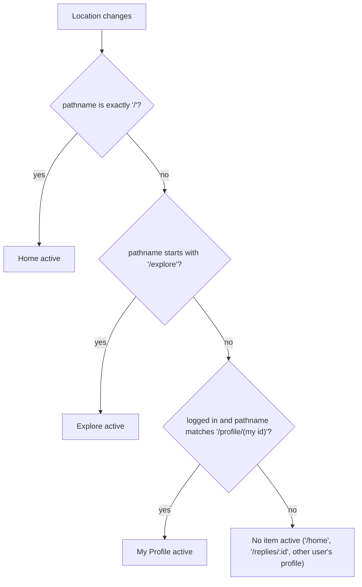
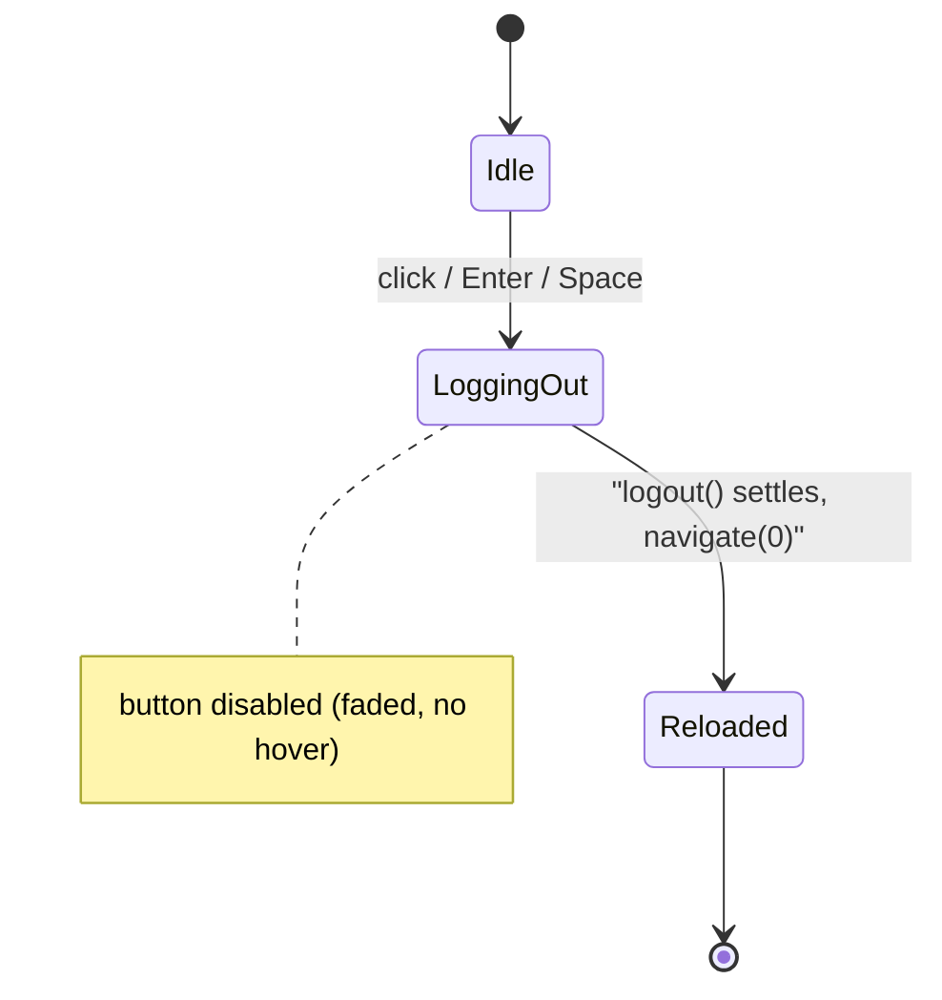

# S05 - Desktop NavBar with active route, primary pill and compact user chip

- **Plan:** [plan.md](plan.md)
- **Type:** Slice
- **Requirements covered:** FR-16, FR-08 (desktop), FR-09 (nav items, Tweet Now, login, logout), FR-05 (home, explore, profile, logout), FR-06, FR-07
- **Prerequisites:** color tokens (`--color-surface-hover`, `--color-text`, `--color-text-secondary`, `--color-text-muted`, `--color-accent`), typography tokens (`--font-size-xs/sm/md/lg`, `--font-weight-medium/semibold/bold`, `--line-height-tight`), spacing `--space-1..5`, `--radius-pill`, motion `--duration-fast`, `--ease-out` (+ global reduced-motion rule), global `:focus-visible` ring, `react-icons@^5.7.0` (`LuHouse`, `LuHash`, `LuUser`, `LuLogOut` from `react-icons/lu`), `Button` (`$variant`, `$fullWidth`) from `src/components/ui/button.tsx`, `TweetNewForm` (`onCreated`, `onCancel`; props unchanged)
- **Creates:** none (restyles the existing `LogoutButton`, which keeps no props)

## 1. Goal

Restyle the desktop/tablet sidebar (visible above 600px) into a modern, keyboard-usable navigation, without changing its structure or any backend interaction.

When done:

- The sidebar shows, top to bottom and in the same order as today: the logo (`alt="GrowTweet"`), the nav list (Home, Explore, My Profile when logged in), then the orange "+ Tweet Now" pill (logged in) or the orange "Login" pill (logged out), and the compact user chip pinned at the bottom (logged in only).
- Nav items are real links (`NavLink`) drawn as rounded rows with a hover background; the item matching the current route is orange and bold and carries `aria-current="page"`. On `/replies/:id` and on another user's profile, no item is highlighted.
- Icons are Lucide (`LuHouse`, `LuHash`, `LuUser`, `LuLogOut`); no `react-icons/fa` or `react-icons/sl` import remains in the three files.
- The user chip shows the avatar (with `alt`), the name, the muted `@handle` and a semantic Logout button.
- `LogoutButton` is a `<button type="button">` with `LuLogOut` and the visible text "Logout", a compact ghost style, disabled while logging out, and the same handler (`logout()` then `navigate(0)`). It still renders correctly where it is used outside the sidebar (profile header), since it has no props and no outer margin.
- Every control is reachable with Tab, shows the orange focus ring, and activates with Enter (links) or Enter/Space (buttons).

## 2. Context

- `src/components/nav-bar.tsx`: `NavBar` reads `localStorage["user"]` in a `useEffect` into `userInfo` state; nav items are clickable `div`s (`Item`) calling `navigate(...)`; icons from `react-icons/fa`; two identical styled buttons `CreateTweetButton` and `LoginButton`; `TweetNewForm` is rendered when `showNewTweetForm` is true; `LoggedUserInfoStyled = styled(LoggedUserInfo)` is `position: fixed; bottom: 1rem`. `Logo` is an `` with no `alt`. Uses `import styled from "styled-components"` and legacy tokens (`--color-bg-4`, `--color-fg-4`) plus `color-mix(... white)`.
- `src/components/logged-user-info.tsx`: `LoggedUserInfo({ className?, userInfo })` returns an empty fragment when `userInfo` is null; otherwise avatar `` (no `alt`, falls back to `empty_avatar.png`) + a column with name, `@username` and `<LogoutButton/>`; muted tag via `color-mix(--color-fg-2 30%)`.
- `src/components/logout-button.tsx`: `LogoutButton()` renders a clickable `div` with `SlLogout` and "Logout"; `loading` state guards double clicks; handler `new ApiAuth().logout().finally(() => { navigate(0); setLoading(false) })`. `ApiAuth.logout()` only clears localStorage (no request). It is also rendered, unchanged, in `src/pages/profile/profile-user-info.tsx` (not touched here).
- Routes (`src/app-router.tsx`, unchanged): `/` and `/home` both render the feed, `/explore`, `/profile/:userId`, `/replies/:tweetId`, `/login`.
- `react-router-dom@^6.21`: `NavLink` sets `aria-current="page"` and the `active` class on the matching link; `end` restricts `/` to an exact match; matching respects segment boundaries (`/profile/1` does not match `/profile/12`).
- `NavBar` is hidden at `width <= 600px` (mobile uses its own bar); between 601 and 1024px it stays visible.
- The sidebar is a stretched flex child of the layout row, so it has the full height of the content area.
- Lint: `react-refresh/only-export-components` with `--max-warnings 0`; the three files export only components and types. TypeScript strict.
- No test suite: verification is lint, build, greps and manual browser checks.

## 3. Structure

### 3.1 Files

| File | Change | Responsibility |
|------|--------|----------------|
| `src/components/nav-bar.tsx` | modify | Sidebar layout, nav links with active state, primary pills, composer toggle |
| `src/components/logged-user-info.tsx` | modify | Compact user chip (avatar, name, handle, logout) |
| `src/components/logout-button.tsx` | modify | Semantic logout button with states; same handler |

No other file changes.

### 3.2 `src/components/nav-bar.tsx`

Imports become:

```tsx
import { styled } from "styled-components";
import { useEffect, useState } from "react";
import { NavLink, useNavigate } from "react-router-dom";
import { LuHash, LuHouse, LuUser } from "react-icons/lu";
import logo from "../assets/logo.svg";
import { TweetNewForm } from "./tweet/tweet-new-form";
import { LoggedUserInfo } from "./logged-user-info";
import { UserAuthInfo } from "../api/dto/auth-dtos";
import { Button } from "./ui/button";
```

`NavBar()` keeps its signature, its `showNewTweetForm` / `userInfo` state, the `useEffect` that reads `localStorage["user"]`, and `loginButtonHandler` (`navigate('/login')`). JSX:

```tsx
<Wrapper>
    <Logo src={logo} alt="GrowTweet"/>
    <ItemList aria-label="Main navigation">
        <Item to="/" end><LuHouse aria-hidden="true"/> Home</Item>
        <Item to="/explore"><LuHash aria-hidden="true"/> Explore</Item>
        {userInfo &&
            <Item to={`/profile/${userInfo.id}`}><LuUser aria-hidden="true"/> My Profile</Item>
        }
    </ItemList>

    {userInfo &&
        <>
            <Button type="button" $fullWidth onClick={() => setShowNewTweetForm(true)}>
                + Tweet Now
            </Button>
            {showNewTweetForm &&
                <TweetNewForm
                    onCreated={() => window.location.reload()}
                    onCancel={() => setShowNewTweetForm(false)}
                />
            }
        </>
    }

    {(userInfo === null) &&
        <Button type="button" $fullWidth onClick={loginButtonHandler}>
            Login
        </Button>
    }

    <UserChip userInfo={userInfo}/>
</Wrapper>
```

- Texts stay verbatim ("Home", "Explore", "My Profile", "+ Tweet Now", "Login").
- `Button` defaults to `$variant="primary"` (orange pill, white text, hover/pressed/disabled/focus built in). The Login control stays a button with the same handler (FR-09 "click handlers stay the same").
- `CreateTweetButton`, `LoginButton`, the old `Item` div and `LoggedUserInfoStyled` are deleted.

Styled components (bottom of file), all values through tokens:

| Name | Element | Rules |
|------|---------|-------|
| `Wrapper` | `styled.div` | `display: flex; flex-direction: column; gap: var(--space-4); width: 13rem;` (sidebar width kept from today) `padding: var(--space-4) var(--space-4) var(--space-4) var(--space-3); min-height: 0; overflow-y: auto;` (on short viewports the column scrolls instead of the chip overlapping the pill); `@media (width <= 600px) { display: none; }` (unchanged breakpoint) |
| `Logo` | `styled.img` | `width: 80%; margin-left: var(--space-3);` (aligned with the item icons) |
| `ItemList` | `styled.nav` | `display: flex; flex-direction: column; gap: var(--space-1); margin: var(--space-4) 0;` |
| `Item` | `styled(NavLink)` | see below |
| `UserChip` | `styled(LoggedUserInfo)` | `margin-top: auto;` (pushes the chip to the bottom of the column; replaces `position: fixed`) |

`Item` rules:

- `display: flex; align-items: center; gap: var(--space-3); min-height: ${NAV_ITEM_MIN_HEIGHT}; padding: var(--space-2) var(--space-3); border-radius: var(--radius-pill); color: var(--color-text); text-decoration: none; font-size: var(--font-size-md); font-weight: var(--font-weight-medium); line-height: var(--line-height-tight); transition: background-color var(--duration-fast) var(--ease-out), color var(--duration-fast) var(--ease-out), transform var(--duration-fast) var(--ease-out);`
- `& svg { flex-shrink: 0; font-size: var(--font-size-lg); }` (20px icons).
- Hover: `&:hover { background-color: var(--color-surface-hover); }`.
- Pressed: `&:active { transform: scale(${NAV_ITEM_PRESSED_SCALE}); }`.
- Current route: `&[aria-current="page"] { color: var(--color-accent); font-weight: var(--font-weight-bold); }` (icon follows via `currentColor`; hover background still applies).
- Focus: the global `:focus-visible` outline, which follows the pill radius.

Private module constants (not exported):

```ts
/** Nav rows keep at least the 40px hit area used by every control. */
const NAV_ITEM_MIN_HEIGHT = "40px";
/** Same subtle press feedback as the shared buttons. */
const NAV_ITEM_PRESSED_SCALE = 0.97;
```

### 3.3 `src/components/logged-user-info.tsx`

`LoggedUserInfoProps` (`className?`, `userInfo: UserAuthInfo | null`) and the `LoggedUserInfo` signature are unchanged; it still returns `<></>` when `userInfo` is null and still forwards `className` to its root (so the sidebar can position it). Markup keeps the same elements and order:

```tsx
<Wrapper className={props.className}>
    <Picture src={userInfo.pictureUrl ?? emptyAvatar} alt={`${userInfo.name} avatar`}/>
    <Description>
        <UserName>{userInfo.name}</UserName>
        <UserTag>@{userInfo.username}</UserTag>
        <LogoutButton/>
    </Description>
</Wrapper>
```

Styles:

| Name | Rules |
|------|-------|
| `Wrapper` (`styled.div`) | `display: flex; align-items: center; gap: var(--space-3); padding: var(--space-2) var(--space-3); margin: 0; border: none; color: var(--color-text); font-size: var(--font-size-sm); min-width: 0;` |
| `Picture` (`styled.img`) | `width: 40px; height: 40px; flex-shrink: 0; border-radius: 50%; object-fit: cover;` (40px = the chip's avatar size, written once here) |
| `Description` (`styled.div`) | `display: flex; flex-direction: column; align-items: flex-start; min-width: 0;` and `& > button { margin-left: calc(-1 * var(--space-2)); }` (offsets the logout button's own horizontal padding inside the chip only) |
| `UserName` (`styled.span`) | `max-width: 100%; font-weight: var(--font-weight-semibold); line-height: var(--line-height-tight); overflow: hidden; text-overflow: ellipsis; white-space: nowrap;` |
| `UserTag` (`styled.span`) | same truncation rules; `font-size: var(--font-size-xs); color: var(--color-text-muted);` |

The `LogoutButton` sits under the handle; the chip's `Description` rule `& > button` shifts it left by its padding so its icon lines up with the name and handle. `LogoutButton` itself carries no margin.

### 3.4 `src/components/logout-button.tsx`

```tsx
import { useState } from "react";
import { useNavigate } from "react-router-dom";
import { styled } from "styled-components";
import { LuLogOut } from "react-icons/lu";
import { ApiAuth } from "../api/api-auth";
import { Button } from "./ui/button";

export function LogoutButton()
```

- No props (unchanged). State `loading` and `logoutHandler` stay byte-for-byte the same: early `return` when `loading`, `setLoading(true)`, `(new ApiAuth()).logout().finally(() => { navigate(0); setLoading(false) })`.
- Markup (the wrapping fragment is dropped):

  ```tsx
  <Logout type="button" onClick={logoutHandler} disabled={loading}>
      <LuLogOut aria-hidden="true"/> Logout
  </Logout>
  ```

  The visible text "Logout" is the accessible name. `disabled` replaces the old `.disabled` class; the `loading` guard in the handler is kept as a second line of defence.
- Style: `const Logout = styled(Button).attrs({ $variant: "ghost" as const })` overriding only size and tone, so hover, pressed, disabled, 40px min height, transition and focus come from `Button`:
  - `border-color: transparent; padding: 0 var(--space-2); gap: var(--space-2); font-size: var(--font-size-xs); font-weight: var(--font-weight-medium); color: var(--color-text-secondary);`
  - `& svg { font-size: var(--font-size-sm); }`
  - `&:hover:not(:disabled) { color: var(--color-text); }` (the ghost hover background `--color-surface-hover` is inherited).
  - No outer `margin-top` (the old `0.5rem` is dropped) so the button fits any container.

## 4. Logic flows

Active-route highlighting is computed by `NavLink` from the current location; the diagram shows which item gets `aria-current="page"`.



Logout keeps today's flow; only the element changes. While `loading` the button is disabled, so further clicks do nothing until the reload.



## 5. Edge cases and errors

| Case | Expected behavior |
|------|-------------------|
| Logged out | Home and Explore links, then the orange "Login" pill (navigates to `/login`); no My Profile link, no Tweet Now, no chip. |
| On `/` | Only Home is active (`end` prevents it matching every route). |
| On `/home` | Feed renders; no item is highlighted (accepted; see design notes). |
| On `/replies/:id` | No item highlighted. |
| On another user's profile | My Profile is not highlighted (its link targets my own id). |
| On my profile with an id that is a prefix of another (`/profile/1` vs `/profile/12`) | Only the exact own-id route highlights My Profile. |
| Clicking the already-active link | Client-side navigation to the same route, no reload, no request. |
| Ctrl/middle-click on a nav item | Opens the route in a new tab (new, harmless link behavior). |
| Very long name or username | Truncated with an ellipsis inside the chip; the sidebar width does not change. |
| User without `pictureUrl` | `empty_avatar.png` shown, same `alt`. |
| Short viewport (sidebar content taller than the area) | The sidebar column scrolls; the chip never overlaps the pill. |
| Tall viewport | The chip sits at the bottom of the sidebar. |
| Double click / Enter repeated on Logout | First activation disables the button; later ones are ignored; one `navigate(0)`. |
| `LogoutButton` in the profile header | Same compact button, no extra top margin; fits the actions column. |
| Composer open from Tweet Now | `TweetNewForm` opens as before; on close focus returns to the pill. |
| Reduced motion | Hover/press transitions are instant (global rule). |
| Width ≤ 600px | Sidebar hidden as before. |

## 6. Tests

No automated test suite exists and none is added (RFF decision 11).

### 6.1 Automated

| Check | Given / When / Then | Proves |
|-------|---------------------|--------|
| `npm run lint` | Given the modified files, when linting, then 0 errors and 0 warnings. | Build criteria |
| `npm run build` | Given the modified files, when running `tsc && vite build`, then it succeeds (NavLink, `styled(Button).attrs`, `alt` props type-check). | Build criteria |

### 6.2 Manual

Run `npm run dev`, desktop width 1280px unless stated.

- Given logged in, when opening `/`, `/explore` and my profile in turn, then exactly the matching item is orange and bold and has `aria-current="page"` in DevTools; on `/replies/<id>` and on another user's profile none is. (FR-08, FR-16)
- Given width 800px, then the sidebar is still visible and highlights the same way; given 375px, it is hidden. (FR-16, structure)
- Given the sidebar, when hovering each nav item, then a rounded background tint appears; pressing shrinks it slightly. (FR-06, FR-16)
- Given keyboard only, when tabbing from the top of the page, then focus goes Home → Explore → My Profile → "+ Tweet Now" → Logout, each with the orange focus ring; Enter on a link navigates; Enter and Space on "+ Tweet Now" open the composer; Space on Logout logs out. (FR-09, FR-06)
- Given logged in, then "+ Tweet Now" is a full-width orange pill with white text and hover/pressed states; clicking it opens the composer; Cancel closes it. (FR-07, parity)
- Given keyboard only, when pressing Enter on "+ Tweet Now" and then closing the composer with Cancel or Esc, then focus (orange ring) is back on the "+ Tweet Now" pill. (FR-06, FR-09)
- Given logged out (clear localStorage), then the "Login" orange pill appears where Tweet Now was and opens `/login`; no chip shows. (FR-07, FR-09, RFF §5 logged-out edge)
- Given logged in, then the chip at the bottom shows a 40px round avatar, the name, a muted `@handle` and a compact "Logout" control with the `LuLogOut` icon; inspecting the avatar shows `alt="<name> avatar"` and the logo `alt="GrowTweet"`. (FR-16, RFF §6 alt text)
- Given a user with a 40-character name, then name and handle truncate with an ellipsis. (edge)
- Given a viewport 1280×500, then the sidebar scrolls and the chip does not cover the pill; at 1280×900 the chip sits at the bottom. (edge)
- Given my own profile page, then the Logout control in the profile header looks like the sidebar one and is aligned in its column. (shared `LogoutButton`)
- Given DevTools → Rendering → `prefers-reduced-motion: reduce`, when hovering a nav item, then the tint changes instantly. (FR-04 respected)
- Parity: given the Network tab, when clicking Logout, then no request is sent, the session is cleared (localStorage empty) and the current route reloads (`navigate(0)`); when clicking nav items, no request is triggered by the sidebar itself; posting from the Tweet Now composer behaves exactly as before (create request, then page reload). (RFF §10 parity)

### 6.3 Static checks

- `grep -nE "react-icons/(fa|sl)" src/components/nav-bar.tsx src/components/logged-user-info.tsx src/components/logout-button.tsx` → no output. (FR-05)
- `grep -n "react-icons/" src/components/nav-bar.tsx src/components/logout-button.tsx | grep -v "react-icons/lu"` → no output. (FR-05)
- `grep -nE "CreateTweetButton|LoginButton|navigate\('/'\)|navigate\('/explore'\)" src/components/nav-bar.tsx` → no output. (FR-09, DRY)
- `grep -nE "styled\.div\`" src/components/logout-button.tsx` → no output (logout is a button). (FR-09)
- `grep -nE "#[0-9a-fA-F]{3,8}\b|rgba?\(|color-mix|--color-(bg|fg)-" src/components/nav-bar.tsx src/components/logged-user-info.tsx src/components/logout-button.tsx` → no output (new tokens only).
- `grep -n "alt=" src/components/nav-bar.tsx src/components/logged-user-info.tsx` → two matches.
- `git diff --stat -- src/api src/app-router.tsx src/pages` → no output.

## 7. Implementation order

1. `logout-button.tsx`: semantic `styled(Button)` ghost button with `LuLogOut`; lint + build; check it in the sidebar and on the profile header.
2. `logged-user-info.tsx`: chip layout, avatar `alt`, truncation; lint + build.
3. `nav-bar.tsx`: `NavLink` items with Lucide icons and active style, `Button` pills, logo `alt`, flex-bottom chip; delete the old styled buttons; lint + build.
4. Manual checks (6.2) and static checks (6.3).

## 8. Out of scope

- Does not change the mobile bottom bar, the layout shell, the composer/dialog, the profile header file or any page.
- Does not change routes, `src/api/**`, the auth/token handling or the logout behavior (no confirmation added).
- Does not change `TweetNewForm` props or the logo/avatar assets (only sizing, framing and `alt`).
- Adds no global CSS, no tokens, no dependency.
- Does not add a `/home` active highlight or a logo link.

## 9. Design notes

- **`NavLink` + `aria-current` selector:** the active style targets `[aria-current="page"]`, which `NavLink` sets itself, so the visual state and the accessible state share one source of truth; rejected: a `className` callback, which would be overwritten by the class styled-components passes to `styled(NavLink)`.
- **`/home` not highlighted:** the plan marks it optional. Forcing it would need a `useMatch("/home")` plus a second styling hook on the Home link; the visible links never point to `/home`, so it is left out (KISS).
- **Login stays a `<button>`:** it keeps the existing `loginButtonHandler` and the shared primary `Button` look; a `Link` styled as a button would need `as` polymorphism on a transient-prop component for no user-visible gain.
- **One button implementation (DRY, FR-07):** the two duplicate pills become `Button`; `LogoutButton` extends `Button` (ghost) and overrides only size and tone, inheriting every interaction state and the 40px hit area instead of re-declaring them.
- **Chip pinned with `margin-top: auto`, not `position: fixed`:** same place on normal viewports, but it can no longer overlap the pill on short viewports, and the sidebar scrolls instead. Trade-off: the sidebar gains `overflow-y: auto`, so the focus ring of a nav item at the very edge could be clipped; the side padding of `Wrapper` leaves room for the 2px + 2px ring.
- **`LogoutButton` has no outer margin:** a placement-agnostic component; containers set spacing. The chip (`logged-user-info.tsx`) sets the negative left offset on its own `Description > button` so the icon lines up with the text above it; other containers (profile header) are unaffected.
- **Local constants** `NAV_ITEM_MIN_HEIGHT` and `NAV_ITEM_PRESSED_SCALE` repeat the values of the shared control constants, which are private to the `ui/` folder; kept local and named instead of magic numbers.
- **Avatar `alt` uses the name** (`"<name> avatar"`) per RFF §6 alt-text requirement, even though the name is shown next to it.
