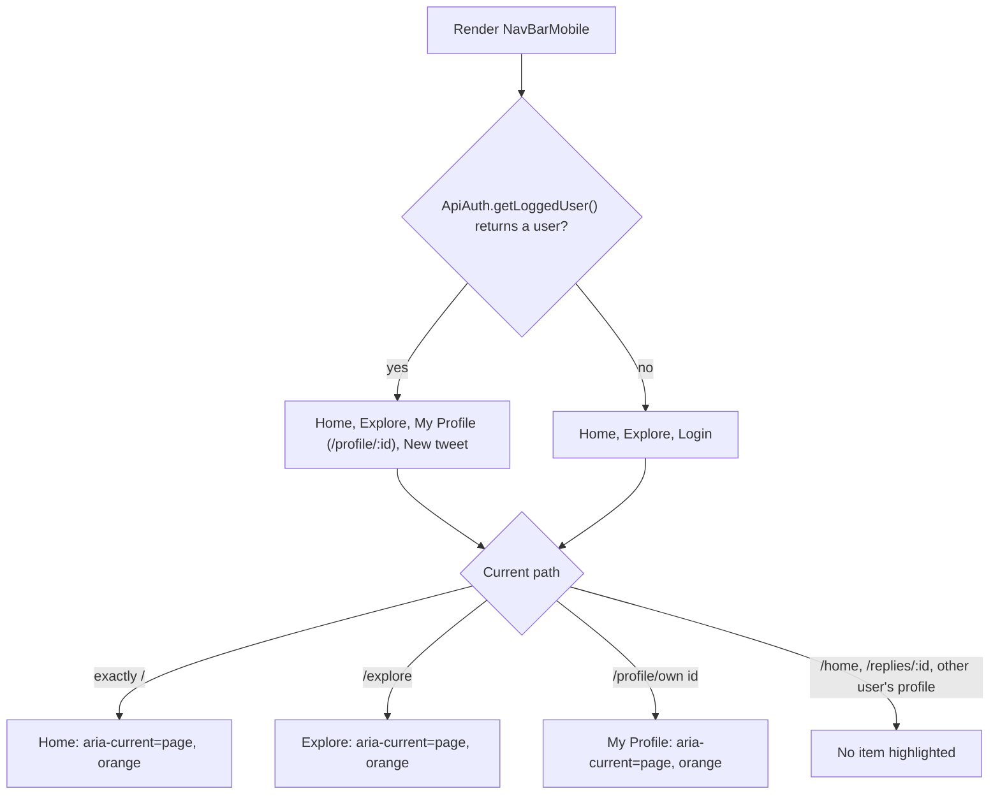
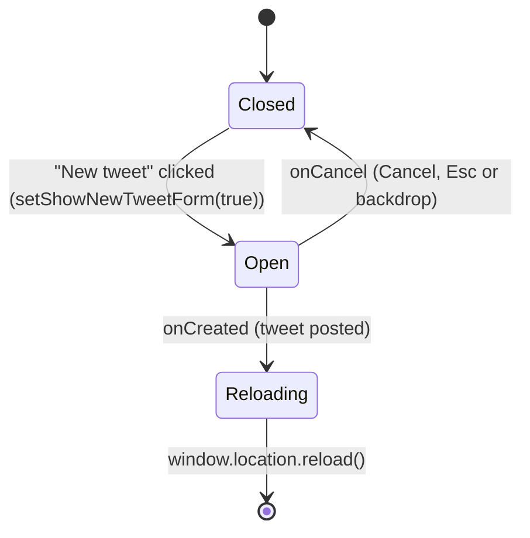

# S06 - Mobile bottom bar with Lucide icons, active state and safe-area padding

- **Plan:** [plan.md](plan.md)
- **Type:** Slice
- **Requirements covered:** FR-21, FR-08 (mobile), FR-09 (mobile items), FR-05 (mobile icons), FR-06
- **Prerequisites:** color tokens `--color-surface-0`, `--color-surface-hover`, `--color-border`, `--color-text`, `--color-text-secondary`, `--color-accent`; spacing `--space-4`; radius `--radius-pill`; typography `--font-size-xl`; motion `--duration-fast`, `--ease-out`; layout `--mobile-nav-height` (bar content height, excluding the safe area; full bar = `calc(var(--mobile-nav-height) + env(safe-area-inset-bottom))`); global `:focus-visible` ring and reduced-motion rule; `react-icons@^5.7.0` (`LuHouse`, `LuHash`, `LuUser`, `LuSquarePlus`, `LuLogIn` from `react-icons/lu`); `IconButton` (`src/components/ui/icon-button.tsx`); `TweetNewForm` (`replyId?`, `onCreated`, `onCancel`, used unchanged)
- **Creates:** none

## 1. Goal

Restyle `NavBarMobile` into a modern, accessible bottom bar. At widths of 600px or less:

- The bar shows the same items in the same order: Home, Explore, My Profile and New tweet when logged in; Home, Explore and Login when logged out.
- Items are evenly spaced across the bar, use Lucide icons, and are real controls: `NavLink`s for navigation and an `IconButton` for the new-tweet action, each 44×44px with an `aria-label`.
- The item matching the current route is orange with a heavier icon stroke and carries `aria-current="page"`.
- The bar has a `--color-border` top divider and is exactly `calc(var(--mobile-nav-height) + env(safe-area-inset-bottom))` tall, with the safe-area inset as bottom padding (iPhone home indicator).
- Click targets and behavior stay the same: `/`, `/explore`, `/profile/:id`, `/login`, and "+" opens the composer, which reloads the page after posting.

Above 600px the bar stays hidden, as it is today.

## 2. Context

- `src/components/nav-bar-mobile.tsx` today has clickable `div` items (`Item`) calling `navigate(...)`, icons from `react-icons/fa` (`FaHome`, `FaHashtag`, `FaRegUser`), `react-icons/bs` (`BsPlusSquare`) and `react-icons/sl` (`SlLogin`). It has no labels and no active state. `Wrapper` is `height: 3rem; padding: 1rem; gap: 2rem` with a `color-mix(...)` top border and `display: none` above 600px. The user comes synchronously from `ApiAuth.getLoggedUser()` on every render. `showNewTweetForm` state toggles `<TweetNewForm onCreated={() => window.location.reload()} onCancel={() => setShowNewTweetForm(false)} />`.
- `MainTemplatePage` renders the bar as the last child of a `100dvh` flex column (`VBox`, `overflow: hidden`). The layout's space reservation for the bar is not part of this file. This step's only obligation is that the bar's total height equals the `--mobile-nav-height` contract.
- `index.css` sets `box-sizing: border-box` globally, so `height` includes the border and padding.
- `react-router-dom@^6.21`: `NavLink` sets `aria-current="page"` on the matching link; `end` restricts `/` to an exact match; segment matching means `/profile/1` does not match `/profile/12`.
- `IconButton` is a `styled.button` with `type="button"` by default, a minimum size of 40×40px, `--color-text-secondary` icon, `--color-surface-hover` hover tint (neutral tone), 20px icons, a pressed scale and disabled states. `aria-label` is passed by convention.
- `TweetNewForm` renders a `Modal` portaled to `document.body`, so rendering it inside the bar does not place the dialog inside the bar's box.
- styled-components v6 (`import { styled, css } from "styled-components"`), transient `$` props. Lint fails on any warning (`react-refresh/only-export-components`): the file exports only `NavBarMobile`.
- Breakpoint convention: `@media (width <= 600px)` / `(width > 600px)`.
- No test suite: verification is lint, build and manual browser checks.

## 3. Structure

### 3.1 Files

| File | Change | Responsibility |
|------|--------|----------------|
| `src/components/nav-bar-mobile.tsx` | modify | Mobile bottom bar: nav links with active state, new-tweet action, composer toggle, bar sizing |

No other file changes.

### 3.2 Component: `src/components/nav-bar-mobile.tsx`

Imports after the change:

```tsx
import { styled, css } from "styled-components";
import { NavLink } from "react-router-dom";
import { useState } from "react";
import { LuHash, LuHouse, LuLogIn, LuSquarePlus, LuUser } from "react-icons/lu";
import { ApiAuth } from "../api/api-auth";
import { TweetNewForm } from "./tweet/tweet-new-form";
import { IconButton } from "./ui/icon-button";
```

Removed: `useNavigate`, and every `react-icons/fa`, `react-icons/sl` and `react-icons/bs` import.

Private constants (module level, not exported):

```ts
/** Tap target of every bar item; fits inside --mobile-nav-height (56px) with room to spare (FR-09, FR-21). */
const BAR_ITEM_SIZE = "44px";

/** Icon stroke of the item for the current route (Lucide default is 2), the "bolder weight" of FR-08. */
const ACTIVE_ICON_STROKE_WIDTH = 2.5;

/** Scale while a nav link is pressed; same strength as the shared IconButton. */
const NAV_ITEM_PRESSED_SCALE = 0.97;
```

Component (public signature unchanged: no props, named export):

```tsx
export function NavBarMobile()
{
    const [showNewTweetForm, setShowNewTweetForm] = useState(false);
    const userInfo = ApiAuth.getLoggedUser();

    return (
        <Wrapper aria-label="Mobile navigation">
            <NavItem to="/" end aria-label="Home"><LuHouse aria-hidden="true"/></NavItem>
            <NavItem to="/explore" aria-label="Explore"><LuHash aria-hidden="true"/></NavItem>

            {userInfo &&
                <NavItem to={`/profile/${userInfo.id}`} aria-label="My Profile"><LuUser aria-hidden="true"/></NavItem>
            }

            {userInfo &&
                <NewTweetButton aria-label="New tweet" onClick={() => setShowNewTweetForm(true)}>
                    <LuSquarePlus aria-hidden="true"/>
                </NewTweetButton>
            }

            {(userInfo == null) &&
                <NavItem to="/login" aria-label="Login"><LuLogIn aria-hidden="true"/></NavItem>
            }

            {showNewTweetForm &&
                <TweetNewForm
                    onCreated={() => window.location.reload()}
                    onCancel={() => setShowNewTweetForm(false)}
                />
            }
        </Wrapper>
    );
}
```

- The item order, the conditions (`userInfo` truthy / `userInfo == null`), the composer callbacks and the `TweetNewForm` props are kept exactly as today.
- `aria-label` texts: "Home", "Explore", "My Profile" (same wording as the desktop sidebar), "New tweet", "Login". Icons are decorative (`aria-hidden="true"`).
- `end` on the `/` link: Home is active only on `/` (not on `/home`, `/explore`, and so on).

### 3.3 Styles (bottom of the file)

| Name | Base | Responsibility |
|------|------|----------------|
| `Wrapper` | `styled.nav` | Bar container: sizing, safe area, divider, spacing, visibility |
| `barItemBox` | private `css` block | Shared box of every item: 44×44 circle, centered icon at 24px, resting color, hover tint on hover-capable devices |
| `NavItem` | `styled(NavLink)` | Navigation item with active-route style |
| `NewTweetButton` | `styled(IconButton)` | New-tweet action sized like the nav items |

**`Wrapper`**

```css
display: flex;
justify-content: space-around;      /* evenly spaced for 3 or 4 items */
align-items: center;
flex-shrink: 0;                     /* never squeezed by the flex column above it */
width: 100%;
height: calc(var(--mobile-nav-height) + env(safe-area-inset-bottom));
margin: 0;
padding: 0 var(--space-4) env(safe-area-inset-bottom);
background-color: var(--color-surface-0);
border-top: 1px solid var(--color-border);

@media (width > 600px) {
    display: none;
}
```

The `height` and the safe-area padding come from the token contract, so the bar is never taller than the space the layout reserves. With `border-box`, the 1px border and the bottom padding are inside that height, and the items center in the remaining 55px.

**`barItemBox`** (private, applied to both item kinds so they look identical):

```css
display: inline-flex;
align-items: center;
justify-content: center;
width: ${BAR_ITEM_SIZE};
height: ${BAR_ITEM_SIZE};
padding: 0;
border-radius: var(--radius-pill);
color: var(--color-text-secondary);
& svg { font-size: var(--font-size-xl); flex-shrink: 0; }   /* 24px icons */

@media (hover: hover) {
    &:hover:not(:disabled) {
        background-color: var(--color-surface-hover);
        color: var(--color-text);
    }
}
```

- `@media (hover: hover)` keeps the tint from sticking after a tap on touch screens. It still applies with a mouse, including in DevTools emulation with a mouse pointer.
- Focus: the global `:focus-visible` outline applies unchanged and follows the circular radius.

**`NavItem`** = `styled(NavLink)`:

```css
${barItemBox}
text-decoration: none;
transition: background-color var(--duration-fast) var(--ease-out),
            color var(--duration-fast) var(--ease-out),
            transform var(--duration-fast) var(--ease-out);

&:active { transform: scale(${NAV_ITEM_PRESSED_SCALE}); }

&[aria-current="page"],
&[aria-current="page"]:hover {
    color: var(--color-accent);
}
&[aria-current="page"] svg { stroke-width: ${ACTIVE_ICON_STROKE_WIDTH}; }
```

- The active style targets `[aria-current="page"]`, which `NavLink` sets itself, so the visual and accessible states share one source. The hover background tint still applies to the active item, and the icon stays orange.
- `stroke-width` in CSS overrides the `stroke-width="2"` presentation attribute on Lucide SVGs.

**`NewTweetButton`** = `styled(IconButton)`:

```css
${barItemBox}

@media (hover: none) {
    &:hover:not(:disabled) {
        background-color: transparent;
        color: var(--color-text-secondary);
    }
}
```

- It keeps everything else from `IconButton`: `type="button"`, pressed scale, disabled state, transition and the neutral tone. `barItemBox` aligns its size (44px instead of the 40px minimum), icon size, padding and resting color with the nav items. It is never active (`$active` not used).
- `IconButton`'s neutral hover rule (`&:hover:not(:disabled)`) has no hover-capability guard. The `@media (hover: none)` override cancels it on touch screens, so the "+" behaves like the nav items. It uses the same selector specificity, and the extension's rules are injected after the base component's, so the override wins.
- Reduced motion is handled by the global rule; no media query here.

## 4. Logic flows

Which items render depends only on the logged user; which item is highlighted depends only on the current location (computed by `NavLink`). The "+" button only toggles local state.





The composer state machine is unchanged from today; only the trigger became a semantic button.

## 5. Edge cases and errors

| Case | Expected behavior |
|------|-------------------|
| Logged out | Home, Explore, Login (in that order); no profile or "+" item. |
| Logged in, on my profile `/profile/<my id>` | My Profile is orange with `aria-current="page"`. |
| On another user's profile or on `/replies/:id` | No item highlighted. |
| On `/home` | Home is not highlighted (`end` on `/`). |
| My id is `1` and the URL is `/profile/12` | My Profile is not highlighted (segment matching). |
| Tapping the already-active item | Client-side navigation to the same route; no reload, no request. |
| Width above 600px | Bar hidden (`display: none`), so its items are not focusable. |
| Device without a home indicator / browser without safe-area support | `env(safe-area-inset-bottom)` resolves to 0; the bar is exactly `--mobile-nav-height` tall. |
| iPhone with home indicator (inset > 0) | Bar grows by the inset; items stay centered in the top 56px, above the indicator. |
| Touch device after a tap | No lingering hover tint on any item: nav links get the tint only under `@media (hover: hover)`, and `NewTweetButton` cancels `IconButton`'s unguarded hover under `@media (hover: none)`. The active orange color shows the new route. |
| Keyboard Tab | Each item shows the orange focus ring; links activate with Enter, the "+" button with Enter or Space. |
| Composer open, then Cancel / Esc / backdrop | Composer closes; bar unchanged. |
| Tweet posted from the composer | Full page reload, as today. |
| Reduced motion enabled | Pressed scale and color changes are instant (global rule). |

## 6. Tests

The project has no automated test suite and this step adds none.

### 6.1 Automated

| Check | Given / When / Then | Proves |
|-------|---------------------|--------|
| `npm run lint` | Given the modified file, when linting, then 0 errors and 0 warnings (no unused `useNavigate`). | Build criteria |
| `npm run build` | Given the modified file, when running `tsc && vite build`, then it succeeds (`styled(NavLink)`, `styled(IconButton)`, Lucide imports type-check). | Build criteria, FR-05 (names exist in 5.7.0) |

### 6.2 Manual

Run `npm run dev`; DevTools device emulation 375×812 unless stated.

- Given logged in, when opening `/`, `/explore` and my profile in turn, then exactly the matching icon is orange with a heavier stroke and its element has `aria-current="page"`; on `/replies/<id>`, on `/home` and on another user's profile, no icon is orange. (FR-08 mobile, FR-21)
- Given logged in, then the bar shows Home, Explore, My Profile and "+" in that order, evenly spaced across the width, with a thin top divider. Given logged out, then it shows Home, Explore and Login in that order. (FR-21)
- Given the bar, when inspecting each item in DevTools, then each box is 44×44px and round, has an `aria-label` ("Home", "Explore", "My Profile", "New tweet" or "Login"), nav items are `<a>` elements and "+" is `<button type="button">`. (FR-09)
- Given the bar, when inspecting `Wrapper`, then its computed height is 56px (inset 0 in emulation) and `padding-bottom` resolves from `env(safe-area-inset-bottom)` in the Styles pane. (FR-21 safe area, contract)
- Given keyboard only (desktop browser at 375px width), when tabbing through the bar, then each item shows the 2px orange focus ring; Enter on a link navigates; Enter or Space on "+" opens the composer. (FR-06, FR-09)
- Given a mouse in emulation, when hovering an item, then it gets the subtle circular hover tint and white icon; when pressing, it shrinks slightly. (FR-06)
- Given touch emulation (DevTools mobile preset, touch pointer), when tapping "+" and then cancelling the composer, and when tapping a nav link, then neither the "+" nor the tapped link keeps a hover tint. (FR-06, FR-21)
- Given logged out, when tapping Login, then `/login` opens. Given logged in, when tapping My Profile, then `/profile/<my id>` opens. (FR-09 same targets)
- Given width 800px and 1280px, then the bar is hidden as before. (Layout unchanged)
- Given an iPhone (or Safari with a device that has a home indicator), when viewing the feed, then the icons sit above the home indicator. (FR-21 safe area; best effort if no device is available)
- Parity: given logged in on mobile, when tapping "+", then the composer opens; when posting, then Network shows the same single create `POST` followed by a full page reload. Navigating with the bar issues no request other than what the destination page already fires. (Backend parity)

### 6.3 Static checks

- `grep -nE "react-icons/(fa|sl|bs)" src/components/nav-bar-mobile.tsx` → no output. (FR-05)
- `grep -n "react-icons/" src/components/nav-bar-mobile.tsx` → only `react-icons/lu`. (FR-05)
- `grep -c "aria-label=" src/components/nav-bar-mobile.tsx` → `6` (bar landmark + 5 items). (FR-09)
- `grep -nE "useNavigate|styled\.div" src/components/nav-bar-mobile.tsx` → no output (no clickable divs left). (FR-09)
- `grep -nE "#[0-9a-fA-F]{3,8}\b|rgba?\(|hsla?\(|color-mix|var\(--color-[0-9]|var\(--color-(bg|fg)-" src/components/nav-bar-mobile.tsx` → no output (only new tokens).
- `grep -n "mobile-nav-height" src/components/nav-bar-mobile.tsx` → one match in `Wrapper`'s `height`.
- `git status --porcelain -- src` → only `src/components/nav-bar-mobile.tsx` modified.

## 7. Implementation order

1. Swap the imports to Lucide icons and `NavLink`/`IconButton`; replace the `Item` divs with `NavItem` links and the `NewTweetButton`, with `aria-label`s; remove `useNavigate`. Lint + build.
2. Rewrite the styles: `Wrapper` sizing with the token and safe area, `barItemBox`, `NavItem` active style, `NewTweetButton`. Lint + build.
3. Manual checks at 375×812, 800 and 1280px; static checks.

## 8. Out of scope

- Changes only `src/components/nav-bar-mobile.tsx`. Does not touch the layout's space reservation, the desktop sidebar, `TweetNewForm`/`Modal`, `IconButton`, global CSS, `index.html` or tokens.
- Does not add, remove or reorder items, change targets, add text labels under icons, or add a `/home` highlight.
- No API changes; no new dependencies.

## 9. Design notes

- **Semantic controls (FR-09):** navigation uses `NavLink` (real `<a href>`, works with middle-click and screen readers) and the action uses the shared `IconButton`. Rejected: `IconButton as={NavLink}`, because `IconButton`'s `.attrs` would put `type="button"` on an anchor.
- **One box for both item kinds (DRY):** the private `barItemBox` css block gives links and the button the same 44px circle, icon size and hover. The shared `control-styles.ts` constants are internal to `ui/`, so the bar keeps its own named constants. 44px (rather than the 40px minimum) suits a touch-only bar and fits inside the 56px content height.
- **Active state via `[aria-current="page"]`:** `NavLink` sets it, so the visual and accessible states cannot diverge. The "bolder weight" of FR-08 for icon-only items is a heavier stroke (2.5 instead of 2), since there is no label to bold.
- **Height from the contract:** `height: calc(var(--mobile-nav-height) + env(safe-area-inset-bottom))` with the inset as bottom padding and `flex-shrink: 0`. The bar is never taller than the reserved space and never shrinks in the `100dvh` column.
- **`<nav aria-label="Mobile navigation">`** makes the bar a landmark. It is hidden above 600px, so it never duplicates the desktop navigation landmark in the accessibility tree.
- **Hover only on hover-capable devices:** avoids the sticky tint after a tap on phones, so the active route color stays the only highlight. Nav links add the tint only under `@media (hover: hover)`. The "+" inherits `IconButton`'s unguarded hover, so `NewTweetButton` resets it under `@media (hover: none)` locally rather than changing the shared primitive.
- **`end` on the Home link:** Home is active only on `/`, so it is not lit on every route and `/home` gets no highlight.
