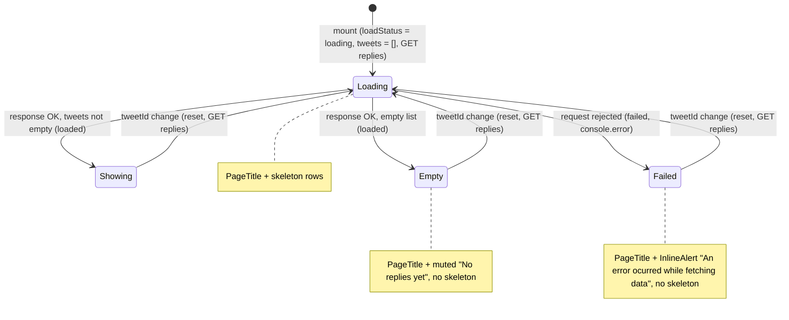

# S07 - Main layout, central-column titles, Explore page and replies inline error

- **Plan:** [plan.md](plan.md)
- **Type:** Slice
- **Requirements covered:** FR-15, FR-12 (replies page), FR-03 (type scale on these pages)
- **Prerequisites:** color tokens `--color-surface-0`, `--color-surface-hover`, `--color-border`, `--color-text`, `--color-text-muted`; typography tokens `--font-size-xs`, `--font-size-sm`, `--font-weight-semibold`, `--line-height-tight`, `--line-height-base`; spacing `--space-1`, `--space-3`, `--space-4`, `--space-5`; motion `--duration-fast`, `--ease-out`; layout token `--mobile-nav-height` (full mobile bar = `calc(var(--mobile-nav-height) + env(safe-area-inset-bottom))`); `PageTitle` (`src/components/ui/page-title.tsx`); `InlineAlert` (`src/components/ui/inline-alert.tsx`, default variant `"danger"`, accepts `className`)
- **Creates:** none

## 1. Goal

The 3-column shell and the simple central-column pages use the dark theme and the type scale, and the replies page no longer uses `alert()`. When done:

- `MainTemplatePage` keeps NavBar | central column | News with the same 1024px and 600px breakpoints. Its background and text come from the semantic tokens, the central column's side dividers use `--color-border`, and at ≤ 600px the content area reserves exactly the mobile bar's full height (`--mobile-nav-height` + safe-area inset), so nothing sits under the bar.
- Feed (`/`, `/home`), Explore (`/explore`) and Replies (`/replies/:tweetId`) start with the shared sticky `PageTitle` (texts unchanged: "Home", "Explore" + "(static demo page)", "Home").
- Explore's 5 static items use the type scale (13px muted meta, 15px semibold headline), `--color-border` row dividers and a subtle hover tint.
- If loading replies fails, the central column shows an inline danger banner "An error ocurred while fetching data" (below the title) instead of a browser alert, and the endless skeleton stops. If replies load successfully but the list is empty, a muted "No replies yet" message shows instead of the skeleton.
- The requests are unchanged: feed and replies each fire the same `GET` as before.

## 2. Context

- `src/pages/main-template-page.tsx`: `VBox` (column flex, `100vw` × `100dvh`, `overflow: hidden`, `background-color: var(--color-bg-2)`, `color: var(--color-fg-2)`) contains `HBox` (row flex, `flex-grow: 1`, `max-height: 100%`; at ≤ 600px `max-height: calc(100% - 3rem)`, the old bar height) and `NavBarMobile`. `HBox` holds `NavBar`, `CentralWidget` and `News`. `CentralWidget` is the scrolling element (`overflow-y: auto`), `width: 50%; max-width: 600px`, side borders `color-mix(in srgb, var(--color-3) 30%, transparent)`; at ≤ 1024px it grows (`flex-grow: 1; max-width: none`), at ≤ 600px it loses its borders. NavBar hides itself at ≤ 600px and News at ≤ 1024px (in their own files).
- `feed-page.tsx`, `explore-page.tsx`, `replies-page.tsx` each define a private `Tittle` (`styled.header`, `1rem` padding, `1.2rem` bold). Explore's `Tittle` also has a 30%-white bottom border and a `small` at `0.7rem`; its `Item` uses `0.7rem` meta at 50% white and a `0.8rem` bold headline.
- `replies-page.tsx`: `useEffect([tweetId])` calls `new ApiTweet().replies(parseInt(tweetId))`; on success `setTweets(response.data.data)`; on failure `alert('An error ocurred while fetching data')` and `console.error(error)`. `TweetList` gets `loading={tweets.length === 0}`, so after a failure the skeleton shows forever. `setTweetDisplayProps` sets `canNavigateDown`/`canNavigateUp` per index.
- `TweetList` (not changed here) renders three `TweetDisplayLoading` rows while `loading`, otherwise the rows.
- Conventions: styled-components at the bottom of each file with `import { styled } from "styled-components"`; breakpoints written as `@media (width <= 600px)`; ESLint `react-refresh/only-export-components` (pages export only their component; private constants are fine); `eslint-plugin-react-hooks` 4.x; TypeScript strict with `noUnusedLocals`. No test suite.

## 3. Structure

### 3.1 Files

| File | Change | Responsibility |
|------|--------|----------------|
| `src/pages/main-template-page.tsx` | modify (styles only) | Themed 3-column shell, mobile bar space reservation |
| `src/pages/feed-page.tsx` | modify | Use `PageTitle` |
| `src/pages/explore-page.tsx` | modify | Use `PageTitle`; themed static items |
| `src/pages/replies-page.tsx` | modify | Use `PageTitle`; inline fetch-error state instead of `alert()` |

No other file changes. Markup of `MainTemplatePage` (the `VBox` / `HBox` / `NavBar` / `CentralWidget` / `Outlet` / `News` / `NavBarMobile` tree) stays as is.

### 3.2 Layout styles: `src/pages/main-template-page.tsx`

Only the styled-components at the bottom change; the component function is untouched.

- **`VBox`:** replace `background-color: var(--color-bg-2); color: var(--color-fg-2);` with `background-color: var(--color-surface-0); color: var(--color-text);`. All other rules stay.
- **`HBox`:** add `min-height: 0;` (lets the flex child shrink so the central column, not the page, scrolls). Replace the ≤ 600px rule with:

  ```css
  @media (width <= 600px) {
      max-height: calc(100% - (var(--mobile-nav-height) + env(safe-area-inset-bottom)));
  }
  ```

  This is exactly the full bar height defined by the `--mobile-nav-height` contract; the `3rem` literal goes away.
- **`CentralWidget`:** replace the `color-mix(...)` border with `border: 1px solid var(--color-border);` keeping `border-width: 0 1px 0 1px;`. Breakpoint rules (≤ 1024px grow, ≤ 600px `border: none`) and `overflow` rules stay.

### 3.3 Feed page: `src/pages/feed-page.tsx`

- Import `PageTitle` from `"../components/ui/page-title"`.
- Render `<PageTitle>Home</PageTitle>` in place of `<Tittle>Home</Tittle>`.
- Delete the `Tittle` styled-component and the now-unused `styled` import.
- Data loading (`useEffect`, `ApiTweet.all()`, `TweetList` props) is unchanged.

### 3.4 Explore page: `src/pages/explore-page.tsx`

- Import `PageTitle`; render `<PageTitle>Explore <small>(static demo page)</small></PageTitle>` in place of `Tittle` (`PageTitle` styles the `small` as a muted 13px subtitle line). Delete `Tittle`.
- Keep the 5 `Item`s with their exact texts and order. Restyle `Item` (still `styled.div` with `header` + `p` children):

  ```css
  padding: var(--space-3) var(--space-4);
  margin: 0;
  border-bottom: 1px solid var(--color-border);
  transition: background-color var(--duration-fast) var(--ease-out);

  &:hover { background-color: var(--color-surface-hover); }

  & > header {
      margin: 0 0 var(--space-1) 0;
      padding: 0;
      font-size: var(--font-size-xs);
      line-height: var(--line-height-tight);
      color: var(--color-text-muted);
  }

  & > p {
      margin: 0;
      padding: 0;
      font-size: var(--font-size-sm);
      font-weight: var(--font-weight-semibold);
      line-height: var(--line-height-base);
      color: var(--color-text);
  }
  ```

- Items stay non-interactive (no link, no `cursor: pointer`): the hover tint is visual feedback only, as the plan asks; no content or behavior is added.

### 3.5 Replies page: `src/pages/replies-page.tsx`

```tsx
import { PageTitle } from "../components/ui/page-title";
import { InlineAlert } from "../components/ui/inline-alert";

/** Where the replies request stands for the current tweetId. */
type RepliesLoadStatus = "loading" | "loaded" | "failed";

/** Same text as the former alert(); kept verbatim (FR-12). */
const FETCH_ERROR_MESSAGE = "An error ocurred while fetching data";
const EMPTY_REPLIES_MESSAGE = "No replies yet";

export function RepliesPage()
{
    const { tweetId = "0" } = useParams();
    const [tweets, setTweets] = useState<TweetDisplayInfo[]>([]);
    const [loadStatus, setLoadStatus] = useState<RepliesLoadStatus>("loading");

    useEffect(() => {
        const tweetIdInt = parseInt(tweetId);

        setLoadStatus("loading");
        setTweets([]);
        (new ApiTweet()).replies(tweetIdInt)
            .then((response) => {
                setTweets(response.data.data);
                setLoadStatus("loaded");
            })
            .catch((error) => {
                setLoadStatus("failed");
                console.error(error);
            });
    }, [tweetId]);

    // setTweetDisplayProps unchanged

    function renderContent()
    {
        if (loadStatus === "failed")
            return <FetchErrorAlert>{FETCH_ERROR_MESSAGE}</FetchErrorAlert>;

        if (loadStatus === "loaded" && tweets.length === 0)
            return <EmptyMessage>{EMPTY_REPLIES_MESSAGE}</EmptyMessage>;

        return (
            <TweetList
                tweets={tweets}
                loading={loadStatus === "loading"}
                beforeRenderDisplay={setTweetDisplayProps}
            />
        );
    }

    return (
        <>
            <PageTitle>Home</PageTitle>
            {renderContent()}
        </>
    );
}

const FetchErrorAlert = styled(InlineAlert)`
    margin: var(--space-4);
`;

const EmptyMessage = styled.p`
    margin: 0;
    padding: var(--space-5) var(--space-4);
    text-align: center;
    font-size: var(--font-size-sm);
    line-height: var(--line-height-base);
    color: var(--color-text-muted);
`;
```

- **State:** `loadStatus: RepliesLoadStatus` (private, non-exported type; default `"loading"`) replaces the old implicit "loading = no tweets" rule. `tweets` stays as is.
- **Reset on each fetch:** the effect sets `loadStatus` to `"loading"` and `tweets` to `[]` before the request. React Router keeps the same `RepliesPage` instance when only `:tweetId` changes, so without the reset the previous page's rows, error or empty message would show at once. With it, every `tweetId` change shows the skeleton until the new response arrives.
- **Success:** `setTweets(...)` then `setLoadStatus("loaded")`. Both run in the same promise callback, and React 18 batches them into one render, so there is no frame with `"loaded"` and an empty list before the rows arrive.
- **Rendering (`renderContent`, private to the component), first match wins:**
  1. `"failed"`: the danger banner `FETCH_ERROR_MESSAGE`; no list, no skeleton (the plan's "stop showing skeletons once an error is set").
  2. `"loaded"` with `tweets.length === 0`: the muted `EMPTY_REPLIES_MESSAGE` "No replies yet" instead of the skeleton.
  3. Otherwise `TweetList` with `loading={loadStatus === "loading"}`: the skeleton while loading, the rows once loaded. `TweetList`'s existing props are used as they are.
- `alert(...)` is removed; `console.error(error)` stays.
- `InlineAlert` keeps its default `"danger"` variant and `role="alert"`, so screen readers announce the error when it appears. `EmptyMessage` is a plain `<p>` (an informational state, not an alert).
- `FETCH_ERROR_MESSAGE`, `EMPTY_REPLIES_MESSAGE` and `RepliesLoadStatus` are private module members, which the lint rule allows. Delete the old `Tittle` styled-component; `styled` stays imported for `FetchErrorAlert` and `EmptyMessage`.
- The page title text stays "Home" (current copy).

## 4. Logic flows

Replies page loading: the request is the same `GET` as before. Only the local outcome changes: a failure shows an inline banner instead of a browser alert, and an empty successful response shows "No replies yet" instead of an endless skeleton. `Showing` and `Empty` are both `loadStatus = "loaded"`, told apart by `tweets.length`.



## 5. Edge cases and errors

| Case | Expected behavior |
|------|-------------------|
| Replies request fails (network error, backend down, 4xx/5xx other than 401) | Danger `InlineAlert` "An error ocurred while fetching data" under the "Home" title; no browser alert; no skeleton; error logged with `console.error`. |
| Replies request returns 401 | Unchanged: the API layer clears storage and hard-redirects to `/login` (the banner may flash before the redirect). |
| Navigating from a failed or empty replies page to another `/replies/:id` (e.g. browser back/forward) | `loadStatus` resets to `"loading"` and `tweets` to `[]`; the skeleton shows, then the new rows, "No replies yet" or a new error. Tweets loaded on an earlier `tweetId` never reappear. |
| Navigating from a loaded replies page to another `/replies/:id` (e.g. "show replies" on a row) | `tweets` reset, skeleton shows instead of the previous rows, then the new rows. |
| Replies request succeeds with an empty list | Muted centered "No replies yet" under the title; no skeleton (user decision). |
| Replies request succeeds with only one tweet | That row renders as usual (no empty message): the message is for an empty list only. |
| Request still pending | Skeleton rows, as today. |
| Feed request fails | Unchanged behavior (no catch today; skeleton stays). Not in this step's scope. |
| Very long central-column content | `CentralWidget` scrolls; `PageTitle` stays stuck at its top with an opaque background. |
| Width ≤ 600px | NavBar hidden, central column full width without side borders, content area ends exactly where the bottom bar (incl. safe-area inset) begins; last row fully visible when scrolled to the end. |
| Width 601-1024px | News hidden, central column grows, side dividers in `--color-border`. |
| Width > 1024px | All 3 columns; central column `50%` capped at 600px. |
| Device with a non-zero bottom safe-area inset | Reservation grows by the same inset as the bar. |
| Hover on an Explore item with reduced motion | Tint appears instantly (global reduced-motion rule). |
| Touch device tapping an Explore item | At most a sticky hover tint; nothing else happens (items are not interactive). |

## 6. Tests

The project has no automated test suite and this step adds none (RFF decision 11).

### 6.1 Automated

| Check | Given / When / Then | Proves |
|-------|---------------------|--------|
| `npm run lint` | Given the changes, when linting, then 0 errors and 0 warnings. | Build criteria |
| `npm run build` | Given the changes, when running `tsc && vite build`, then it succeeds (no unused `styled` import left in `feed-page.tsx`). | Build criteria |

### 6.2 Manual

Run `npm run dev` with the backend running, logged in, unless stated.

- Given widths 1280, 800 and 375px (DevTools device emulation for 375×812), when opening `/` and comparing with the pre-revamp app, then the same columns show/hide at the same breakpoints (3 columns > 1024px, News hidden at 800px, NavBar hidden and bottom bar shown at 375px), the background is the dark surface, and the central column has subtle dark-gray side dividers at 1280 and 800px and none at 375px. (FR-15)
- Given 375px on a long feed, when scrolling the central column to the end, then the last tweet row is fully visible above the bottom bar and nothing overlaps the bar; DevTools shows the `HBox` bottom edge equal to the bar's top edge. (FR-15, `--mobile-nav-height` contract)
- Given `/`, `/explore` and `/replies/<existing id>`, when scrolling the central column, then the title ("Home", "Explore" with the muted "(static demo page)" subtitle, "Home") stays stuck at the top with an opaque background and a bottom divider, and rows scroll under it. (FR-03, FR-15)
- Given `/explore` at 1280px, then the 5 items keep their texts and order, each meta line is 13px muted gray, each headline 15px semibold white (DevTools → Computed), no text is smaller than 13px, items are separated by dark-gray dividers, and hovering an item shows a subtle background tint. (FR-03)
- Given `/replies/999999` or the backend stopped while logged in, when the page loads and the request fails, then the inline danger banner "An error ocurred while fetching data" (red left border, alert icon) appears under the "Home" title, no browser alert appears, the skeleton is gone, and the console shows the logged error. (FR-12)
- Given a replies request that succeeds with an empty list (for example, in DevTools → Network, right-click the `GET /tweet/replies/<id>` request → "Override content" with `{"success":true,"message":"","data":[]}`, then reload), when the response arrives, then the skeleton goes away and a muted, centered "No replies yet" shows under the "Home" title; no error banner. (User decision: empty state)
- Given the empty replies page, when navigating to a replies URL that has tweets (browser Back/Forward or typing the URL), then the skeleton shows, then the rows; "No replies yet" is gone.
- Given `/replies/<existing id>` loaded, then `/replies/999999` failed, when pressing browser Back (DevTools throttling "Slow 3G" helps you see the skeleton), then the error banner is gone, the skeleton appears (not the old rows) and then the tweets.
- Given `/replies/<id A>` loaded, when clicking "show replies" on a row to go to `/replies/<id B>`, then the skeleton replaces the rows of A until B's rows arrive.
- Given `/replies/<existing id>`, then the first row offers "show replied" and the following rows "show replies", as before. (Regression)
- Given the Network tab, when loading `/` and `/replies/<id>`, then the same `GET` requests fire as before the change (endpoint, method, count). (Backend parity)

### 6.3 Static checks

- `grep -n "alert(" src/pages/replies-page.tsx` → no output. (FR-12)
- `grep -n "An error ocurred while fetching data" src/pages/replies-page.tsx` → one match (text kept verbatim). (FR-12)
- `grep -n "No replies yet" src/pages/replies-page.tsx` → one match.
- `grep -n "Tittle" src/pages/feed-page.tsx src/pages/explore-page.tsx src/pages/replies-page.tsx` → no output.
- `grep -n "PageTitle" src/pages/feed-page.tsx src/pages/explore-page.tsx src/pages/replies-page.tsx` → an import and a usage in each file.
- `grep -nE "color-mix|--color-3|--color-bg-|--color-fg-|rem\b" src/pages/main-template-page.tsx src/pages/explore-page.tsx src/pages/feed-page.tsx src/pages/replies-page.tsx` → no output (only semantic tokens, no `rem` literals).
- `grep -n "mobile-nav-height" src/pages/main-template-page.tsx` → one match.
- `git diff --stat -- src` → only the four page files listed in 3.1.

## 7. Implementation order

1. `main-template-page.tsx` styles (tokens, `--color-border` dividers, mobile reservation); check the 3 widths.
2. `feed-page.tsx` → `PageTitle`; lint + build.
3. `explore-page.tsx` → `PageTitle` and `Item` restyle; check `/explore`.
4. `replies-page.tsx` → `PageTitle`, `loadStatus` state, `FetchErrorAlert` and `EmptyMessage`; check the loading, success, empty and error paths.
5. `npm run lint`, `npm run build`, static checks, remaining manual checks.

## 8. Out of scope

- Does not change `NavBar`, `NavBarMobile`, `News`, `TweetList`, `TweetDisplay`, skeletons, the profile page or any auth page.
- Does not change routes, the layout markup tree, breakpoint values, `src/api/**`, `App.tsx` or global CSS (`src/app-style.css`, `index.html`, `index.css`).
- Does not add an empty state for the feed (only the replies page gets one), error handling for the feed fetch, or real Explore content; all copy stays verbatim (including "Home" on the replies page and "ocurred").
- Does not make Explore items clickable.

## 9. Design notes

- **Reuse over local styles (DRY):** the three copies of `Tittle` are replaced by the shared `PageTitle`; the replies banner is the shared `InlineAlert` with only a spacing wrapper (`styled(InlineAlert)` via its `className`).
- **Inline banner, not a toast:** the plan picks the inline variant; it explains why the column is empty and stays visible, while a toast would vanish and leave a blank page.
- **Empty state (user decision):** an empty successful response shows a muted "No replies yet" instead of the endless skeleton. This needs to tell "still loading" apart from "loaded, nothing", which `tweets.length === 0` alone cannot do. So the page tracks a `loadStatus` union (`"loading" | "loaded" | "failed"`). It replaces a separate `fetchFailed` boolean, because one value cannot be both failed and loaded, and the three render branches follow it directly. It stays inside the page: `TweetList` is used through its existing `loading` prop and is not changed. Rejected: a second boolean `fetchCompleted` next to `fetchFailed`, which allows impossible combinations.
- **Constant messages** rather than storing message strings in state: the texts are fixed, so each constant is the single source and the state only says which one to show.
- **Reset on `tweetId` change:** resetting `loadStatus` and `tweets` (`setTweets([])`) at the start of each fetch avoids a stale error or stale rows on the next replies page. React Router reuses the `RepliesPage` instance across `:tweetId` changes, so state would otherwise carry over. This is a local-only change: the request stays the same. The skeleton now also shows when going from one loaded replies page to another, where before the old rows stayed until the new ones arrived. Rejected: an "ignore stale response" cleanup flag, since the page never had one and races are not part of this step's requirements (YAGNI).
- **Mobile reservation from the contract:** `calc(100% - (var(--mobile-nav-height) + env(safe-area-inset-bottom)))` mirrors the bar's full height formula, so bar and layout cannot drift. `min-height: 0` on `HBox` is the standard flex fix that keeps scrolling inside `CentralWidget`.
- **Explore subtitle:** `PageTitle` renders the `small` as a block subtitle line under "Explore" (previously inline next to it). Same element and text, shown in the shared title style; approved by the user ("own line"), for consistency with the shared primitive.
- **Explore headline weight:** semibold (600) instead of bold, matching the type scale's headline weight; items get row dividers and padding instead of margins so the hover tint fills the row.
