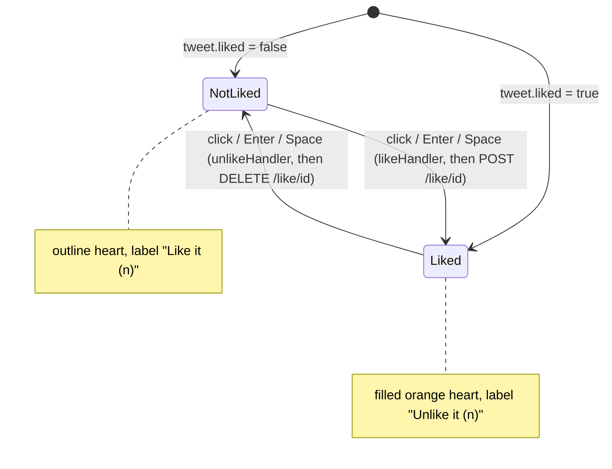
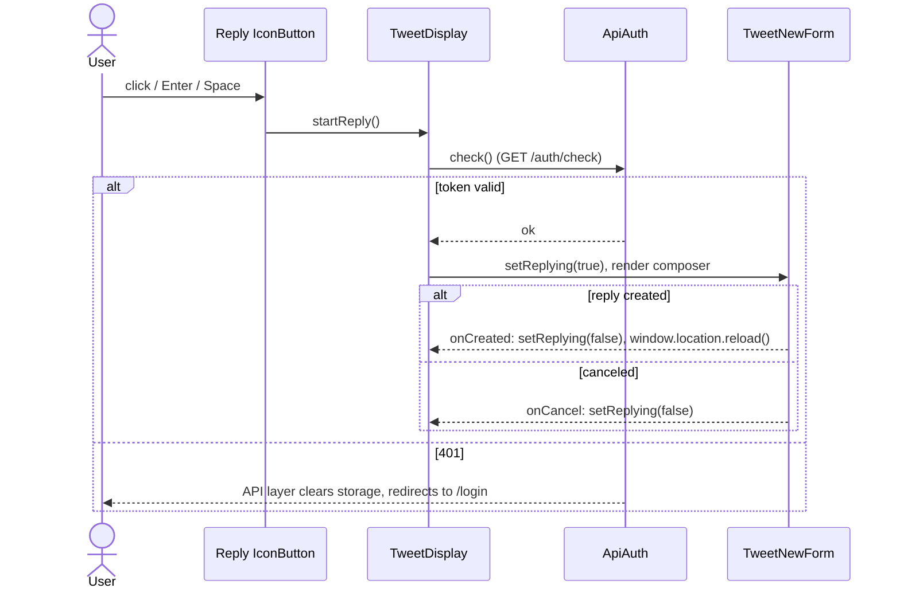

# S08 - Tweet row restyle with accessible icon actions and themed skeleton

- **Plan:** [plan.md](plan.md)
- **Type:** Slice
- **Requirements covered:** FR-17, FR-09 (@username, like, reply, show-replies, show-replied), FR-05 (like, reply, show replies, show replied), FR-14 (`TweetDisplayLoading`), FR-06, FR-03 (type scale in the tweet row), FR-04 (skeleton shimmer respects reduced motion)
- **Prerequisites:** color tokens `--color-surface-2`, `--color-surface-hover`, `--color-border`, `--color-text`, `--color-text-secondary`, `--color-text-muted`; typography tokens `--font-size-sm`, `--font-weight-bold`, `--line-height-tight`, `--line-height-base`; spacing `--space-1`, `--space-2`, `--space-3`, `--space-4`; radius `--radius-sm`; motion `--duration-fast`, `--ease-out`; global `:focus-visible` ring; `react-icons@^5.7.0` (`LuHeart`, `LuMessageCircle`, `LuArrowDownToLine`, `LuArrowUpToLine` from `react-icons/lu`); `IconButton` (`src/components/ui/icon-button.tsx`, transient props `$tone`, `$active`, `type="button"` by default); `readThemeColor(token)` (`src/components/ui/theme-color.ts`); `TweetNewForm` (`replyId?`, `onCreated`, `onCancel`, props unchanged)
- **Creates:** none

## 1. Goal

Restyle the tweet row and its loading skeleton so they read clearly on the dark theme and are fully usable from the keyboard, with the same handlers, requests and navigation as today.

When done:

- Each tweet row shows avatar | header (bold name, muted `@handle` as a real link to `/profile/:id`, muted `•` and relative time), the content at 15px with a 1.5 line height, and a footer of circular icon buttons: like (outline heart, filled orange when liked, with count), reply (with count), show replies, show replied tweet. The same conditions as today decide which of the last two show.
- Rows have a subtle hover background and `--color-border` dividers between them.
- `@handle`, like, reply, show replies and show replied are reachable with Tab, show the orange focus ring and activate with Enter (and Space for buttons). Each icon button has an accessible name.
- All icons come from `react-icons/lu`; the `hi2` and `io` imports are gone.
- While loading, the skeleton rows use the theme's surface colors (dark gray shapes, no white or light-gray blocks), still fading row by row, and stop shimmering under `prefers-reduced-motion: reduce`.

## 2. Context

- `src/components/tweet/tweet-display.tsx` exports `TweetDisplayProps` (`tweet`, `canNavigateDown?`, `canNavigateUp?`) and `TweetDisplay`. It also has a private `relativeTimeString(dateStr)` (not exported, so the lint rule is satisfied). State: `liked`, `totalLikes`, `replying`. Handlers: `likeHandler` (optimistic `setLiked(true)`, `setTotalLikes(totalLikes + 1)`, then `ApiTweet.like`), `unlikeHandler` (mirror, `ApiTweet.unlike`), `startReply` (`await new ApiAuth().check()` then `setReplying(true)`), `replyCanceled`, `replyCreated` (`window.location.reload()`), `openReplies(id)` (`navigate(/replies/:id)`). The `@username` is a `span` with `onClick` → `navigate(/profile/:id)`; the actions are `onClick`s on SVGs from `react-icons/io` (`IoIosHeart`, `IoMdHeartEmpty`), `react-icons/hi2` (`HiOutlineChatBubbleLeft`) and `react-icons/lu` (`LuArrowDownToLine`, `LuArrowUpToLine`), each with a `title`. The avatar `img` has no `alt`. Styles use `color-mix(... var(--color-3) ...)` borders/text and rem sizes (`font-size: 0.8rem`).
- `src/components/tweet/tweet-display-loading.tsx` exports `TweetDisplayLoadingProps` (`opacity?: number`, default `0.3`) and `TweetDisplayLoading`, a `react-content-loader` `ContentLoader` (400×60 viewBox) with `backgroundColor = rgba(255,255,255,opacity)` and `foregroundColor = rgba(255,255,255,opacity + 0.3)`, inside a `Wrapper` with a top border.
- `src/components/tweet/tweet-list.tsx` renders three `TweetDisplayLoading` (opacity `0.5`, `0.2`, `0.1`) while `loading`, otherwise a `TweetDisplay` per tweet (with the optional `beforeRenderDisplay` hook). Consumers (`feed-page`, `profile-page`, `replies-page`) use `TweetList` and `TweetDisplayProps` only; neither changes here. `TweetDisplayLoading` is used only by `TweetList`.
- `react-content-loader` writes the colors into SVG `stop-color` attributes (where `var(--…)` does not resolve) and animates with SMIL `<animate>`, which CSS `animation-duration` rules (including the global reduced-motion rule) do not affect. It accepts an `animate?: boolean` prop and forwards `style` to the root `<svg>`.
- The central column (`CentralWidget`) is the scroller and has `overflow-x: hidden`, so a long unbroken word in a tweet is clipped today.
- Conventions: named function components, styled-components at the bottom of the file via `import { styled } from "styled-components"`, Allman braces, 4-space indent. Lint fails on any warning (`react-refresh/only-export-components`: `.tsx` files export components and types only). No test suite.

## 3. Structure

### 3.1 Files

| File | Change | Responsibility |
|------|--------|----------------|
| `src/components/tweet/tweet-display.tsx` | modify | Tweet row markup (semantic link and buttons, Lucide icons, avatar `alt`) and its styles |
| `src/components/tweet/tweet-display-loading.tsx` | modify | Skeleton row colors from theme tokens, divider token, reduced-motion shimmer |
| `src/components/tweet/tweet-list.tsx` | modify (one line group) | Skeleton row fade values for the new opacity meaning; no spacing change |

Public exports and props of all three files stay the same (`TweetDisplayProps`, `TweetDisplay`, `TweetDisplayLoadingProps`, `TweetDisplayLoading`, `TweetListProps`, `TweetList`).

### 3.2 Markup and logic: `tweet-display.tsx`

**Imports.** Remove `HiOutlineChatBubbleLeft` (`react-icons/hi2`) and `IoIosHeart`, `IoMdHeartEmpty` (`react-icons/io`). Import `LuHeart`, `LuMessageCircle`, `LuArrowDownToLine`, `LuArrowUpToLine` from `react-icons/lu`; `Link` (next to `useNavigate`) from `react-router-dom`; `IconButton` from `../ui/icon-button`.

**Unchanged:** `TweetDisplayProps`, `relativeTimeString`, the three `useState`s, `useNavigate`, and the bodies of `likeHandler`, `unlikeHandler`, `startReply`, `replyCanceled`, `replyCreated`, `openReplies`. The `TweetNewForm` block (`{replying && <TweetNewForm replyId={tweet.id} onCancel={replyCanceled} onCreated={replyCreated}/>}`) stays where it is, at the end of `Description`.

**New private helper** (module level, not exported, next to `relativeTimeString`):

```tsx
/** Accessible name of an icon button that also shows a count, e.g. "Like it (3)". */
function labelWithCount(label: string, count: number): string
{
    return `${label} (${count})`;
}
```

Needed because an `aria-label` replaces the button's text content, so the visible count would otherwise not be announced.

**Private label constants** (module level, not exported; existing `title` texts kept verbatim):

```tsx
const LABEL_LIKE = "Like it";
const LABEL_UNLIKE = "Unlike it";
const LABEL_REPLY = "Reply";
const LABEL_SHOW_REPLIES = "Show replies";
const LABEL_SHOW_REPLIED = "Show replied tweet";
const LABEL_OPEN_PROFILE = "Open user profile";
```

**JSX** (replaces the current `return`; element names are the private styled components of §3.3):

```tsx
const likeLabel = liked ? LABEL_UNLIKE : LABEL_LIKE;

return (
    <Wrapper>
        <Picture
            src={tweet.user.pictureUrl || emptyAvatar}
            alt={`${tweet.user.name} avatar`}
        />
        <Description>
            <Header>
                <UserName>{tweet.user.name}</UserName>
                <UserTag to={`/profile/${tweet.user.id}`} title={LABEL_OPEN_PROFILE}>
                    @{tweet.user.username}
                </UserTag>
                <Meta aria-hidden="true">•</Meta>
                <Meta as="time" dateTime={tweet.createdAt}>
                    {relativeTimeString(tweet.createdAt)}
                </Meta>
            </Header>

            <Content>{tweet.content}</Content>

            <Actions>
                <IconButton
                    $tone="accent"
                    $active={liked}
                    title={likeLabel}
                    aria-label={labelWithCount(likeLabel, totalLikes)}
                    onClick={liked ? unlikeHandler : likeHandler}
                >
                    <LuHeart fill={liked ? "currentColor" : "none"} aria-hidden="true"/>
                    <span>{totalLikes}</span>
                </IconButton>

                <IconButton
                    title={LABEL_REPLY}
                    aria-label={labelWithCount(LABEL_REPLY, tweet.totalReplies)}
                    onClick={startReply}
                >
                    <LuMessageCircle aria-hidden="true"/>
                    <span>{tweet.totalReplies}</span>
                </IconButton>

                {canNavigateDown && tweet.totalReplies > 0 &&
                    <IconButton
                        title={LABEL_SHOW_REPLIES}
                        aria-label={LABEL_SHOW_REPLIES}
                        onClick={() => openReplies(tweet.id)}
                    >
                        <LuArrowDownToLine aria-hidden="true"/>
                    </IconButton>
                }

                {canNavigateUp && tweet.repliedId &&
                    <IconButton
                        title={LABEL_SHOW_REPLIED}
                        aria-label={LABEL_SHOW_REPLIED}
                        onClick={() => openReplies(tweet.repliedId!)}
                    >
                        <LuArrowUpToLine aria-hidden="true"/>
                    </IconButton>
                }
            </Actions>

            {/* TweetNewForm block unchanged */}
        </Description>
    </Wrapper>
);
```

Notes on the markup:

- `src={tweet.user.pictureUrl || emptyAvatar}` is the same truthiness test as today's ternary, written once.
- The `@username` becomes a `Link` (`UserTag = styled(Link)`) to the same path `/profile/${tweet.user.id}`, so the route change is identical; it also gains native middle-click/open-in-new-tab.
- The like button is one button whose handler, label, fill and `$active` follow `liked` (today two SVGs swapped). `IconButton` defaults to `type="button"`, so no button submits anything.
- The show-replies / show-replied conditions are copied verbatim (including `tweet.repliedId &&` and the non-null assertion), so the same buttons appear for the same tweets.
- The relative time renders inside `<time dateTime={tweet.createdAt}>` (machine-readable date; same visible text).
- No `aria-pressed` on like: the label itself switches between "Like it" and "Unlike it", which already announces the state; both together would be redundant.

### 3.3 Styles: `tweet-display.tsx` (bottom of the file)

Replace the current styled components (`Wrapper`, `Picture`, `Description`, `Content`, `UserName`, `UserTag`, `RelativeTime`, `Icon`) with these. Only tokens; no literal colors, no `color-mix`.

| Component | Element | Rules |
|-----------|---------|-------|
| `Wrapper` | `styled.article` | `display: flex; gap: var(--space-3); margin: 0; padding: var(--space-3) var(--space-4); border-top: 1px solid var(--color-border); font-size: var(--font-size-sm); line-height: var(--line-height-base); color: var(--color-text); transition: background-color var(--duration-fast) var(--ease-out);` `&:hover { background-color: var(--color-surface-hover); }` |
| `Picture` | `styled.img` | `width: 48px; height: 48px; flex-shrink: 0; border-radius: 50%; object-fit: cover;` (48px = today's `3rem`; `object-fit` keeps non-square photos round without distortion) |
| `Description` | `styled.div` | `display: flex; flex-direction: column; flex: 1; min-width: 0;` (lets long content wrap instead of widening the row) |
| `Header` | `styled.header` | `display: flex; flex-wrap: wrap; align-items: baseline; column-gap: var(--space-1); line-height: var(--line-height-tight);` |
| `UserName` | `styled.span` | `font-weight: var(--font-weight-bold); color: var(--color-text); overflow-wrap: anywhere; margin-right: var(--space-1);` |
| `UserTag` | `styled(Link)` | `color: var(--color-text-muted); text-decoration: none; border-radius: var(--radius-sm); overflow-wrap: anywhere; transition: color var(--duration-fast) var(--ease-out);` `&:hover { color: var(--color-text-secondary); text-decoration: underline; }` `&:active { color: var(--color-text); }` (pressed state) Touch hit area: `@media (width <= 600px) { padding: var(--space-3) var(--space-1); margin: calc(-1 * var(--space-3)) calc(-1 * var(--space-1)); }` (see §9) |
| `Meta` | `styled.span` | `color: var(--color-text-muted);` (used for the `•` separator and, via `as="time"`, the relative time) |
| `Content` | `styled.p` | `margin: var(--space-1) 0 0 0; font-size: var(--font-size-sm); line-height: var(--line-height-base); overflow-wrap: anywhere;` |
| `Actions` | `styled.footer` | `display: flex; flex-wrap: wrap; align-items: center; gap: var(--space-4); margin: var(--space-1) 0 0 calc(-1 * var(--space-2));` (the negative left margin lines the first icon up with the text above, since `IconButton` has inner padding) |


The `IconButton`s get every state from the shared primitive: neutral hover tint for reply / show buttons, orange tint and orange icon on hover for like (`$tone="accent"`), orange icon at rest when liked (`$active`), ≥ 40×40px hit area, pressed scale, `:focus-visible` ring. No per-button overrides are added.

### 3.4 Skeleton: `tweet-display-loading.tsx`

```tsx
import ContentLoader from "react-content-loader";
import { styled } from "styled-components";
import { readThemeColor } from "../ui/theme-color";

export interface TweetDisplayLoadingProps
{
    opacity?: number;   // default 1; opacity of the whole skeleton row (fades successive rows)
}

const SKELETON_BACKGROUND_TOKEN = "--color-surface-2";
const SKELETON_SHIMMER_TOKEN = "--color-border";
const REDUCED_MOTION_QUERY = "(prefers-reduced-motion: reduce)";

function prefersReducedMotion(): boolean
{
    return window.matchMedia(REDUCED_MOTION_QUERY).matches;
}

export function TweetDisplayLoading(props: TweetDisplayLoadingProps)
```

- `const { opacity = 1 } = props;` The `brightOpacity` local is removed.
- `ContentLoader` props: `speed={2}`, `width={400}`, `height={60}`, `viewBox="0 0 400 60"` unchanged; `backgroundColor={readThemeColor(SKELETON_BACKGROUND_TOKEN)}`; `foregroundColor={readThemeColor(SKELETON_SHIMMER_TOKEN)}`; `animate={!prefersReducedMotion()}`; `style={{ opacity }}`. The `<circle>`/`<rect>` shapes are unchanged.
- The constants and `prefersReducedMotion` are module-level and **not exported** (lint rule).
- `Wrapper`: `margin: 0; padding: var(--space-3) var(--space-4); border-top: 1px solid var(--color-border);` (same divider and padding as a real row, so content does not jump when rows replace the skeleton).

Why these two tokens: `--color-surface-2` shapes read as dark gray blocks on the `--color-surface-0` column, and the shimmer passes to `--color-border`, one step lighter, so the sweep stays visible but subtle. `--color-surface-1` was rejected for the shapes: on `--color-surface-0` it is too close to see once the row is faded.

### 3.5 List: `tweet-list.tsx`

Only the three skeleton rows change their `opacity` values to fit the new meaning (whole-row opacity instead of white alpha):

```tsx
<TweetDisplayLoading opacity={1}/>
<TweetDisplayLoading opacity={0.6}/>
<TweetDisplayLoading opacity={0.3}/>
```

`Wrapper`, the rows mapping and `beforeRenderDisplay` stay unchanged. No spacing change is needed (rows own their padding and dividers).

## 4. Logic flows

The like button is a two-state toggle driven by local state; the request fires after the optimistic update, and its result never changes the UI (same as today).



Reply keeps today's sequence; only the control that starts it changed.



## 5. Edge cases and errors

| Case | Expected behavior |
|------|-------------------|
| User has no `pictureUrl` (empty or null) | Default avatar, `alt="<name> avatar"`. |
| Very long name, handle or unbroken word in the content | Wraps inside the row (`overflow-wrap: anywhere`, `min-width: 0`); no horizontal overflow or clipping by the column. |
| `totalReplies` is 0 | Reply button shows `0`; show-replies button is not rendered (same as today). |
| Tweet is not a reply (`repliedId` null) or `canNavigateUp` false | Show-replied button not rendered (same condition as today). |
| `canNavigateDown` false (replies page sets it per row) | Show-replies button not rendered. |
| Like / unlike request fails (non-401) | Same as today: the optimistic state stays, the promise rejection is unhandled (no new error UI; parity). |
| 401 on like, unlike or `check()` | Unchanged: the API layer clears storage and hard-redirects to `/login`. |
| Rapid repeated clicks on like | Each click toggles and fires one request, exactly as with today's swapped icons. |
| Clicking reply twice while `check()` is pending | Same as today (two `check()` calls, composer opens). |
| Keyboard: Enter on `@handle` | Navigates to `/profile/:id` (native link). Enter or Space on an icon button runs its handler (native button). |
| Mouse click on an icon button | No focus ring (`:focus-visible` only); hover tint shows. |
| Row hovered while the reply composer is open | The composer is a portaled dialog, so the row's hover has no effect on it. |
| `prefers-reduced-motion: reduce` | Row hover / link color change instant (global rule); skeleton renders static (`animate={false}`). The preference is read at render; toggling it while a skeleton is on screen applies on the next render. |
| `readThemeColor` returns a computed color | Valid SVG `stop-color`; skeleton never shows white. |
| Touch layout (≤ 600px) | Icon buttons ≥ 40×40px; `@handle` hit area extended vertically to about 44px; the negative margin keeps the header height and baseline unchanged. |

## 6. Tests

The project has no automated test suite and this step adds none (RFF decision 11).

### 6.1 Automated

| Check | Given / When / Then | Proves |
|-------|---------------------|--------|
| `npm run lint` | Given the changes, when linting, then 0 errors and 0 warnings (no helper or constant exported from the `.tsx` files). | Build criteria |
| `npm run build` | Given the changes, when running `tsc && vite build`, then it succeeds (Lucide imports, `styled(Link)`, `IconButton` props, `ContentLoader` `animate`/`style`). | FR-05, build criteria |

### 6.2 Manual

Run `npm run dev` with the backend running, logged in, at 1280px unless stated. Keep the DevTools Network tab open for the parity checks.

- Given the feed, when looking at a tweet, then avatar | bold white name, muted `@handle`, muted `•` and relative time, content at 15px (DevTools → Computed `font-size: 15px`, `line-height: 22.5px`), and a footer with heart + count, chat bubble + count and, where applicable, the down/up arrows; rows are separated by dark-gray 1px lines and hovering a row tints its background. (FR-17, FR-03)
- Given a tweet with no profile picture, then the default avatar is round and its `alt` is "`<name>` avatar" (Elements panel). (FR-09 accessibility)
- Given the feed, when pressing Tab from the address bar through the first tweet, then focus visits `@handle`, like, reply, show replies / show replied (when shown), each with the 2px orange ring; Enter on `@handle` opens that user's profile; Enter and Space on reply open the composer; Enter on show replies opens `/replies/<id>`. (FR-09, FR-06)
- Given a screen reader or the Accessibility pane, when inspecting the footer, then the buttons are named "Like it (n)" / "Unlike it (n)", "Reply (n)", "Show replies", "Show replied tweet", and the `@handle` is a link. (FR-09)
- Given a tweet not liked, when clicking the heart, then it fills orange and the count increments immediately; hovering shows an orange circular tint; clicking again empties the heart and decrements. (FR-17)
- Given the feed, when hovering an `@handle`, then it turns lighter gray and underlined; when pressing the mouse button on it (before release), then it turns white; when tabbing to it, then the orange focus ring shows. (FR-06)
- Given DevTools mobile emulation (375×812), when inspecting each icon button and the `@handle` link, then each button box is at least 40×40px and the link's box is about 44px tall without moving the header text. (FR-09 hit area)
- Given a tweet with a 250-character unbroken string, then the text wraps inside the row and nothing is clipped at the right edge. (FR-17)
- Given a hard reload of `/` (or Network throttling "Slow 3G"), then three skeleton rows appear in dark-gray tones with a subtle shimmer, fading from the first to the third, with the same dividers as real rows; no white or light-gray blocks. (FR-14)
- Given DevTools → Rendering → `prefers-reduced-motion: reduce` and a hard reload with throttling, then the skeleton rows are static (no shimmer). (FR-04)
- Given `/replies/<id of a reply>`, then the first row shows the show-replied arrow and the following rows show the show-replies arrow where they have replies, as before. (Regression)
- Given `/profile/<id>`, then the user's tweets render with the same row style and the skeleton shows while loading. (Regression)
- **Parity (Network):**
  - Like: one `POST /like/<id>` after the heart fills; unlike: one `DELETE /like/<id>`.
  - Reply: `GET /auth/check`, then the composer opens; posting fires the reply request, then the page reloads.
  - `@handle`, show replies, show replied: client-side navigation to `/profile/<id>` or `/replies/<id>` with no extra request from the row (only the target page's own fetches).

### 6.3 Static checks

- `grep -rnE "react-icons/(hi2|io)" src/components/tweet/` → no output. (FR-05)
- `grep -rn "react-icons/" src/components/tweet/tweet-display.tsx src/components/tweet/tweet-display-loading.tsx | grep -v "react-icons/lu"` → no output. (FR-05)
- `grep -nE "rgba?\(|#[0-9a-fA-F]{3,8}\b|color-mix" src/components/tweet/tweet-display.tsx src/components/tweet/tweet-display-loading.tsx` → no output (colors only through tokens). (FR-14, conventions)
- `grep -n "readThemeColor" src/components/tweet/tweet-display-loading.tsx` → the import and two calls. (FR-14)
- `grep -nE "<(span|svg)[^>]*onClick|onClick=.*<Lu" src/components/tweet/tweet-display.tsx` → no output; `grep -c "<IconButton" src/components/tweet/tweet-display.tsx` → `4`. (FR-09)
- `grep -n "aria-label" src/components/tweet/tweet-display.tsx` → 4 matches. (FR-09)
- `git diff --stat <commit this step started from> -- src` → only the three files of §3.1 changed.

## 7. Implementation order

1. `tweet-display-loading.tsx`: token colors, `animate`, `style={{ opacity }}`, divider; then the three opacity values in `tweet-list.tsx`. Check the skeleton with throttling.
2. `tweet-display.tsx` markup: imports, label constants and `labelWithCount`, avatar `alt`, `UserTag` as `Link`, footer `IconButton`s with `aria-label`s (handlers unchanged). `npm run lint && npm run build`.
3. `tweet-display.tsx` styles: replace the styled components per §3.3. Check the 3 widths and keyboard navigation.
4. Run the static checks and the Network parity checks.

## 8. Out of scope

- Does not change any page (`feed-page`, `profile-page`, `replies-page`), `TweetNewForm`, `Modal`, the shared `ui` primitives, global CSS or tokens.
- Does not change `TweetDisplayProps`, `TweetListProps`, `TweetDisplayLoadingProps` names or types, nor the handlers, request calls, their order, or the navigation targets.
- Adds no error UI for failed like/unlike, no empty-feed state, no tweet content changes (no link detection, no preserved line breaks), no new copy beyond accessible names built from the existing `title` texts.
- Adds no logout, nav or profile header changes.

## 9. Design notes

- **One like button instead of two swapped icons (SRP, simplicity):** the handler, label, fill and `$active` derive from `liked`, so focus stays on the same element after toggling (swapping two elements would drop keyboard focus).
- **Accessible names reuse today's `title` texts** ("Like it", "Unlike it", "Reply", "Show replies", "Show replied tweet", "Open user profile") as named constants (no magic strings), and append the visible count for like and reply because `aria-label` hides the button's text from assistive tech. `title` stays for the mouse tooltip, as today.
- **`IconButton` used as-is:** all hover, pressed, disabled, focus and hit-area rules come from the primitive; this file adds layout only (DRY). The liked heart is `LuHeart` with `fill="currentColor"`, so `$active`'s orange colors both stroke and fill.
- **`@handle` touch hit area:** a 40px-tall inline link would push the header apart, so at ≤ 600px it gets vertical padding cancelled by an equal negative margin. `UserTag` is a flex item of `Header`, so the vertical padding would enlarge the header; the equal negative margin cancels it, so the header height and baseline stay the same. Rejected: `display: inline-block; min-height: 40px` (breaks the header baseline and adds row height).
- **Dividers stay on `border-top`** for rows and skeleton rows, as today, now in `--color-border`. Every page that renders a tweet list keeps the same separators, including the line between the `/profile/:id` header and the first tweet. Trade-off: under the sticky page title, which has its own bottom border, the first row's top border sits right next to it. Rejected: moving to `border-bottom`, which would remove the profile header's only divider, and that header is not in this step's files.
- **Skeleton colors via `readThemeColor`** because `react-content-loader` puts them in SVG attributes; the opacity prop now fades the whole SVG (`style={{ opacity }}`) instead of being the alpha of white, which is why `TweetList`'s values change to `1 / 0.6 / 0.3`. Rejected: `backgroundOpacity`/`foregroundOpacity` with surface colors, which made the faded rows invisible on the dark column.
- **Reduced motion for the skeleton:** its shimmer is SMIL, which the global CSS reduced-motion rule cannot reach, so the component passes `animate={false}` when the media query matches. Read at render (no listener): a skeleton is short-lived, so a live listener would be YAGNI.
- **`<article>` for the row and `<time dateTime>` for the age:** cheap semantic gains with no visual or behavioral change.
