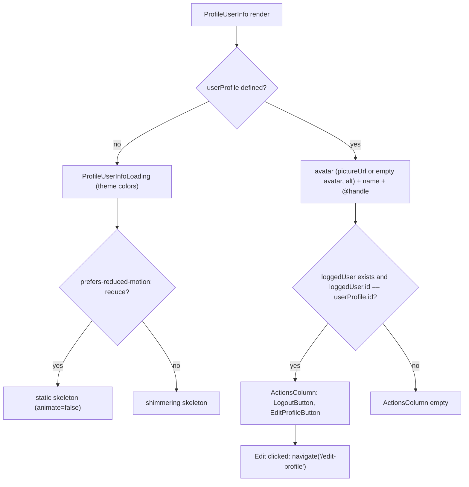

# S10 - Profile header restyle with ghost Edit button and themed skeleton

- **Plan:** [plan.md](plan.md)
- **Type:** Slice
- **Requirements covered:** FR-19, FR-14 (`ProfileUserInfoLoading`), FR-09 (edit-profile), FR-05 (edit icon), FR-07, FR-06, FR-03 (type scale on the profile header)
- **Prerequisites:** color tokens (`--color-surface-0`, `--color-surface-2`, `--color-border`, `--color-text`, `--color-text-muted`, `--color-accent`), typography tokens (`--font-size-sm`, `--font-size-lg`, `--font-weight-bold`, `--line-height-tight`), spacing `--space-1..4`, global `:focus-visible` ring, `react-icons@^5.7.0` (`LuPencil` from `react-icons/lu`), `Button` (`$variant`) from `src/components/ui/button.tsx`, `PageTitle` from `src/components/ui/page-title.tsx`, `readThemeColor(token)` from `src/components/ui/theme-color.ts`, existing `LogoutButton` (`src/components/logout-button.tsx`, used as-is, no props)
- **Creates:** none

## 1. Goal

Restyle the profile page header so it matches the dark theme while keeping its elements and their order.

When done, `/profile/:id` shows, top to bottom:

1. The sticky shared page title "Profile" with its bottom divider.
2. The header: the avatar (96px circle with an orange accent ring and alt text), and next to it, only on my own profile, the actions column with Logout then Edit, both ghost buttons of equal width.
3. The name (20px, bold, white) and the muted `@handle` (15px).
4. The tweet list, unchanged.

"Edit" is a semantic `<button type="button">` ghost button with a Lucide `LuPencil` icon that navigates to `/edit-profile`, reachable with Tab and activated with Enter/Space. While the profile loads, the skeleton uses the theme's surface colors (no white/grey blocks), has the same shape as the header and does not shimmer under reduced motion. Requests are unchanged.

## 2. Context

- `src/pages/profile/profile-page.tsx`: `ProfilePage` fetches `ApiTweet.fromUserId` and `ApiUser.byId` in one `useEffect` keyed on `userId`. It renders a styled `Header` (`<header>`, padding 1rem, bold) containing a local `Tittle` ("Profile") and `ProfileUserInfo`, then `TweetList`. The fetch logic must not change.
- `src/pages/profile/profile-user-info.tsx`: `ProfileUserInfo({ userProfile? })` returns `ProfileUserInfoLoading` when `userProfile` is undefined. Otherwise it renders `Wrapper > PictureRow > (Picture, ActionsColumn > [LogoutButton, EditProfileButton] when loggedUser.id == userProfile.id)`, then `UserName` and `UserTag`. The picture has no `alt`; the border uses legacy `--color-fg-1`; the tag uses `color-mix(... --color-fg-2 50%...)` and `font-weight: 100`.
- `src/pages/profile/profile-user-info-loading.tsx`: `ContentLoader` 400×150 with literal `#dedede55` / `#ffffff` colors.
- `src/components/edit-profile-button.tsx`: a clickable `styled.div` with `VscEdit` (from `react-icons/vsc`) and the handler `navigate('/edit-profile')`. It is used only by `ProfileUserInfo`.
- `LogoutButton` is a ghost `Button` with `LuLogOut` and "Logout" text, with no outer margin; this step renders it unchanged and lays it out from the container.
- `PageTitle` is a sticky `<h1>` with its own padding, opaque `--color-surface-0` background and bottom border, so it must be a direct child of the scrolling central column (not inside the padded header) to span the full column width.
- `TweetList` rows (and its skeleton rows) start with a top divider, which separates the header from the first tweet.
- `react-content-loader` sets colors through SVG `stop-color` attributes, where `var(--…)` does not resolve, so colors come from `readThemeColor`. Its shimmer is an SVG `<animate>` element, which the global CSS reduced-motion rule does not affect, so it is turned off through its `animate` prop.
- Conventions: styled-components at the bottom of each file, `import { styled } from "styled-components"`, `@media (width <= 600px)`, `react-refresh/only-export-components` (no exported helpers from `.tsx`), lint fails on warnings, TypeScript strict with `noUnusedLocals`. No test suite exists.

## 3. Structure

### 3.1 Files

| File | Change | Responsibility |
|------|--------|----------------|
| `src/pages/profile/profile-page.tsx` | modify | Page composition: `PageTitle`, padded header, tweet list |
| `src/pages/profile/profile-user-info.tsx` | modify | Header content: framed avatar, actions, name, handle |
| `src/pages/profile/profile-user-info-loading.tsx` | modify | Header skeleton in theme colors |
| `src/components/edit-profile-button.tsx` | modify | Semantic ghost "Edit" button |

### 3.2 Page: `src/pages/profile/profile-page.tsx`

- Leave the imports for data, the state, `useParams`, and the whole `useEffect` (both requests, `setTweets(null)`, the `isNaN` guard) untouched.
- Add `import { PageTitle } from "../../components/ui/page-title";`.
- New JSX (title moved out of the header, same order):

  ```tsx
  return (
      <>
          <PageTitle>Profile</PageTitle>
          <Header>
              <ProfileUserInfo userProfile={userProfile}/>
          </Header>
          <TweetList tweets={tweets ?? []} loading={tweets === null}/>
      </>
  );
  ```

- Delete the local `Tittle` styled component.
- `Header` stays a `styled.header` and only sets the spacing; its font rules are removed (typography now lives in `ProfileUserInfo`):

  ```ts
  const Header = styled.header`
      margin: 0;
      padding: var(--space-4);
  `;
  ```

### 3.3 Header content: `src/pages/profile/profile-user-info.tsx`

- The props (`ProfileUserInfoProps { userProfile?: UserDisplayInfo }`), the loading branch (`if (!userProfile) return <ProfileUserInfoLoading/>;`) and the ownership condition (`loggedUser && loggedUser?.id == userProfile?.id`) do not change. Logout stays before Edit.
- Picture: one `<Picture>` element instead of the ternary, with alt text:

  ```tsx
  <Picture
      src={userProfile.pictureUrl || emptyAvatar}
      alt={`${userProfile.name} avatar`}
  />
  ```

  `||` keeps today's truthiness rule: an empty string or a missing URL falls back to the default avatar.
- Private constant above the styled components (not exported): `const AVATAR_SIZE = "96px";` (today's 6rem).
- Styled components, replacing the current rules:

  | Component | Rules |
  |-----------|-------|
  | `Wrapper` (`div`) | `display: flex; flex-direction: column; gap: var(--space-1);` |
  | `PictureRow` (`div`) | `display: flex; flex-direction: row; align-items: center; gap: var(--space-4); margin-bottom: var(--space-3);` |
  | `ActionsColumn` (`div`) | `display: flex; flex-direction: column; justify-content: center; gap: var(--space-2);`. The default `align-items: stretch` makes Logout and Edit the same width. |
  | `Picture` (`img`) | `width: ${AVATAR_SIZE}; height: ${AVATAR_SIZE}; flex-shrink: 0; object-fit: cover; border-radius: 50%; background-color: var(--color-surface-2); box-shadow: 0 0 0 2px var(--color-surface-0), 0 0 0 4px var(--color-accent);`. This draws a 2px orange ring with a 2px dark gap around the avatar, outside the layout box, so the row's size does not change. The background shows behind transparent avatar images. |
  | `UserName` (`span`) | `font-size: var(--font-size-lg); font-weight: var(--font-weight-bold); line-height: var(--line-height-tight); color: var(--color-text); overflow-wrap: anywhere;` |
  | `UserTag` (`span`) | `font-size: var(--font-size-sm); color: var(--color-text-muted); overflow-wrap: anywhere;` |

- The `margin-left: 0.5rem` offsets of name and tag are dropped: both now align with the avatar's left edge, which matches the skeleton below.

### 3.4 Skeleton: `src/pages/profile/profile-user-info-loading.tsx`

```tsx
import ContentLoader from "react-content-loader";
import { readThemeColor } from "../../components/ui/theme-color";

const REDUCED_MOTION_QUERY = "(prefers-reduced-motion: reduce)";

export function ProfileUserInfoLoading()
{
    const prefersReducedMotion = window.matchMedia(REDUCED_MOTION_QUERY).matches;

    return (
        <ContentLoader
            speed={2}
            animate={!prefersReducedMotion}
            width={400}
            height={164}
            viewBox="0 0 400 164"
            style={{ maxWidth: "100%", height: "auto" }}
            backgroundColor={readThemeColor("--color-surface-2")}
            foregroundColor={readThemeColor("--color-border")}
            title="Loading profile"
        >
            <circle cx="52" cy="52" r="48" />
            <rect x="0" y="116" rx="6" ry="6" width="200" height="20" />
            <rect x="0" y="146" rx="6" ry="6" width="140" height="14" />
        </ContentLoader>
    );
}
```

- Colors: shapes in `--color-surface-2`, the shimmer in `--color-border`, read at render time. There are no literal colors in the file.
- Shapes mirror the new header: the avatar circle (r 48, offset 4px to leave room for the ring), then a name bar and a handle bar aligned at the left edge. There are no action shapes, since only the owner sees actions and that is unknown while loading.
- `style={{ maxWidth: "100%", height: "auto" }}`: below 432px of available width the SVG scales down proportionally instead of being clipped by the central column's `overflow-x: hidden`.
- `title="Loading profile"` replaces the library's default `'Loading...'` text. The library always renders the `<svg>` with `role="img"` and `aria-labelledby` pointing to its inner `<title>`, and fills that `<title>` from this prop. Screen readers therefore announce "Loading profile" and can tell this skeleton from the tweet skeletons. Do not use `aria-label`: `aria-labelledby` takes precedence over it.
- The redundant fragment wrapper is removed.

### 3.5 Edit button: `src/components/edit-profile-button.tsx`

```tsx
import { useNavigate } from "react-router-dom";
import { LuPencil } from "react-icons/lu";
import { Button } from "./ui/button";

export function EditProfileButton()
{
    const navigate = useNavigate();

    return (
        <Button
            type="button"
            $variant="ghost"
            onClick={() => navigate('/edit-profile')}
        >
            <LuPencil aria-hidden="true"/>Edit
        </Button>
    );
}
```

- Remove the `VscEdit` import, the `styled` import and the local styled `Button` (`div`). There is no outer margin: `ActionsColumn` sets the spacing, the same way it does for `LogoutButton`.
- Hover, pressed, disabled, focus ring and the 40px minimum height come from the shared `Button`. The visible text "Edit" is the accessible name, so no `aria-label` is needed.
- The handler and target (`navigate('/edit-profile')`) stay the same.

## 4. Logic flows

`ProfileUserInfo` keeps its only branching: the skeleton while the profile is unknown, then the header, with actions only for the owner.



## 5. Edge cases and errors

| Case | Expected behavior |
|------|-------------------|
| Profile without `pictureUrl` (or empty string) | Default avatar image, same accent ring, alt "`<name>` avatar". |
| Avatar image with transparency or non-square size | Cropped to a circle (`object-fit: cover`); transparent parts show `--color-surface-2`. |
| Another user's profile, or logged out | No Logout/Edit; the avatar row keeps its layout (empty actions column). |
| Very long name or username | Wraps inside the central column (`overflow-wrap: anywhere`); no horizontal scroll. |
| Narrow column (375px mobile) | Avatar and the actions fit side by side; the skeleton scales down instead of being clipped. |
| Reduced motion on | Skeleton is static (no shimmer). Button state transitions are instant (global rule). |
| Edit activated with keyboard | Enter or Space opens `/edit-profile`; the focus ring is visible on Tab focus. |
| Navigating from one profile to another | Unchanged: the tweet list goes back to its skeleton and the header keeps the previous profile until `byId` resolves. |
| `byId` request fails | Unchanged: the skeleton stays (no error UI added); a 401 still triggers the API layer's redirect. |
| Profile page scrolled | The "Profile" title stays at the top of the central column with an opaque background; the header and tweets scroll under it. |

## 6. Tests

The project has no automated test suite and this step adds none (RFF decision 11).

### 6.1 Automated

| Check | Given / When / Then | Proves |
|-------|---------------------|--------|
| `npm run lint` | Given the changed files, when linting, then 0 errors and 0 warnings. | Build criteria |
| `npm run build` | Given the changed files, when running `tsc && vite build`, then it succeeds (no unused imports left, `Button` transient props typed). | Build criteria |

### 6.2 Manual

Run `npm run dev` with the backend up, logged in. Desktop width is 1280px unless stated.

- Given my own profile (`/profile/<my id>`), when comparing with the pre-revamp page, then the elements show in the same order: title "Profile", avatar with Logout then Edit to its right, name, @handle, then tweets. The avatar has an orange ring, the name is white bold 20px and the handle is muted 15px. (FR-19)
- Given my own profile, when inspecting the avatar, then it has `alt="<my name> avatar"`. (FR-19, accessibility)
- Given my own profile, when tabbing from the sidebar, then Logout and then Edit receive focus with the orange ring. Pressing Enter on Edit opens `/edit-profile`; going back and pressing Space on Edit opens it too. Clicking Edit also opens it. (FR-09, FR-06)
- Given my own profile, when hovering and pressing Edit, then it shows the ghost hover tint and pressed scale; it is outlined, not orange-filled, and it is the same width as Logout. The icon is the Lucide pencil. (FR-07, FR-05, FR-06)
- Given another user's profile (click an @username in the feed), then no Logout/Edit show; the avatar, name and handle are styled the same. (FR-19)
- Given DevTools Network throttling "Slow 3G" and a hard reload of a profile, then the header skeleton (circle and two bars) appears in dark surface tones with a subtle shimmer, followed by dark tweet skeleton rows, with no white or light grey blocks. (FR-14)
- Given DevTools → Rendering → `prefers-reduced-motion: reduce` and the same throttled reload, then the header skeleton does not shimmer. (FR-04)
- Given DevTools mobile emulation 375×812 on my own profile, then the avatar and buttons fit without horizontal scroll, the title sticks while scrolling the central column, and under throttling the skeleton is fully visible (scaled, not clipped). (FR-19, FR-15 layout unchanged)
- Given a long profile, when scrolling the central column, then the "Profile" title stays at the top with a bottom divider and rows pass under it.
- **Parity:** Given the Network tab cleared, when opening a profile and then switching to another profile, then each `userId` change fires exactly one tweets-by-user `GET` and one user-by-id `GET`, as before. Clicking Edit fires no request and navigates to `/edit-profile`. Clicking Logout behaves as before (logout, then reload of the current route). (RFF §10 backend parity)

### 6.3 Static checks

- `grep -rn "react-icons/vsc" src` → no output. (FR-05)
- `grep -n "react-icons/" src/components/edit-profile-button.tsx` → only `react-icons/lu`. (FR-05)
- `grep -nE "#[0-9a-fA-F]{3,8}\b|rgba?\(|hsla?\(" src/pages/profile/*.tsx src/components/edit-profile-button.tsx` → no output (colors only through tokens and `readThemeColor`). (FR-01, FR-14)
- `grep -nE "var\(--color-([0-9]|bg-|fg-)" src/pages/profile/*.tsx src/components/edit-profile-button.tsx` → no output (owned files use the new token names).
- `grep -n "styled.div" src/components/edit-profile-button.tsx` → no output (no clickable `div` left). (FR-09)
- `grep -n "alt=" src/pages/profile/profile-user-info.tsx` → one match. (accessibility)
- Before committing this step, run `git diff --stat <start-commit> -- src/api src/app-router.tsx src/main.tsx` against the commit this step started from → no output (non-goals untouched).
- `grep -n "<LogoutButton" src/pages/profile/profile-user-info.tsx` → one match, `<LogoutButton/>`, with no props (the shared `LogoutButton` is used as-is).

## 7. Implementation order

1. `edit-profile-button.tsx`: switch to the ghost `Button` with `LuPencil`. Run lint and build; the profile still works.
2. `profile-user-info.tsx`: single `Picture` with `alt`, new styles. Lint and build.
3. `profile-user-info-loading.tsx`: theme colors, new geometry, reduced-motion `animate`, scaling. Lint and build.
4. `profile-page.tsx`: `PageTitle` outside the header, remove `Tittle`, header spacing. Lint and build.
5. Manual checks (desktop, mobile, throttled, reduced motion, Network parity) and the static checks.

## 8. Out of scope

- Does not change `LogoutButton` (markup, style or handler); it is only laid out by `ActionsColumn`.
- Does not change the profile fetch logic, the request order, or the loading/error behavior (no error UI, no reset of the header between profiles).
- Does not change `TweetList`, `TweetDisplay` or their skeletons, the layout, navigation bars, `src/api/**`, routes, global CSS or tokens.
- Does not redesign the default avatar asset (only its framing).
- Adds no new content or empty state for profiles without tweets.

## 9. Design notes

- **Reuse over local styles (DRY, FR-07):** the local clickable `div` is replaced by the shared ghost `Button`, so Edit and Logout share one look and one set of states. Rejected: a profile-specific button style.
- **Title outside the header:** `PageTitle` carries its own padding, background and full-width divider, and must be a direct child of the scroller to stick correctly. The padded `Header` now wraps only the user info. The visible order is unchanged.
- **Avatar ring via `box-shadow`:** a two-layer shadow (dark gap, then orange ring) frames the avatar without changing its layout box. Rejected: `border`, which would shrink the image or shift the row.
- **Single `Picture` with `||`:** one element and one `alt` instead of two branches. This keeps today's fallback rule (falsy URL → default avatar).
- **Skeleton colors and motion:** shapes `--color-surface-2` and shimmer `--color-border`, as used for the tweet skeleton, so both skeletons look alike. The shimmer turns off under reduced motion through `animate`, because SVG `<animate>` ignores the global CSS rule. The reduced-motion query is a private constant in this file; a shared helper was not introduced for a one-line check.
- **Same width for actions:** `ActionsColumn` stretches its children, so the two ghost buttons line up as a tidy pair next to the avatar.
- **Name and handle alignment:** the old 0.5rem left indent is dropped, so the text aligns with the avatar and the skeleton bars start at the same edge.
