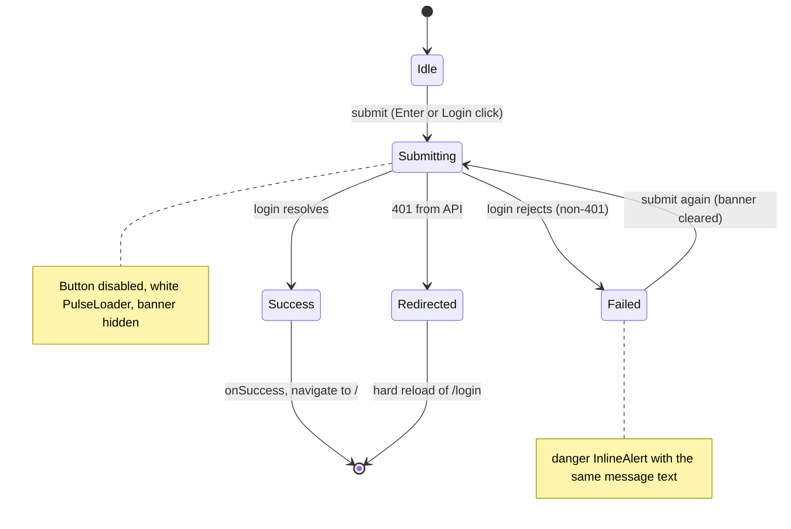

# S11 - Login page as a themed split panel

- **Plan:** [plan.md](plan.md)
- **Type:** Slice
- **Requirements covered:** FR-20 (login page), FR-07 (Login primary pill), FR-09 (Login button, "Create your new account" link), FR-06 (states of every login control), FR-03 (type scale on this page)
- **Prerequisites:** color tokens (`--color-surface-1`, `--color-border`, `--color-text`, `--color-text-secondary`, `--color-text-muted`, `--color-accent`, `--color-accent-hover`, `--color-accent-pressed`, `--color-accent-subtle`, `--color-on-accent`), typography tokens (`--font-size-xs/sm/md/lg/xl/2xl`, `--font-weight-semibold/bold`, `--line-height-tight/base`), spacing `--space-2..6`, motion `--duration-fast`, `--ease-out`, global `:focus-visible` ring; `Button` (`$fullWidth`), `FieldLabel`, `TextInput`, `InlineAlert`, `CenteredPage`, `Panel`
- **Creates:** none

## 1. Goal

`/login` keeps its two-part card (welcome text | "Come in..." form) and its layout (side by side on wide screens, stacked at 768px or less), restyled as one dark raised card:

- The welcome half has a warm orange tint and the "GrowTweet" title in orange; the form half is the plain dark card surface; a `--color-border` divider separates them.
- Email and password are dark fields with visible labels, the orange focus border and ring; the existing placeholders stay.
- Login is a full-width orange pill; while waiting it is disabled and shows a white `PulseLoader`.
- A failed login shows the same message text as today, now in a danger `InlineAlert` banner (still inline, no browser alert).
- "Create your new account" is a real `<Link>` to `/new-account`, reachable by Tab, with the focus ring.
- The login request, `setLoggedUser` and the navigation to `/` are unchanged.

## 2. Context

- `src/pages/login/login-page.tsx`: `LoginPage` renders `Wrapper` (full-viewport flex, `--color-bg-1`) > `MainPanel` (flex row, `height: 60%; min-height: 400px; width: 60%; min-width: 250px`; column and `width: 80%` at `width <= 768px`) > `LeftPanel` (`--color-bg-5`, `h2` "Wellcome to", `h1` "GrowTweet" at 4rem, `small`, justified `p`) and `RightPanel` (`--color-bg-4`, `h1` "Come in...", `LoginForm onSuccess={() => navigate('/')}`, and `CreateAccountButton`, a clickable underlined `div` calling `navigate('/new-account')`). Corner radii are set per half (20px desktop, 10px stacked).
- `src/pages/login/login-form.tsx`: `LoginForm({ onSuccess? })` with local `errorMessage` and `loading` state; the native `onSubmit` handler reads `form.email.value` / `form.password.value` **by input `name`**, calls `new ApiAuth().login(email, password)`, then `onSuccess`; errors set `errorMessage` (axios: `response.data.message ?? message`; other: `Error.message` or `String(reason)`). Styles `Input`, `Button`, `ErrorLabel` (a `<label>` used as error text) and `PulseLoaderStyled` (`color="white"`) are local copies. No react-hook-form here (unchanged).
- With the remapped legacy tokens the page is already dark, but the form half is solid orange and the inputs/button use legacy names.
- react-spinners 0.13.8 writes `PulseLoader`'s `color` into an inline `backgroundColor`, so `color="var(--color-on-accent)"` works.
- `Panel` sets no width and has `--space-6` padding (`--space-5` at 600px or less), a 1px `--color-border` outline and `--shadow-1`; consumers size it with `styled(Panel)`. `CenteredPage` is a `min-height: 100dvh` centered wrapper with page padding.
- `ApiConnection` hard-redirects to `/login` on any 401 (non-goal, unchanged).
- Lint: `react-refresh/only-export-components`, 0 warnings; TypeScript strict with `noUnusedLocals`. Private (non-exported) constants in a `.tsx` file are fine.
- No test suite: verification is lint, build and manual browser checks.

## 3. Structure

### 3.1 Files

| File | Change | Responsibility |
|------|--------|----------------|
| `src/pages/login/login-page.tsx` | modify | Split card layout, welcome copy, link to `/new-account` |
| `src/pages/login/login-form.tsx` | modify | Login fields, error banner, submit button; same submit handler |

No other file changes.

### 3.2 Page: `src/pages/login/login-page.tsx`

```tsx
import { styled, css } from "styled-components";
import { Link, useNavigate } from "react-router-dom";
import { LoginForm } from "./login-form";
import { CenteredPage, Panel } from "../../components/ui/panel";

export function LoginPage()   // signature unchanged
```

Markup (all copy verbatim, including "Wellcome"):

```tsx
<CenteredPage>
    <SplitPanel>
        <WelcomePanel>
            <h2>Wellcome to</h2>
            <h1>GrowTweet</h1>
            <small>Inspirational activity for the course Full Stack Web Starter, from Growdev</small>
            <p>An innovative social media application ... with a global audience.</p>
        </WelcomePanel>
        <FormPanel>
            <h1>Come in...</h1>
            <LoginForm onSuccess={() => navigate('/')} />
            <CreateAccountLink to="/new-account">Create your new account</CreateAccountLink>
        </FormPanel>
    </SplitPanel>
</CenteredPage>
```

- `navigate` stays only for `onSuccess` (same target `/`). The `onClick={() => navigate('/new-account')}` handler is replaced by the link's `to` (same target).
- `Wrapper`, `MainPanel`, `LeftPanel`, `RightPanel`, `CreateAccountButton` are removed.

Private constants (top of the styles section):

```ts
/** Width at which the two halves stack (unchanged from the current page). */
const STACK_BREAKPOINT = "768px";
/** Hero title: one and a half times the largest type-scale step (48px), between the old 64px and the scale's 32px. */
const HERO_TITLE_SIZE = "calc(var(--font-size-2xl) * 1.5)";
```

Styled components (bottom of file):

- **`SplitPanel = styled(Panel)`**: `display: flex; align-items: stretch; padding: 0; overflow: hidden;` (the halves pad themselves; `overflow: hidden` clips the welcome tint to the card's `--radius-lg` corners) `width: 60%; min-width: 250px; min-height: max(400px, 60dvh);` (same footprint as the old `height: 60%; min-height: 400px` inside a full-viewport wrapper; `min-height` so content never clips). `@media (width <= ${STACK_BREAKPOINT}) { flex-direction: column; width: 80%; }`.
- **Shared half rules**: a private `const halfStyles = css\`display: flex; flex-direction: column; justify-content: center; flex: 1; padding: var(--space-6);\`` with `@media (width <= ${STACK_BREAKPOINT}) { padding: var(--space-5); }`, used by both halves.
- **`WelcomePanel = styled.div`**: `halfStyles`; `background-color: var(--color-accent-subtle);` (warm tint over the card's surface); `border-right: 1px solid var(--color-border);`, at the stack breakpoint `border-right: none; border-bottom: 1px solid var(--color-border);`.
  - `& h2 { margin: 0; font-size: var(--font-size-lg); font-weight: var(--font-weight-semibold); color: var(--color-text-secondary); }`
  - `& h1 { margin: 0; font-size: ${HERO_TITLE_SIZE}; font-weight: var(--font-weight-bold); line-height: var(--line-height-tight); color: var(--color-accent); }`
  - `& small { display: block; margin-top: var(--space-2); font-size: var(--font-size-xs); color: var(--color-text-muted); }`
  - `& p { margin: var(--space-5) 0 0; font-size: var(--font-size-sm); line-height: var(--line-height-base); color: var(--color-text-secondary); }` (left-aligned; the old `text-align: justify` is dropped)
  - Stacked: `h2` `--font-size-md`, `h1` `--font-size-2xl`, `p` `margin-top: var(--space-4)`.
- **`FormPanel = styled.div`**: `halfStyles`; `gap: var(--space-5);` (title, form and link spacing; replaces margins) `& h1 { margin: 0; font-size: var(--font-size-xl); font-weight: var(--font-weight-bold); line-height: var(--line-height-tight); color: var(--color-text); }`. Background stays the `Panel` surface (`--color-surface-1`).
- **`CreateAccountLink = styled(Link)`**: `align-self: flex-end; padding: var(--space-3) 0;` (13px text at tight line height plus 2 × 12px gives a ≥ 40px tall hit area, FR-09) `font-size: var(--font-size-xs); font-weight: var(--font-weight-semibold); color: var(--color-accent); text-decoration: underline; text-underline-offset: 2px; transition: color var(--duration-fast) var(--ease-out);` `&:hover { color: var(--color-accent-hover); }` `&:active { color: var(--color-accent-pressed); }`. Focus: global `:focus-visible` ring, unchanged.

### 3.3 Form: `src/pages/login/login-form.tsx`

Public API unchanged: `export interface LoginFormProps { onSuccess?: () => void; }` and `export function LoginForm(props: LoginFormProps)`. State (`errorMessage`, `loading`) and `submitHandler` are **unchanged line for line** (same `preventDefault`, reset, `login(email, password)`, `onSuccess`, error mapping, `finally`).

```tsx
import { styled } from "styled-components";
import React from "react";
import { ApiAuth } from "../../api/api-auth";
import { PulseLoader } from "react-spinners";
import { isAxiosError } from "axios";
import { Button } from "../../components/ui/button";
import { FieldLabel, TextInput } from "../../components/ui/field";
import { InlineAlert } from "../../components/ui/inline-alert";

/** Loader dot size inside the Login button (unchanged value). */
const LOADER_DOT_SIZE = "0.5rem";
```

Markup:

```tsx
<Form onSubmit={submitHandler}>
    <div>
        <FieldLabel htmlFor="login-email">Email</FieldLabel>
        <TextInput id="login-email" type="text" name="email" placeholder="user email"
                   autoComplete="username" autoFocus />
    </div>

    <div>
        <FieldLabel htmlFor="login-password">Password</FieldLabel>
        <TextInput id="login-password" type="password" name="password" placeholder="Password"
                   autoComplete="current-password" />
    </div>

    {errorMessage && <InlineAlert>{errorMessage}</InlineAlert>}

    <Button type="submit" $fullWidth disabled={loading}>
        {loading || 'Login'}
        <PulseLoader loading={loading} size={LOADER_DOT_SIZE} color="var(--color-on-accent)" />
    </Button>
</Form>
```

- `name="email"` / `name="password"` are kept: the handler reads the values through them.
- `type="text"` is kept for email (an `email` type would add browser validation that can block the request, a behavior change).
- `id`s are prefixed `login-` so they cannot clash with other forms' ids; `FieldLabel` + `htmlFor` gives each field a visible label and accessible name (FR-20); the placeholders stay as hints.
- `autoComplete` values are added so password managers fill the fields; they do not change the request.
- The error banner keeps today's text exactly (no prefix added); `InlineAlert`'s `role="alert"` announces it.
- `{loading || 'Login'}` stays: while loading the button shows only the loader; `Button` centers it.
- Styled components at the bottom: only `const Form = styled.form\`display: flex; flex-direction: column; gap: var(--space-4);\``. `Input`, `Button` (local), `ErrorLabel` and `PulseLoaderStyled` are removed (no `margin-top` hack needed: `Button` is an inline-flex centered row).

## 4. Logic flows

The submit flow is unchanged; only what renders in each state changes.



On submit the banner is cleared and the button disabled with the loader; success navigates to `/`; a rejected login shows the banner and re-enables the button; a 401 is handled by the API layer's existing hard redirect.

## 5. Edge cases and errors

| Case | Expected behavior |
|------|-------------------|
| Wrong credentials, API returns an error body with `message` | Danger `InlineAlert` with that message verbatim; fields keep their values; button re-enabled. |
| Network error / backend down (axios error without response) | Banner with axios' `message` (e.g. "Network Error"), as today. |
| Non-axios error (e.g. "Invalid login token" from `setLoggedUser`) | Banner with the error's message, as today. |
| API returns 401 | Existing global handler clears storage and hard-reloads `/login` (unchanged; the banner is not seen). |
| Submitting while a request is pending | Button disabled; Enter in a field does not resubmit (native: a form whose only submit button is disabled is not implicitly submitted). |
| Second submit after an error | Banner disappears on submit, reappears only if it fails again. |
| Empty fields submitted | Request sent with empty strings, as today (no client validation added). |
| Very long server message | Wraps inside the banner (`InlineAlert` behavior). |
| Viewport ≤ 768px | Halves stack (welcome above form), card 80% wide, divider moves to the bottom of the welcome half. |
| Short viewport / tall content (e.g. 375×600, error shown) | Card grows; the page scrolls; nothing is clipped (`min-height` everywhere). |
| Keyboard user | Email has focus on load; Tab order email → password → Login → "Create your new account"; each shows the orange ring; Enter on the link opens `/new-account`. |
| Mouse click on the link | No focus ring (global `:focus-visible`); hover darkens/lightens the orange. |
| Reduced motion | Link color transition instant via the global rule. |
| Middle-click / Ctrl+click on the link | Opens `/new-account` in a new tab (now possible because it is a real link). |

## 6. Tests

The project has no automated test suite and this step adds none.

### 6.1 Automated

| Check | Given / When / Then | Proves |
|-------|---------------------|--------|
| `npm run lint` | Given the modified files, when linting, then 0 errors and 0 warnings. | Build criteria |
| `npm run build` | Given the modified files, when running `tsc && vite build`, then it succeeds (no unused imports such as the removed styles). | Build criteria |

### 6.2 Manual

Run `npm run dev` with the backend on `http://localhost:3333`; log out first (clear localStorage) and open `/login`.

- Given 1280px, then one dark card with rounded corners, border and shadow is centered; the left half (warm orange tint, "Wellcome to", orange "GrowTweet", muted small text, paragraph) sits beside the right half ("Come in...", labelled Email/Password fields, orange Login pill, orange "Create your new account" link at the bottom right), divided by a thin line; same arrangement as before. (FR-20, FR-03)
- Given 375px (DevTools mobile emulation) and 768px, then the halves stack with the welcome part on top, the divider below it, and the text sizes reduced; at 769px they are side by side again. (FR-20, layout parity)
- Given the page loads, then the Email field has focus with the orange border and ring; when pressing Tab repeatedly, then focus moves email → password → Login → "Create your new account", each with the 2px orange ring. (FR-06, FR-09)
- Given clicking the "Email" label, then the email input gets focus (label linked). (FR-20)
- Given hovering the Login button and the link, then the button lightens and the link color changes; pressing the button scales it slightly. (FR-06, FR-07)
- Given wrong credentials (backend returning a non-401 error), when submitting, then the button shows the white loader and is disabled while waiting, then the server message appears in a red-bordered banner with an alert icon, and no browser alert is shown; submitting again hides the banner during the request. (FR-20, FR-12 pattern)
- Given the backend stopped, when submitting, then the banner shows "Network Error". (error path)
- Given focus on the link, when pressing Enter, then `/new-account` opens; Ctrl+click opens it in a new tab. (FR-09)
- Given DevTools → Elements, then "Create your new account" is an `<a href="/new-account">`, the inputs keep `name="email"` / `name="password"`, and the banner has `role="alert"`. (FR-09)
- Parity: Given DevTools → Network, when logging in with valid credentials, then exactly one `POST /auth/login` with body `{ "email": ..., "password": ... }` is sent, `localStorage` gets `token` and `user`, and the app navigates to `/`. Clicking the link fires no request. (Backend parity)

### 6.3 Static checks

- `git status --porcelain -- src` → only `src/pages/login/login-page.tsx` and `src/pages/login/login-form.tsx`.
- `grep -rnE "#[0-9a-fA-F]{3,8}\b|rgba?\(|hsla?\(|\"white\"" src/pages/login` → no output (colors only through tokens).
- `grep -rnE -e "--color-(bg|fg)-|--color-danger-2" src/pages/login` → no output (no legacy tokens left in these files).
- `grep -rn "alert(" src/pages/login` → no output.
- `grep -n "navigate('/new-account')" src/pages/login/login-page.tsx` → no output; `grep -n 'to="/new-account"' src/pages/login/login-page.tsx` → one match.
- `grep -nE 'name="(email|password)"' src/pages/login/login-form.tsx` → two matches.

## 7. Implementation order

1. `login-form.tsx`: swap in `TextInput`/`FieldLabel` (with ids, names kept), `InlineAlert`, `Button` + recolored `PulseLoader`; remove the local styles; lint + build; log in once to confirm parity.
2. `login-page.tsx`: replace the wrapper and halves with `CenteredPage`, `SplitPanel`, `WelcomePanel`, `FormPanel`; replace the clickable `div` with `CreateAccountLink`; lint + build.
3. Manual checks at 1280px, 768/769px and 375px, keyboard pass, error and parity checks; static checks.

## 8. Out of scope

- Does not change any copy (including "Wellcome"), the submit handler, the error-message mapping, the request or the navigation after login.
- Does not add client-side validation or react-hook-form to the login form.
- Does not touch `src/api/**`, routes, `App.tsx`, global CSS, tokens or the shared primitives.
- Does not touch the new-account or edit-profile pages or any component outside `src/pages/login/`.
- No logo, light theme or new dependency.

## 9. Design notes

- **Accent area = tinted welcome half + orange title:** the old orange half held the form, but a solid orange background behind an orange primary button and dark fields would fight the button hierarchy (FR-07). The welcome half takes `--color-accent-subtle` and the "GrowTweet" title in `--color-accent`; the form sits on the plain card surface. Rejected: a solid orange welcome half (very loud next to the dark theme; offered as an alternative to the user).
- **One card, two halves:** `SplitPanel` extends `Panel` (DRY: border, radius, shadow come from the primitive) with `padding: 0` and `overflow: hidden`, so per-half corner radii are no longer needed. Shared half layout lives in one `halfStyles` block.
- **Layout parity:** the 768px stacking breakpoint, 60%/80% widths, 250px min width and the 400px / 60% height footprint are kept; `min-height` replaces fixed heights so errors or small screens never clip.
- **Hero size:** the type scale tops out at 32px; the 64px title is brought to 48px with `calc(var(--font-size-2xl) * 1.5)` in a named constant (no new global token) and to 32px when stacked (same as before).
- **Visible labels:** FR-20 asks for a "clear label"; "Email" and "Password" labels are added and the placeholders kept verbatim. The `login-` id prefix avoids clashes. `type="text"` stays to avoid new browser validation.
- **Error banner:** `InlineAlert` (danger) replaces the misused `<label>` error text; the message text is unchanged.
- **Link, not button:** "Create your new account" navigates, so it is a `<Link>` (FR-09); vertical padding gives the ≥ 40px hit area without a private `ui/` constant.
- **Trade-off:** dropping `text-align: justify` on the paragraph avoids uneven word gaps at narrow widths; content and order are unchanged.
