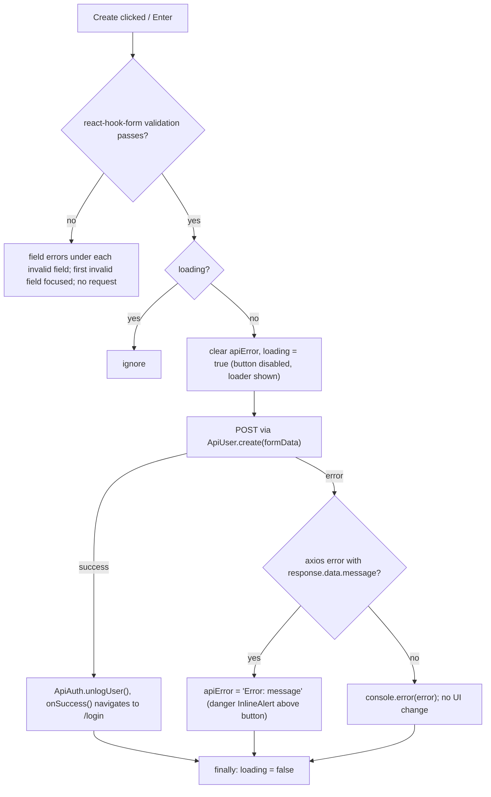
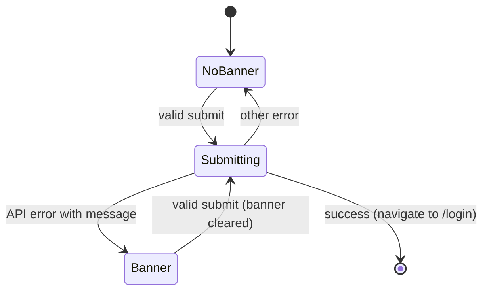

# S12 - New-account page restyle with inline API errors

- **Plan:** [plan.md](plan.md)
- **Type:** Slice
- **Requirements covered:** FR-20, FR-12 (new-account), FR-07, FR-06
- **Prerequisites:** color tokens (`--color-text`, `--color-on-accent`), typography tokens (`--font-size-xl`, `--font-weight-bold`, `--line-height-tight`), spacing `--space-1`, `--space-4`, `--space-5`, global `:focus-visible` ring; `Button` (`$variant`, `$fullWidth`), `FieldLabel`, `TextInput`, `FieldError`, `InlineAlert` (`variant`), `CenteredPage`, `Panel`
- **Creates:** none

## 1. Goal

`/new-account` becomes a centered dark raised card titled "Create your account" with labelled dark inputs, red inline field errors and a full-width orange "Create" pill that shows a recolored `PulseLoader` while waiting. If the API rejects the sign-up, the message `Error: <server message>` appears in a danger banner right above the button; no browser `alert()` is shown, the form keeps its values and the user can correct and retry. Requests, payload and the redirect to `/login` on success are unchanged.

## 2. Context

- `src/pages/new-account/new-account-page.tsx`: `NewAccountPage` renders `Wrapper` (full-viewport flex centering, `height: 100vh; width: 100vw`, `--color-bg-1`) > `MainPanel` (`--color-bg-5`/`--color-fg-5` card, `padding: 50px`, `width: 60%`, `min-width: 300px`, `max-width: 500px`) > `<h1>Create your account</h1>` + `<NewAccountForm onSuccess={() => navigate('/login')} />`.
- `src/pages/new-account/new-account-form.tsx`: `NewAccountForm({ onSuccess? })` with react-hook-form `useForm<UserRegistration>()`, a `loading` state guard, and `onSubmit` that calls `new ApiUser().create(formData)`, then `ApiAuth.unlogUser()`, then `props.onSuccess?.()`. On an axios error with `response.data.message` it calls `alert(\`Error: ${message}\`)`; any other error is only `console.error`-ed. Five fields in order: `username` (autoFocus, required "User name can't be empty"), `email` (required "Email can't be empty"), `name` (required "Full name can't be empty"), `password` (`type="password"`, required "Password name can't be empty"), `pictureUrl` (optional). Each `<label htmlFor>` points at an id that no input has, so labels are not linked today. Local styled `Form`, `ErrorMessage`, `Input`, `Button`, `PulseLoaderStyled` use legacy tokens. The button renders `{loading || 'Create'}` followed by `<PulseLoader loading={loading} color="white" .../>`.
- `react-spinners` `PulseLoader` applies `color` as an inline `backgroundColor`, so `var(--…)` works there.
- Lint fails on any warning (`react-refresh/only-export-components`): these files export only components and the props interface. No test suite; verification is lint, build and manual browser checks.
- All copy stays verbatim (RFF: messages kept, no content changes), including "Password name can't be empty" and the label texts with their trailing colons.

## 3. Structure

### 3.1 Files

| File | Change | Responsibility |
|------|--------|----------------|
| `src/pages/new-account/new-account-page.tsx` | modify | Page shell: `CenteredPage` + sized `Panel` + title |
| `src/pages/new-account/new-account-form.tsx` | modify | Sign-up form: themed fields, inline API error, primary button |

No other file changes.

### 3.2 Page: `new-account-page.tsx`

`NewAccountPage` keeps its name, `useNavigate()` and the `onSuccess={() => navigate('/login')}` callback. Replace the local `Wrapper` and `MainPanel` (delete both):

```tsx
import { styled } from "styled-components";
import { useNavigate } from "react-router-dom";
import { CenteredPage, Panel } from "../../components/ui/panel";
import { NewAccountForm } from "./new-account-form";

export function NewAccountPage()
{
    const navigate = useNavigate();

    return (
        <CenteredPage>
            <AccountPanel>
                <Title>Create your account</Title>
                <NewAccountForm onSuccess={() => navigate('/login')}/>
            </AccountPanel>
        </CenteredPage>
    );
}

const AccountPanel = styled(Panel)`...`;
const Title = styled.h1`...`;
```

- **`AccountPanel`** (private, `styled(Panel)`): `display: flex; flex-direction: column; gap: var(--space-5); width: 100%; max-width: 500px;`. `Panel` supplies the surface, border, radius, shadow and padding (smaller ≤ 600px); `CenteredPage` supplies the centering, page padding and scrolling for tall content. The old `width: 60%; min-width: 300px` is dropped: at narrow widths the card now fills the space between the page paddings instead of overflowing a 300px minimum.
- **`Title`** (private, `styled.h1`): `margin: 0; font-size: var(--font-size-xl); font-weight: var(--font-weight-bold); line-height: var(--line-height-tight); color: var(--color-text);`. White text (orange is reserved for the primary action).

### 3.3 Form: `new-account-form.tsx`

Public API unchanged: `export interface NewAccountFormProps { onSuccess?: () => void; }` and `export function NewAccountForm(props: NewAccountFormProps)`.

**State**

```tsx
const [loading, setLoading] = useState(false);
const [apiError, setApiError] = useState<string | undefined>(undefined);
const { register, handleSubmit, formState: { errors } } = useForm<UserRegistration>();
```

**`onSubmit`** (same order of API calls; only the error presentation changes):

```tsx
const onSubmit = async (formData: UserRegistration) =>
{
    if (loading)
        return;

    try
    {
        setApiError(undefined);
        setLoading(true);
        await (new ApiUser()).create(formData);
        ApiAuth.unlogUser();
        props.onSuccess?.();
    }
    catch (error)
    {
        if (isAxiosError(error) && error.response?.data?.message)
        {
            setApiError(`Error: ${error.response.data.message}`);
            return;
        }

        console.error(error);
    }
    finally
    {
        setLoading(false);
    }
}
```

- The two nested `if`s collapse into one condition (same truth table). The text is built exactly as today's alert text: `Error: <message>`.
- Errors without a server message keep today's behavior: `console.error` only, no UI.

**Markup** (field order, label texts, validation rules and messages, `autoFocus`, `type="password"` unchanged):

```tsx
<Form onSubmit={handleSubmit(onSubmit)}>
    <div>
        <FieldLabel htmlFor="username">User name:</FieldLabel>
        <TextInput id="username" autoFocus
            aria-invalid={errors.username ? "true" : undefined}
            {...register("username", { required: "User name can't be empty" })}
        />
        {errors.username && <SpacedFieldError>{errors.username.message?.toString()}</SpacedFieldError>}
    </div>

    {/* same pattern for: email ("Email:"), name ("Full name:"), password ("Password:", type="password") */}

    <div>
        <FieldLabel htmlFor="pictureUrl">Picture URL:</FieldLabel>
        <TextInput id="pictureUrl" {...register("pictureUrl")} />
    </div>

    {apiError && <InlineAlert>{apiError}</InlineAlert>}

    <Button type="submit" $fullWidth disabled={loading}>
        {loading || 'Create'}
        <PulseLoader loading={loading} size="0.5rem" color="var(--color-on-accent)"/>
    </Button>
</Form>
```

- **Ids** equal the field names (`username`, `email`, `name`, `password`, `pictureUrl`), so the existing `htmlFor` values now link label and input (clicking a label focuses its input; screen readers announce the label). The route renders only this form, so the ids are unique on the page.
- **`aria-invalid`** is set to `"true"` only while that field has a react-hook-form error (red border from `TextInput`); `pictureUrl` has no rule and gets none.
- **`InlineAlert`** uses the default `danger` variant (`role="alert"`, announced on mount) and sits between the last field and the button.
- **Button:** shared primary `Button`, full width as today's stretched button. `{loading || 'Create'}` is kept, so while loading the label is replaced by the loader, as today. The loader color comes from the token instead of the literal `"white"`; the old `PulseLoaderStyled` wrapper (`margin-top: 2px`) is removed because `Button` centers its children with `inline-flex`.

**Styles** (bottom of the file; delete the local `ErrorMessage`, `Input`, `Button`, `PulseLoaderStyled`):

- `Form` (private, `styled.form`): `display: flex; flex-direction: column; gap: var(--space-4);` (one gap between field groups, the alert and the button).
- `SpacedFieldError` (private, `styled(FieldError)`): `margin-top: var(--space-1);` (`FieldError` has `margin: 0`; the label already carries its own bottom margin).
- Field groups are plain `<div>`s (block flow: label, input, optional error), so no extra styled wrapper is needed.

Imports: `import { styled } from "styled-components"`, `FieldLabel`, `TextInput`, `FieldError` from `../../components/ui/field`, `Button` from `../../components/ui/button`, `InlineAlert` from `../../components/ui/inline-alert`; existing imports of `useForm`, `UserRegistration`, `ApiUser`, `isAxiosError`, `PulseLoader`, `useState`, `ApiAuth` stay.

## 4. Logic flows

The submit path is the same as today; only the API-error branch changes from `alert()` to the `apiError` state, which renders the banner until the next submit starts.





The banner stays while the user edits the fields; an invalid re-submit (validation fails) does not start a request, so the banner remains next to the new field errors until a valid submit.

## 5. Edge cases and errors

| Case | Expected behavior |
|------|-------------------|
| Required field empty on submit | Same message as today under that field (`SpacedFieldError`, red, 13px), red input border, no request sent. |
| Email already in use / any API error with a message | Danger banner `Error: <server message>` above Create; no `alert()`; all field values kept; button re-enabled. |
| Very long server message | Wraps inside the banner (`InlineAlert` handles wrapping). |
| Retry after an API error | Banner disappears when the valid submit starts; reappears only if the new request fails with a message. |
| Network error / axios error without `response.data.message` / non-axios error | `console.error` only, no banner (today's behavior); button re-enabled. |
| Double click / Enter while submitting | Button disabled and `loading` guard returns; one request only. |
| 401 from the API | Handled by `ApiConnection` as today (clears storage, redirects to `/login`). |
| Empty Picture URL | Sent as today (react-hook-form value unchanged); no validation, no error. |
| Narrow screen (375px) | Card fills the width minus the page padding; no horizontal scroll. |
| Short viewport / tall form | Page grows and scrolls (`CenteredPage` `min-height`), nothing clipped. |
| Keyboard focus | Orange focus ring on every input and the button (global `:focus-visible`; inputs also turn their border orange). |

## 6. Tests

The project has no automated test suite and this step adds none.

### 6.1 Automated

| Check | Given / When / Then | Proves |
|-------|---------------------|--------|
| `npm run lint` | Given the changes, when linting, then 0 errors and 0 warnings. | Build criteria |
| `npm run build` | Given the changes, when running `tsc && vite build`, then it succeeds. | Typed primitives usage, `apiError` state |

### 6.2 Manual

Run `npm run dev` with the local backend; desktop 1280px unless stated.

- Given `/new-account` at 1280px and at 375px (DevTools mobile emulation), then a dark raised card with a subtle border and rounded corners is centered on the dark background, titled "Create your account" in white, with five labelled dark fields in the same order and labels as before and a full-width orange "Create" pill; at 375px the card fills the width with page padding and there is no horizontal scroll. (FR-20, FR-07)
- Given the page just loaded, then the User name field has focus; when clicking each label text, then its input gets focus; when pressing Tab repeatedly, then focus goes User name → Email → Full name → Password → Picture URL → Create, each with the orange focus ring. (FR-06, FR-20)
- Given all fields empty, when clicking Create, then "User name can't be empty", "Email can't be empty", "Full name can't be empty" and "Password name can't be empty" show under their fields in red with red input borders, and no request appears in the Network tab. (FR-20, regression)
- Given an email that already exists, when submitting, then a red banner `Error: <server message>` appears above Create, no browser alert is shown, the entered values remain, and the button is enabled again. (FR-12)
- Given the banner visible, when fixing the email and submitting again, then the banner disappears as the request starts and, on success, the app navigates to `/login`. (FR-12)
- Given DevTools Network throttling ("Slow 3G"), when submitting valid data, then the button is faded/disabled and shows the white pulse loader instead of "Create"; hovering it shows no hover change. (FR-06, FR-20)
- Given DevTools → Elements, when inspecting the inputs, then each has an `id` matching its label's `for`, and an invalid one has `aria-invalid="true"`; the banner element has `role="alert"`. (FR-20, FR-12)
- Parity: given valid new data, when submitting, then the Network tab shows exactly one `POST` to the user-create endpoint with `{ username, email, name, password, pictureUrl }` as before, then `localStorage` no longer holds `token`/`user` and the app is at `/login`. (RFF §10 parity)

### 6.3 Static checks

- `grep -rn "alert(" src/pages/new-account` → no output. (FR-12)
- `grep -rnE "#[0-9a-fA-F]{3,8}\b|rgba?\(|hsla?\(|\"white\"" src/pages/new-account` → no output (colors only through tokens).
- `grep -rnE "var\(--color-(bg|fg|danger)-[0-9]" src/pages/new-account` → no output (no legacy tokens in owned files).
- `grep -c "id=\"" src/pages/new-account/new-account-form.tsx` → `5`.
- `git status --porcelain -- src` → only the two files of this step.

## 7. Implementation order

1. `new-account-page.tsx`: swap `Wrapper`/`MainPanel` for `CenteredPage` + `AccountPanel` + `Title`; lint + build; check the card at both widths.
2. `new-account-form.tsx`: replace inputs, labels and errors with the primitives (ids, `aria-invalid`, `SpacedFieldError`, `Form` gap); lint + build; check validation.
3. Add `apiError` state, replace `alert()` with `setApiError`, render `InlineAlert`; swap the button for `Button` with the token-colored loader; lint + build.
4. Run the manual checks, the parity check and the static checks.

## 8. Out of scope

- Does not change `src/api/**`, routes, `App.tsx`, global CSS or the shared primitives.
- Does not change any copy, field order, validation rule or message, the request, its payload, or the redirect to `/login`.
- Does not add feedback for errors that have no server message (kept as `console.error`).
- Does not touch any file outside `src/pages/new-account/`.

## 9. Design notes

- **Reuse over local copies (DRY, FR-07):** the local `Input`, `Button` and `ErrorMessage` copies are deleted in favor of the shared primitives; only layout (`Form` gap, `AccountPanel` width, `SpacedFieldError` margin) stays local.
- **Banner placement and lifetime:** above the button (plan) so it is next to the action that produced it; cleared when a new submit starts, not on every keystroke, keeping the state logic to one `setApiError(undefined)` call. Rejected: a toast (FR-12 asks for inline, styled like the login error).
- **Silent unknown errors kept:** adding a generic message would introduce new copy, which the RFF rules out; behavior stays as today.
- **Ids equal field names:** the existing `htmlFor` values already use them, so linking needs no label change; no id generation (`useId`) is needed because the page renders a single form.
- **Plain `<div>` field groups:** block flow plus `FieldLabel`'s own bottom margin gives the spacing; a dedicated wrapper component would add a `forwardRef`-free but needless abstraction for five fields.
- **Width:** `max-width: 500px` kept from today; `width: 60%; min-width: 300px` replaced by `width: 100%` inside `CenteredPage`'s padding, which avoids overflow on narrow phones.
