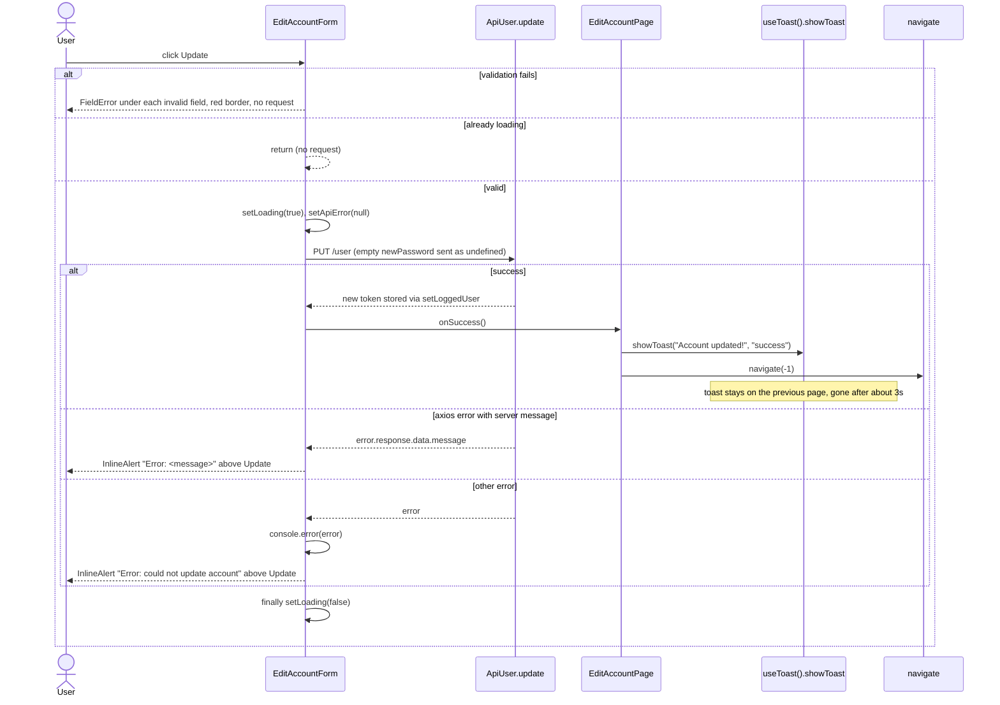

# S13 - Edit-profile page restyle with inline errors and "Account updated!" toast

- **Plan:** [plan.md](plan.md)
- **Type:** Slice
- **Requirements covered:** FR-20, FR-12 (edit-account form and page), FR-07, FR-06
- **Prerequisites:**
  - Tokens `--color-text`, `--color-on-accent`, `--font-size-xl`, `--font-weight-bold`, `--line-height-tight`, `--space-1`, `--space-4`, `--space-5`, and the global `:focus-visible` ring
  - `Button` (`$variant`, `$fullWidth`) from `src/components/ui/button.tsx`
  - `FieldLabel`, `TextInput`, `FieldError` from `src/components/ui/field.tsx`
  - `InlineAlert` (`variant`) from `src/components/ui/inline-alert.tsx`
  - `CenteredPage`, `Panel` from `src/components/ui/panel.tsx`
  - `useToast()` / `showToast(text, variant?, durationMs?)` from `src/components/toast-context.ts` (toast survives route changes; `ToastProvider` wraps `RouterProvider`)
- **Creates:** none

## 1. Goal

`/edit-profile` keeps its form, fields, validation and request flow, restyled to the dark theme, and loses both of its `alert()` calls:

- A centered dark raised card titled "Edit your account" on the app background, with labelled dark inputs (labels linked to inputs, so clicking a label focuses its field), the orange focus ring, red inline field errors with a red field border, and an orange full-width "Update" pill showing the recolored `PulseLoader` while the request runs.
- An API error with a server message shows `Error: <message>` in an inline danger banner above the Update button; no browser alert; the form stays filled for a retry.
- Any other failure (no server message: backend down, network error, non-axios error) shows the fallback text `Error: could not update account` in the same inline danger banner (user decision); the error is still logged with `console.error`.
- On success, a green "Account updated!" toast appears and the app navigates back (`navigate(-1)`) at once; the toast stays visible on the page you return to and disappears on its own.

## 2. Context

- `src/pages/edit-account/edit-account-page.tsx`: `EditAccountPage` renders `Wrapper` (full-viewport flex, `--color-bg-1`) > `MainPanel` (`--color-bg-5` / `--color-fg-5`, 50px padding, 10px radius, `width: 60%; min-width: 300px; max-width: 500px`) > `<h1>Edit your account</h1>` + `<EditAccountForm onSuccess={() => { alert("Account updated!"); navigate(-1); }} />`.
- `src/pages/edit-account/edit-account-form.tsx`: `EditAccountForm({ onSuccess? })` with `react-hook-form` (`useForm<UserUpdateFormData>` with async `defaultValues` from `ApiAuth.getLoggedUser()`), a `loading` state, and `onSubmit` that guards on `loading`, turns an empty `newPassword` into `undefined`, awaits `new ApiUser().update(formData)` (which itself calls `ApiAuth.setLoggedUser` with the returned token), then calls `props.onSuccess?.()`. On an axios error with `error.response.data.message` it calls `alert(\`Error: ${message}\`)`; any other error is only `console.error`'d. Fields, in order: `username`, `email`, `name`, `pictureUrl`, `currentPassword`, `newPassword`, `newPasswordConfirm`; each `<label htmlFor="...">` names the field but the inputs have **no `id`**, so the labels are not linked today. Local styled `Form`, `ErrorMessage`, `Input`, `Button`, `PulseLoaderStyled`. The submit button renders `{loading || 'Update'}` (text hidden while loading) and `<PulseLoaderStyled loading={loading} size="0.5rem" color="white"/>`.
- `react-spinners` 0.13.8: `PulseLoader` applies `color` as an inline `backgroundColor`, so `var(--color-on-accent)` resolves; extra props (`className`) reach its root `span`.
- Both files render outside the main layout but inside `RouterProvider`, so `useToast()` is available.
- Conventions: styled-components at the bottom of each file, Allman braces, 4-space indent; a `.tsx` exporting a component exports only components and types (`react-refresh/only-export-components`, lint fails on any warning). No test suite: lint, build and manual checks.

## 3. Structure

### 3.1 Files

| File | Change | Responsibility |
|------|--------|----------------|
| `src/pages/edit-account/edit-account-page.tsx` | modify | Page shell (`CenteredPage` + sized `Panel` + title); success feedback via `showToast` then `navigate(-1)` |
| `src/pages/edit-account/edit-account-form.tsx` | modify | Form markup with the shared field primitives, `apiError` state rendered with `InlineAlert`, primary `Button` with recolored loader; same submit logic and request |

### 3.2 Page: `src/pages/edit-account/edit-account-page.tsx`

```tsx
import { styled } from "styled-components";
import { useNavigate } from "react-router-dom";
import { EditAccountForm } from "./edit-account-form";
import { CenteredPage, Panel } from "../../components/ui/panel";
import { useToast } from "../../components/toast-context";

const ACCOUNT_UPDATED_MESSAGE = "Account updated!";

export function EditAccountPage()
{
    const navigate = useNavigate();
    const { showToast } = useToast();

    const handleSuccess = () =>
    {
        showToast(ACCOUNT_UPDATED_MESSAGE, "success");
        navigate(-1);
    };

    return (
        <CenteredPage>
            <EditPanel>
                <Title>Edit your account</Title>
                <EditAccountForm onSuccess={handleSuccess} />
            </EditPanel>
        </CenteredPage>
    );
}
```

- `ACCOUNT_UPDATED_MESSAGE` is a module-private string constant (not exported). Text verbatim from the old alert.
- `showToast` is called **before** `navigate(-1)`, with the default duration (3000ms). Navigation is immediate (no delay); the toast survives because it lives in the app-level provider.
- Removed: `Wrapper`, `MainPanel`, the `alert()` call.
- Styled-components at the bottom:
  - `EditPanel = styled(Panel)`: `display: flex; flex-direction: column; gap: var(--space-5); width: 100%; max-width: 500px;` (replaces `width: 60%; min-width: 300px`, which forced horizontal overflow below 300px + padding; the panel now fills the page up to the old max width). Background, border, radius, shadow and padding come from `Panel`.
  - `Title = styled.h1`: `margin: 0; font-size: var(--font-size-xl); font-weight: var(--font-weight-bold); line-height: var(--line-height-tight); color: var(--color-text);`.

### 3.3 Form: `src/pages/edit-account/edit-account-form.tsx`

Public API unchanged: `export interface EditAccountFormProps { onSuccess?: () => void; }` and `export function EditAccountForm(props: EditAccountFormProps)`.

Imports added: `Button` (`../../components/ui/button`), `FieldLabel`, `TextInput`, `FieldError` (`../../components/ui/field`), `InlineAlert` (`../../components/ui/inline-alert`). Imports kept: `useForm`, `UserUpdateRequest`, `ApiUser`, `isAxiosError`, `ApiAuth`, `PulseLoader`, `useState`, `styled`.

**State**

```tsx
const [loading, setLoading] = useState(false);
const [apiError, setApiError] = useState<string | null>(null);
```

**Module-private constant** (not exported):

```ts
/** Shown when an update fails without a server message (user decision). */
const UPDATE_FAILED_MESSAGE = "Error: could not update account";
```

**`onSubmit` (only three changes; everything else identical)**

1. Right after `setLoading(true)`, call `setApiError(null)` (a new valid submit clears the previous banner; react-hook-form only calls `onSubmit` once validation passes).
2. Replace `alert(\`Error: ${error.response?.data?.message}\`)` with `setApiError(\`Error: ${error.response?.data?.message}\`)` (same text). The following `return` and the `finally { setLoading(false); }` stay.
3. Right after the existing `console.error(error);` at the end of the `catch` block, add `setApiError(UPDATE_FAILED_MESSAGE);`. This line is reached for every error that did not return in change 2 (axios error without `response.data.message`, network error, non-axios error).

Untouched: the `if (loading) return;` guard, the `newPassword` empty-to-`undefined` conversion, `await (new ApiUser()).update(formData)`, `props.onSuccess?.()`, the `console.error(error)` call itself, `defaultValues`, every `register()` rule and message, the `newPasswordConfirm` validator, and the `UserUpdateFormData` interface.

**Markup** (same fields, same order, same label texts, same rules)

```tsx
<Form onSubmit={handleSubmit(onSubmit)}>
    <FieldGroup>
        <FieldLabel htmlFor="username">User name:</FieldLabel>
        <TextInput id="username" autoFocus
            aria-invalid={errors.username ? "true" : undefined}
            {...register("username", { required: "User name can't be empty" })} />
        {errors.username && <FieldError>{errors.username.message?.toString()}</FieldError>}
    </FieldGroup>

    {/* email, name: same shape (id = field name, aria-invalid, FieldError) */}

    <FieldGroup>
        <FieldLabel htmlFor="pictureUrl">Picture URL:</FieldLabel>
        <TextInput id="pictureUrl" {...register("pictureUrl")} />
    </FieldGroup>

    {/* currentPassword (type="password", required, aria-invalid, FieldError) */}

    <FieldGroup>
        <FieldLabel htmlFor="newPassword">New password (optional):</FieldLabel>
        <TextInput id="newPassword" type="password" {...register("newPassword")} />
    </FieldGroup>

    {/* newPasswordConfirm (type="password", validate rule, aria-invalid, FieldError) */}

    {apiError && <InlineAlert>{apiError}</InlineAlert>}

    <Button type="submit" $fullWidth disabled={loading}>
        {!loading && "Update"}
        <PulseLoader loading={loading} size="0.5rem" color={LOADER_COLOR} />
    </Button>
</Form>
```

- Every input gets `id` equal to its field name, so the existing `htmlFor` values link the labels (click-to-focus, accessible names).
- `aria-invalid={errors.<field> ? "true" : undefined}` on the five validated inputs (`username`, `email`, `name`, `currentPassword`, `newPasswordConfirm`); `pictureUrl` and `newPassword` have no rule and get none.
- `autoFocus` stays on `username`; `type="password"` stays on the three password inputs.
- `{!loading && "Update"}` renders exactly what `{loading || 'Update'}` rendered (text when idle, nothing while loading) without relying on React dropping `true`.
- Module-private constant: `const LOADER_COLOR = "var(--color-on-accent)";` (replaces the literal `"white"`; works because `PulseLoader` sets it as inline `backgroundColor`).
- `InlineAlert` uses its default `danger` variant and sits directly above the button.

**Styled-components at the bottom** (the local `ErrorMessage`, `Input`, `Button` and `PulseLoaderStyled` are deleted; the `Button` primitive's inline-flex gap replaces the loader's `margin-top: 2px`):

- `Form = styled.form`: `display: flex; flex-direction: column; gap: var(--space-4);`.
- `FieldGroup = styled.div` (private): `display: flex; flex-direction: column;` and `& > ${FieldError} { margin-top: var(--space-1); }` (label spacing comes from `FieldLabel`'s own bottom margin).

## 4. Logic flows



The request path, its guard and its follow-up are unchanged; only the feedback differs from today (error banner with the server message or the fallback text, success toast). A banner from a previous attempt is cleared when the next valid submit starts.

## 5. Edge cases and errors

| Case | Expected behavior |
|------|-------------------|
| Required field empty on submit | Same message as today under the field ("User name can't be empty", "Email can't be empty", "Full name can't be empty", "Current password can't be empty"), red border, no request; react-hook-form focuses the first invalid field. |
| `newPasswordConfirm` differs from `newPassword` | "Password confirmation doesn't match" under the field, red border, no request. |
| Wrong current password / server rejects | `Error: <server message>` in a danger `InlineAlert` (`role="alert"`) above Update; all fields keep their values; no browser alert. |
| Retry after an API error | Banner removed when the valid submit starts; shown again (possibly with a new message) if it fails again. |
| Validation fails while a banner is shown | Banner stays (no submit started); field errors show as well. |
| Error without a server message (backend down, network error, non-axios error) | `console.error(error)` as today, plus a danger `InlineAlert` with `Error: could not update account` above Update; fields keep their values; button back to "Update". |
| Axios error whose response has no `data.message` (e.g. 500 with an empty body) | Same fallback banner `Error: could not update account`. |
| Double click / Enter while loading | Button disabled and the `loading` guard returns; one request only. |
| Loading | Button faded and disabled, text hidden, white pulse dots centered. |
| Long server message | Wraps inside the banner (primitive behavior). |
| Success | Green "Account updated!" toast, immediate `navigate(-1)`; toast visible on the previous page for about 3s. |
| Page opened directly (no in-app history) | `navigate(-1)` behaves as today (browser back); the toast shows only if the destination is still the app. |
| Empty `newPassword` | Sent as `undefined`, as today. |
| Narrow viewport (375px) | Panel fills the width minus the page padding; no horizontal scroll; tall form scrolls the page. |
| Keyboard | Tab order: the seven inputs in order, then Update; each shows the orange focus ring. |

## 6. Tests

No automated test suite exists and none is added.

### 6.1 Automated

| Check | Given / When / Then | Proves |
|-------|---------------------|--------|
| `npm run lint` | Given the changes, when linting, then 0 errors and 0 warnings (no `react-refresh/only-export-components` warning: both files export only components and the props type). | Build criteria |
| `npm run build` | Given the changes, when running `tsc && vite build`, then it succeeds (`apiError` typing, transient `$fullWidth`, `aria-invalid` values). | Build criteria |

Run with: `npm run lint && npm run build`

### 6.2 Manual

Dev server `npm run dev` with the backend running, logged in. Desktop 1280px unless stated.

- Given `/edit-profile`, then a dark raised card with a subtle border and the white "Edit your account" title is centered on the dark background; inputs are dark fields prefilled with the current user, labels are muted and small, the username field has focus, and "Update" is a full-width orange pill. (FR-20, FR-07)
- Given the form, when clicking each label, then its input gets focus; when tabbing through, each input and the button show the orange focus ring in field order. (FR-20, FR-06)
- Given the username field cleared, when clicking Update, then "User name can't be empty" appears in red under it, its border is red (also while focused), and no request appears in the Network tab; given mismatched new passwords, then "Password confirmation doesn't match" shows the same way. (FR-20, parity)
- Given a wrong current password, when submitting, then the loader dots show in the button while waiting, then `Error: <server message>` appears in a red-tinted banner with an alert icon above Update, no browser alert opens, and the fields keep their values. (FR-12)
- Given the backend stopped (or DevTools Network set to "Offline") with the page already loaded, when submitting valid data, then the banner shows `Error: could not update account`, no browser alert opens, the error is logged in the console, and the fields keep their values; after restarting the backend, a valid submit clears the banner. (FR-12, user decision)
- Given the banner visible, when correcting the password and submitting again, then the banner disappears as the request starts. (FR-12)
- Given valid data (e.g. a changed full name), when submitting from the profile page's Edit button, then the app returns to the profile page at once and a green "Account updated!" toast with a check icon is visible there, disappearing after about 3s; the sidebar user chip shows the new name. (FR-12)
- Given the Update button hovered / pressed / disabled during the request, then it lightens / shrinks slightly / fades and ignores hover. (FR-06, FR-07)
- Given DevTools mobile emulation 375×812, then the panel fits the width with no horizontal scroll and the page scrolls to reach the button. (FR-20)
- Given the DevTools Network tab, when submitting a valid update with an empty "New password", then exactly one `PUT /user` is sent with the same payload as before (`newPassword` absent), the stored `token`/`user` in localStorage are replaced, then `navigate(-1)` happens. (Backend parity)

### 6.3 Static checks

- `grep -rn "alert(" src/pages/edit-account` → no output. (FR-12)
- `grep -n "color=\"white\"\|--color-bg-\|--color-fg-\|--color-danger-1" src/pages/edit-account/*.tsx` → no output. (Tokens only)
- `grep -n "id=\"" src/pages/edit-account/edit-account-form.tsx` → seven matches (`username`, `email`, `name`, `pictureUrl`, `currentPassword`, `newPassword`, `newPasswordConfirm`). (Labels linked)
- `grep -n "showToast(" src/pages/edit-account/edit-account-page.tsx` → exactly one match, `showToast(ACCOUNT_UPDATED_MESSAGE, "success");`, on the line directly before `navigate(-1)`. (FR-12)
- `git diff -- src/pages/edit-account/edit-account-form.tsx` → inside `onSubmit`, only `setApiError(null)` added, `alert(...)` replaced by `setApiError(...)`, and `setApiError(UPDATE_FAILED_MESSAGE)` added after `console.error(error)`. (Parity, FR-12)
- `grep -n "could not update account" src/pages/edit-account/edit-account-form.tsx` → exactly one match, the `UPDATE_FAILED_MESSAGE` constant. (FR-12, user decision)

## 7. Implementation order

1. Form: add `apiError` state, `setApiError(null)` at submit start, replace `alert(...)` with `setApiError(...)`, add `UPDATE_FAILED_MESSAGE` and its `setApiError` after `console.error`, render `InlineAlert` above the button. Lint + build.
2. Form: swap the local `Input`/`ErrorMessage`/`Button`/`PulseLoaderStyled` for `TextInput`/`FieldError`/`Button`/`PulseLoader`, add ids, `aria-invalid`, `FieldGroup`, `LOADER_COLOR`; delete the old styled-components. Lint + build.
3. Page: `CenteredPage` + `EditPanel` + `Title`, `useToast()` and `handleSuccess`; delete `Wrapper`/`MainPanel` and the alert. Lint + build.
4. Static and manual checks.

## 8. Out of scope

- Does not touch `src/api/**`, the route table, `App.tsx`, the toast components, the shared `ui/` primitives, or any global CSS.
- Does not change field set, order, label texts, validation rules or messages, default values, the request, the `setLoggedUser` handling inside the API client, or the `navigate(-1)` follow-up.
- Adds no new copy other than the fallback error text `Error: could not update account`; no "Cancel"/back button, no new npm package.

## 9. Design notes

- **Toast before immediate navigation:** the app-level toast service makes the RFF's preferred option possible, so the 1.5s-delay alternative is rejected (it would change the flow timing).
- **Success feedback stays in the page, not the form:** the form only reports success through `onSuccess` (unchanged API); the page decides how to show it (Single Responsibility).
- **Banner cleared on the next valid submit, not on edit:** keeps the message visible while the user fixes the cause; react-hook-form only reaches `onSubmit` when validation passes, so a failed validation does not hide it.
- **`id` equals field name:** reuses the existing `htmlFor` values, so labels get linked without new names.
- **`EditPanel` uses `width: 100%; max-width: 500px`:** keeps the old maximum width while removing the `min-width: 300px` that could overflow small phones; `Panel` deliberately leaves sizing to the consumer.
- **Loader color through a token:** `PulseLoader` sets inline `backgroundColor`, so `var(--color-on-accent)` works; no literal color remains.
- **Messages verbatim** (`Error: <message>`, "Account updated!", all validation texts), as FR-12 requires.
- **Fallback banner for errors without a server message (user decision):** a failed update must never look like nothing happened, so these errors show `Error: could not update account` in the same banner. It follows the existing `Error: ...` prefix, lives in one private constant, and keeps the `console.error` for debugging. Rejected: console-only (today's behavior: silent failure) and a toast (would differ from the inline pattern used for API errors).
